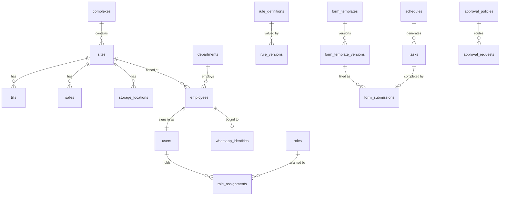
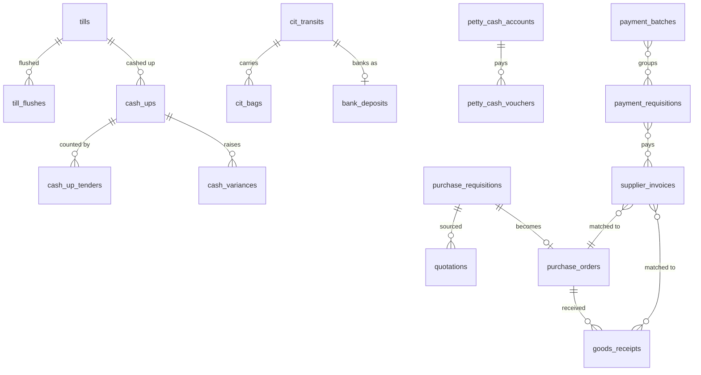
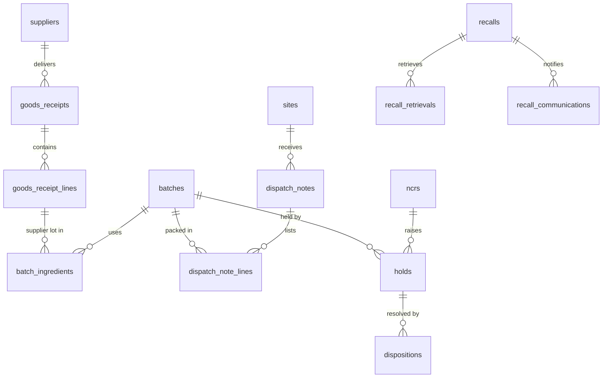

# Foodies data model

Logical data model for Foodies: 200 tables grouped by release area. Requirements are in [spec.md](spec.md), and the API is in [api/openapi.yaml](../api/openapi.yaml). Field names here match the API.

Types are logical. This document assumes a relational database with JSON support, and does not choose a product.

## Conventions

**Every table** also has these columns, which are not repeated below.

| Column | Type | Notes |
|---|---|---|
| `id` | uuid | Primary key, UUIDv7. |
| `created_at`, `updated_at` | timestamptz | UTC. |
| `created_by`, `updated_by` | uuid | FK `users`. Empty for system writes. |
| `row_version` | integer | Optimistic lock. Exposed as `ETag`. |

**Records with a reference prefix** also have `reference` (text, unique). The format is `PREFIX-SITE-YEAR-SEQUENCE`, for example `CUP-HRE01-2026-000123`. Sequences have no gaps per prefix, site and year, so a missing number can be detected.

**Records with status values** also have `status`. It changes only through a state action, which writes an audit event.

**Type notes:**

- `money` is two columns: `<name>_amount` (decimal 18,4) and `<name>_currency` (FK `currencies.code`). Amounts in different currencies are never added together. Totals across currencies are stored in base currency with the rate used.
- `decimal` is decimal 18,4.
- `timestamptz` is stored in UTC and shown in Africa/Harare.
- `date` is a business date in Africa/Harare. A trading day that runs past midnight stays on its opening date.
- `json` is validated by the template or rule that owns it.

**Personal data** columns are marked and are masked in lists and logs unless the role allows them. **Restricted** tables log every read.

**Nothing is hard-deleted.** Records stay until a disposition batch is approved under their retention class. The tables with a delete operation hold reference data or links.

**Offline capture.** Tables written offline carry `client_record_id` (uuid, unique per device) and `captured_at`, set by the device. `created_at` remains the time the server received the record.

## Generic links

Shared services attach to any record through two columns, `subject_type` and `subject_id`. This is used by these tables: `approval_requests`, `signature_requests`, `attachments`, `comments`, `record_links`, `audit_events`, `tasks`, `escalations`, `actions`, `postings`, `legal_holds` and `compliance_obligations`.

`subject_type` holds the table name. The application enforces that the target exists, since the database cannot. `record_links` holds typed links between two records, such as complaint to NCR to recall.

## Core relationships

## Money trail

## Traceability

The chain below answers recall questions. Each link is a foreign key, so `GET /traceability` can walk it either way. POS sales link by product, site and date, unless GAAP POS can supply batch data.

## What Foodies does not store

- Sales ledger, stock ledger, general ledger, depreciation or payroll calculations. These stay in the systems of record. `pos_sales_summaries`, `stock_balances` and `z_reports` are read copies, stamped with the sync run they came from.
- CCTV video. Foodies holds the register, approvals and chain of custody.
- Full card numbers, card PINs or alarm codes.
- Full bank details in lists. `suppliers.bank_details_masked` is what the API returns. The full value stays in SAP Business One.
- Sanction decisions. `cash_variances` and `disciplinary_cases` track the process only.
- Passwords or PINs in readable form. Credentials are held as salted slow hashes in a separate store, outside this model.

## Audit and integrity

`audit_events` is append-only. Each row stores the hash of the previous row, so a change is detectable. `signature_requests.content_hash` freezes what was signed: editing a signed record voids its signatures and needs them collected again.

## Tables

## Platform

### Organisation

#### `complexes`

A managed group of sites. A complex may hold one site.

Phase 0.

| Column | Type | Required | Notes |
|---|---|---|---|
| `code` | text | yes |  |
| `name` | text | yes |  |
| `manager_employee_id` | uuid |  | FK `employees`. |
| `active` | boolean |  |  |

#### `sites`

A physical location that captures records and, where it holds stock, a stockholding node. Head Office is a site of type head_office with no complex.

Phase 0. Source: Inventory: Multi-branch/node configuration; Security: Site and branch profiles.

| Column | Type | Required | Notes |
|---|---|---|---|
| `code` | text | yes |  |
| `name` | text | yes |  |
| `type` | enum | yes | `head_office`, `branch`, `central_kitchen`, `central_store`, `bakery`, `butchery`. |
| `complex_id` | uuid |  | FK `complexes`. |
| `brand` | text |  |  |
| `trading_pattern` | enum |  | `closes_2200`, `open_24h`, `non_trading`. Selects the turnover report deadline. |
| `opens_at` | time |  |  |
| `closes_at` | time |  |  |
| `stockholding` | boolean |  | True if the site is a stock node. |
| `address` | text |  |  |
| `escalation_contacts` | json |  |  |
| `active` | boolean |  |  |

#### `departments`

Organisational department with its approved acronym, used in document numbering.

Phase 0.

| Column | Type | Required | Notes |
|---|---|---|---|
| `code` | text | yes | Approved department acronym. |
| `name` | text | yes |  |
| `parent_id` | uuid |  | FK `departments`. |
| `head_employee_id` | uuid |  | FK `employees`. |
| `active` | boolean |  |  |

#### `cost_centres`

Cost centre mapped to the SAP Business One code.

Phase 0.

| Column | Type | Required | Notes |
|---|---|---|---|
| `code` | text | yes |  |
| `name` | text | yes |  |
| `department_id` | uuid |  | FK `departments`. |
| `site_id` | uuid |  | FK `sites`. |
| `sap_code` | text |  |  |
| `active` | boolean |  |  |

#### `production_lines`

Production line at a site.

Phase 0.

| Column | Type | Required | Notes |
|---|---|---|---|
| `site_id` | uuid | yes | FK `sites`. |
| `name` | text | yes |  |
| `type` | enum | yes | `chicken_chips`, `pizza`, `bakery`, `beverages`, `butchery`, `other`. |
| `active` | boolean |  |  |

#### `tills`

POS till at a branch.

Phase 0.

| Column | Type | Required | Notes |
|---|---|---|---|
| `site_id` | uuid | yes | FK `sites`. |
| `code` | text | yes |  |
| `pos_terminal_ref` | text |  |  |
| `active` | boolean |  |  |

#### `safes`

Branch safe, referenced by flushes, cash-ups and petty cash.

Phase 0.

| Column | Type | Required | Notes |
|---|---|---|---|
| `site_id` | uuid | yes | FK `sites`. |
| `code` | text | yes |  |
| `location` | text |  |  |
| `lock_status` | enum |  | `ok`, `defective`. |
| `active` | boolean |  |  |

#### `storage_locations`

Storage zone or shelf at a stock node.

Phase 0.

| Column | Type | Required | Notes |
|---|---|---|---|
| `site_id` | uuid | yes | FK `sites`. |
| `code` | text | yes |  |
| `zone` | enum | yes | `dry`, `cold_room`, `freezer`, `chemical`, `packaging`, `quarantine`, `other`. |
| `custodian_employee_id` | uuid |  | FK `employees`. |
| `active` | boolean |  |  |

#### `currencies`

Currency table. Admins add and maintain currencies. USD is the reporting base; USD and ZiG are seeded. Exactly one row has is_base = true.

Phase 0.

| Column | Type | Required | Notes |
|---|---|---|---|
| `code` | text | yes | ISO 4217 or approved code, e.g. USD, ZWG. |
| `name` | text | yes |  |
| `symbol` | text |  |  |
| `decimal_places` | integer |  |  |
| `is_base` | boolean |  |  |
| `active` | boolean |  |  |

#### `fx_rates`

Dated exchange rate. Admins can enter and manually adjust rates; records that use a rate keep the rate id and value they used. Adjustments update the row and write the old value to the audit trail, so closed records stay reproducible from their stored snapshot.

Phase 0. Source: Decision D-15; Store Closing: RBZ rate used.

| Column | Type | Required | Notes |
|---|---|---|---|
| `from_currency` | text | yes | FK `currencies`. |
| `to_currency` | text | yes | FK `currencies`. |
| `rate` | decimal | yes |  |
| `rate_date` | date | yes |  |
| `source` | enum | yes | `rbz`, `manual`. |
| `change_reason` | text |  | Required when adjusting an existing rate. |

#### `public_holidays`

Working-day calendar entry used by working-day clocks.

Phase 0. Source: General Controls: time zone and business calendar.

| Column | Type | Required | Notes |
|---|---|---|---|
| `holiday_date` | date | yes |  |
| `name` | text | yes |  |
| `applies_to_site_id` | uuid |  | FK `sites`. Empty means all sites. |

### People & Access

#### `employees`

One employee master used by HR, rosters, training, uniforms, payroll handover and exit. Every employee has one record.

Phase 0. Reference prefix `EMP`. Restricted: reads are logged. Source: HR: Employee records; Employee master data.

| Column | Type | Required | Notes |
|---|---|---|---|
| `employee_number` | text | yes |  |
| `first_name` | text | yes | Personal data. |
| `last_name` | text | yes | Personal data. |
| `job_title` | text | yes |  |
| `department_id` | uuid | yes | FK `departments`. |
| `site_id` | uuid | yes | FK `sites`. |
| `manager_employee_id` | uuid |  | FK `employees`. |
| `employment_status` | enum |  | `active`, `on_leave`, `suspended`, `transferred`, `resigned`, `terminated`, `retired`. Set by the server. |
| `start_date` | date | yes |  |
| `contract_type` | enum |  | `permanent`, `fixed_term`, `casual`, `other`. |
| `probation_end` | date |  |  |
| `contract_end` | date |  |  |
| `phone_e164` | text |  | Personal data. |
| `email` | text |  | Personal data. |
| `belina_ref` | text |  | Payroll system reference. |

#### `employee_status_changes`

Dated employee status history. A change to separated status starts access revocation.

Phase 0.

| Column | Type | Required | Notes |
|---|---|---|---|
| `employee_id` | uuid | yes | Parent record. |
| `status` | enum | yes | `active`, `on_leave`, `suspended`, `transferred`, `resigned`, `terminated`, `retired`. |
| `effective_date` | date | yes |  |
| `reason` | text | yes |  |
| `supporting_attachment_id` | uuid |  | FK `attachments`. |

#### `employee_transfers`

Change of branch, department, reporting line or role, with approval.

Phase 0.

| Column | Type | Required | Notes |
|---|---|---|---|
| `employee_id` | uuid | yes | Parent record. |
| `from_site_id` | uuid |  | FK `sites`. |
| `to_site_id` | uuid |  | FK `sites`. |
| `from_department_id` | uuid |  | FK `departments`. |
| `to_department_id` | uuid |  | FK `departments`. |
| `new_job_title` | text |  |  |
| `new_manager_employee_id` | uuid |  | FK `employees`. |
| `effective_date` | date | yes |  |
| `reason` | text | yes |  |

Status values: `draft`, `pending_approval`, `approved`, `rejected`, `effective`.

#### `employee_documents`

Restricted personnel file entry, with versioning and logged views.

Phase 0. Restricted: reads are logged.

| Column | Type | Required | Notes |
|---|---|---|---|
| `employee_id` | uuid | yes | Parent record. |
| `document_type` | text | yes |  |
| `issue_date` | date |  |  |
| `expiry_date` | date |  |  |
| `attachment_id` | uuid | yes | FK `attachments`. |
| `visibility` | enum |  | `hr_only`, `hr_and_manager`. |

#### `emergency_contacts`

Employee emergency contact.

Phase 0. Restricted: reads are logged.

| Column | Type | Required | Notes |
|---|---|---|---|
| `employee_id` | uuid | yes | Parent record. |
| `contact_name` | text | yes | Personal data. |
| `relationship` | text | yes |  |
| `phone_e164` | text | yes | Personal data. |
| `alternate_phone` | text |  | Personal data. |
| `last_verified_on` | date |  |  |

#### `users`

Sign-in account. Every employee has one; external parties have none. The username is the employee number.

Phase 0. Source: Decisions D-08, D-14.

| Column | Type | Required | Notes |
|---|---|---|---|
| `employee_id` | uuid | yes | FK `employees`. |
| `channels` | enum | yes | `web`, `whatsapp`, `both`. |
| `mfa_required` | boolean |  | Derived from roles. Set by the server. |
| `last_sign_in_at` | timestamptz |  | Set by the server. |
| `credential_status` | enum |  | `unset`, `active`, `must_change`. Set by the server. |

Status values: `invited`, `active`, `locked`, `disabled`.

#### `roles`

Named set of permissions. Seeded from the roles in the checklist; admins can adjust.

Phase 0.

| Column | Type | Required | Notes |
|---|---|---|---|
| `key` | text | yes |  |
| `name` | text | yes |  |
| `description` | text |  |  |
| `permission_keys` | text[] | yes |  |
| `requires_mfa` | boolean |  |  |
| `system` | boolean |  | Set by the server. |

#### `role_assignments`

Grants a role to a user at a scope.

Phase 0.

| Column | Type | Required | Notes |
|---|---|---|---|
| `user_id` | uuid | yes | FK `users`. |
| `role_id` | uuid | yes | FK `roles`. |
| `scope_type` | enum | yes | `site`, `complex`, `all`. |
| `scope_id` | uuid |  | Site or complex id; empty when scope_type is all. |
| `effective_from` | date | yes |  |
| `effective_to` | date |  |  |

#### `delegations`

Time-boxed delegation of approval authority. Cannot exceed the delegator authority.

Phase 0.

| Column | Type | Required | Notes |
|---|---|---|---|
| `from_user_id` | uuid | yes | FK `users`. |
| `to_user_id` | uuid | yes | FK `users`. |
| `role_id` | uuid |  | FK `roles`. |
| `workflow_keys` | text[] |  |  |
| `valid_from` | timestamptz | yes |  |
| `valid_to` | timestamptz | yes |  |
| `reason` | text | yes |  |

Status values: `draft`, `pending_approval`, `active`, `expired`, `revoked`.

#### `sod_rules`

Segregation-of-duties rule: two actions one person may not both perform on a record.

Phase 0. Source: Finance, Inventory, Sales and Store Ops: Segregation of duties.

| Column | Type | Required | Notes |
|---|---|---|---|
| `key` | text | yes |  |
| `name` | text | yes |  |
| `action_a` | text | yes |  |
| `action_b` | text | yes |  |
| `scope` | enum | yes | `same_record`, `same_business_date`, `same_supplier`. |
| `enforcement` | enum | yes | `block`, `flag`. |
| `active` | boolean |  |  |

#### `devices`

Enrolled web-app device. Enrolment allows PIN unlock and offline capture.

Phase 0.

| Column | Type | Required | Notes |
|---|---|---|---|
| `label` | text | yes |  |
| `site_id` | uuid |  | FK `sites`. |
| `platform` | text |  |  |
| `shared` | boolean |  | Shared branch device. |
| `last_seen_at` | timestamptz |  | Set by the server. |

Status values: `active`, `revoked`.

### Rules & Readiness

#### `rule_definitions`

Catalogue entry for a configurable business rule: threshold, deadline, schedule, limit or authority.

Phase 0. Source: Decision D-10.

| Column | Type | Required | Notes |
|---|---|---|---|
| `key` | text | yes | e.g. cash.till_flush_threshold. |
| `name` | text | yes |  |
| `module` | text | yes |  |
| `value_type` | enum | yes | `number`, `money`, `duration`, `time`, `percent`, `enum`, `schedule`, `json`. |
| `scope_level` | enum | yes | `group`, `complex`, `site`, `item`, `asset`. |
| `owner_role_id` | uuid |  | FK `roles`. |
| `source_clause` | text |  |  |
| `decision_id` | text |  | Open decision that sets the value. |
| `blocking` | boolean |  | Workflows cannot go live while unset. |

#### `rule_versions`

A dated value for a rule at a scope. Only approved versions take effect.

Phase 0.

| Column | Type | Required | Notes |
|---|---|---|---|
| `rule_definition_id` | uuid | yes | Parent record. |
| `scope_type` | enum | yes | `group`, `complex`, `site`, `item`, `asset`. |
| `scope_id` | uuid |  |  |
| `value` | json | yes |  |
| `effective_from` | timestamptz | yes |  |
| `effective_to` | timestamptz |  |  |
| `source_document_id` | uuid |  | FK `documents`. |
| `change_reason` | text | yes |  |

Status values: `draft`, `pending_approval`, `active`, `superseded`, `rejected`.

#### `workflow_activations`

Go-live switch for one workflow at one site.

Phase 0.

| Column | Type | Required | Notes |
|---|---|---|---|
| `workflow_key` | text | yes |  |
| `site_id` | uuid | yes | FK `sites`. |
| `missing_rule_keys` | text[] |  | Blocking rules without an active value. Set by the server. |
| `activated_at` | timestamptz |  | Set by the server. |
| `activated_by` | uuid |  | FK `users`. Set by the server. |

Status values: `not_ready`, `ready`, `live`, `suspended`.

### Approvals

#### `approval_policies`

Versioned routing for one workflow. Bands come from the approved authority matrix and stay unset until supplied.

Phase 0. Source: Finance: Approval engine; Inventory: Procurement approval limits.

| Column | Type | Required | Notes |
|---|---|---|---|
| `workflow_key` | text | yes |  |
| `name` | text | yes |  |
| `version` | integer |  | Set by the server. |
| `effective_from` | timestamptz |  |  |
| `source_document_id` | uuid |  | FK `documents`. |

Status values: `draft`, `pending_approval`, `active`, `superseded`.

**`approval_policy_steps`** (child of `approval_policies`). Ordered approval steps.

| Column | Type | Required | Notes |
|---|---|---|---|
| `approval_policy_id` | uuid | yes | Parent record. |
| `sequence` | integer | yes |  |
| `role_id` | uuid | yes | FK `roles`. |
| `mode` | enum | yes | `any`, `all`. |
| `condition` | json |  | Band or predicate, e.g. amount range. |
| `sla_minutes` | integer |  |  |
| `escalate_to_role_id` | uuid |  | FK `roles`. |

#### `approval_requests`

A running approval for a record. Created by the owning workflow.

Phase 0. Source: All modules: Approval engine.

| Column | Type | Required | Notes |
|---|---|---|---|
| `subject_type` | text |  | Set by the server. |
| `subject_id` | uuid |  | Set by the server. |
| `workflow_key` | text |  | Set by the server. |
| `policy_id` | uuid |  | FK `approval_policies`. Set by the server. |
| `site_id` | uuid |  | FK `sites`. Set by the server. |
| `amount` | money |  | Set by the server. |
| `current_step` | integer |  | Set by the server. |
| `summary` | text |  | Set by the server. |
| `decided_at` | timestamptz |  | Set by the server. |

Status values: `pending`, `approved`, `rejected`, `returned`, `cancelled`.

**`approval_request_steps`** (child of `approval_requests`). Step instances and decisions.

| Column | Type | Required | Notes |
|---|---|---|---|
| `approval_request_id` | uuid | yes | Parent record. |
| `sequence` | integer |  | Set by the server. |
| `role_id` | uuid |  | FK `roles`. Set by the server. |
| `decided_by` | uuid |  | FK `users`. Set by the server. |
| `decision` | enum |  | `pending`, `approved`, `rejected`, `returned`. Set by the server. |
| `decided_at` | timestamptz |  | Set by the server. |
| `channel` | enum |  | `web`, `whatsapp`. Set by the server. |
| `comment` | text |  | Set by the server. |
| `signature_id` | uuid |  | FK `signature_requests`. Set by the server. |
| `due_at` | timestamptz |  | Set by the server. |

### Signatures

#### `signature_requests`

One required or captured sign-off on a record. Employees sign with their PIN. External parties are attested by the employee capturing them.

Phase 0. Source: Decision D-12.

| Column | Type | Required | Notes |
|---|---|---|---|
| `subject_type` | text | yes |  |
| `subject_id` | uuid | yes |  |
| `meaning` | enum | yes | `prepared`, `counted`, `verified`, `witnessed`, `approved`, `received`, `handed_over`, `countersigned`, `acknowledged`. |
| `signer_kind` | enum | yes | `employee`, `external`. |
| `signer_employee_id` | uuid |  | FK `employees`. |
| `signer_role_id` | uuid |  | FK `roles`. |
| `external_name` | text |  | Personal data. |
| `external_organisation` | text |  |  |
| `external_id_ref` | text |  | Personal data. |
| `content_hash` | text |  | SHA-256 of the canonical record at signing. Set by the server. |
| `signed_at` | timestamptz |  | Set by the server. |
| `signed_channel` | enum |  | `web`, `whatsapp`, `offline_web`. Set by the server. |
| `device_id` | uuid |  | FK `devices`. Set by the server. |
| `attested_by` | uuid |  | FK `users`. Employee who captured an external signer. Set by the server. |
| `proof_attachment_id` | uuid |  | FK `attachments`. |

Status values: `pending`, `signed`, `declined`, `expired`.

### Evidence

#### `attachments`

Uploaded evidence. Files go straight to object storage through a short-lived URL.

Phase 0. Source: All modules: Evidence and attachments.

| Column | Type | Required | Notes |
|---|---|---|---|
| `filename` | text | yes |  |
| `content_type` | text | yes |  |
| `size_bytes` | integer | yes |  |
| `sha256` | text | yes |  |
| `subject_type` | text |  |  |
| `subject_id` | uuid |  |  |
| `classification` | enum |  | `normal`, `restricted`. |
| `kind` | enum |  | `photo`, `scan`, `document`, `report`, `other`. |
| `paper_original_location` | text |  | Where a kept paper original is stored. |
| `captured_at` | timestamptz |  |  |
| `upload_url` | text |  | Set by the server. |
| `download_url` | text |  | Set by the server. |

Status values: `pending`, `available`, `quarantined`.

#### `comments`

Comment on any record.

Phase 0.

| Column | Type | Required | Notes |
|---|---|---|---|
| `subject_type` | text | yes |  |
| `subject_id` | uuid | yes |  |
| `body` | text | yes |  |

#### `record_links`

Typed link between two records, such as complaint to NCR to recall.

Phase 0.

| Column | Type | Required | Notes |
|---|---|---|---|
| `from_type` | text | yes |  |
| `from_id` | uuid | yes |  |
| `to_type` | text | yes |  |
| `to_id` | uuid | yes |  |
| `relation` | enum | yes | `caused_by`, `related_to`, `escalated_to`, `launched`, `resolved_by`. |

### Audit

#### `audit_events`

Append-only event, hash-chained. Restricted reads and exports are logged too.

Phase 0. Source: All modules: Audit trail.

| Column | Type | Required | Notes |
|---|---|---|---|
| `occurred_at` | timestamptz |  | Set by the server. |
| `actor_user_id` | uuid |  | FK `users`. Set by the server. |
| `actor_role` | text |  | Set by the server. |
| `action` | text |  | Set by the server. |
| `subject_type` | text |  | Set by the server. |
| `subject_id` | uuid |  | Set by the server. |
| `site_id` | uuid |  | FK `sites`. Set by the server. |
| `channel` | enum |  | `web`, `whatsapp`, `offline_web`, `integration`, `system`. Set by the server. |
| `device_id` | uuid |  | FK `devices`. Set by the server. |
| `ip` | text |  | Set by the server. |
| `before` | json |  | Set by the server. |
| `after` | json |  | Set by the server. |
| `prev_hash` | text |  | Set by the server. |
| `hash` | text |  | Set by the server. |

### Tasks & Schedules

#### `schedules`

Recurrence that generates tasks. Frequencies come from rules; none are invented.

Phase 0. Source: General Controls: Deadline and recurrence engine.

| Column | Type | Required | Notes |
|---|---|---|---|
| `title` | text | yes |  |
| `workflow_key` | text |  |  |
| `form_template_id` | uuid |  | FK `form_templates`. |
| `frequency_rule_key` | text |  | Rule that holds the recurrence. |
| `site_ids` | uuid[] |  |  |
| `assignee_role_id` | uuid | yes | FK `roles`. |
| `due_offset_minutes` | integer |  |  |
| `reminder_minutes` | integer |  |  |
| `escalate_after_minutes` | integer |  |  |
| `escalate_to_role_id` | uuid |  | FK `roles`. |

Status values: `active`, `paused`.

#### `tasks`

A unit of work in a person or role inbox. Every overdue item, reminder and scheduled checklist is a task.

Phase 0. Source: All modules: Automated reminders.

| Column | Type | Required | Notes |
|---|---|---|---|
| `title` | text | yes |  |
| `schedule_id` | uuid |  | FK `schedules`. Set by the server. |
| `subject_type` | text |  |  |
| `subject_id` | uuid |  |  |
| `site_id` | uuid | yes | FK `sites`. |
| `business_date` | date |  |  |
| `shift` | text |  |  |
| `assignee_user_id` | uuid |  | FK `users`. |
| `assignee_role_id` | uuid |  | FK `roles`. |
| `due_at` | timestamptz |  |  |
| `priority` | enum |  | `low`, `normal`, `high`, `critical`. |
| `overdue` | boolean |  | Set by the server. |
| `completed_at` | timestamptz |  | Set by the server. |
| `skip_reason` | text |  | Set by the server. |

Status values: `open`, `in_progress`, `done`, `skipped`, `cancelled`.

### Forms

#### `form_templates`

A checklist, register, log, inspection or report definition.

Phase 0. Source: Decision D-09.

| Column | Type | Required | Notes |
|---|---|---|---|
| `key` | text | yes |  |
| `title` | text | yes |  |
| `kind` | enum | yes | `checklist`, `register`, `log`, `inspection`, `report`, `acknowledgement`. |
| `module` | text | yes |  |
| `area` | text |  |  |
| `source_sop` | text |  |  |
| `owner_role_id` | uuid |  | FK `roles`. |
| `current_version_id` | uuid |  | FK `form_template_versions`. Set by the server. |

Status values: `draft`, `active`, `retired`.

#### `form_template_versions`

Immutable published definition: sections, fields, validation, evidence, sign-off and consequences.

Phase 0.

| Column | Type | Required | Notes |
|---|---|---|---|
| `form_template_id` | uuid | yes | Parent record. |
| `version` | integer |  | Set by the server. |
| `definition` | json | yes | Sections, fields, validation, evidence and sign-off rules. |
| `offline_allowed` | boolean |  |  |
| `channels` | enum | yes | `web`, `whatsapp`, `both`. |
| `whatsapp_flow_id` | text |  | Set by the server. |
| `retention_class_id` | uuid |  | FK `retention_classes`. |
| `required_rule_keys` | text[] |  |  |
| `effective_from` | timestamptz |  |  |

Status values: `draft`, `pending_approval`, `published`, `retired`.

#### `form_submissions`

One completed form or register entry. A failed item can create a task, action, NCR or incident, as set in the template definition.

Phase 0. Reference prefix `FRM`.

| Column | Type | Required | Notes |
|---|---|---|---|
| `template_version_id` | uuid | yes | FK `form_template_versions`. |
| `site_id` | uuid | yes | FK `sites`. |
| `business_date` | date | yes |  |
| `shift` | text |  |  |
| `task_id` | uuid |  | FK `tasks`. |
| `answers` | json | yes |  |
| `result` | enum |  | `pass`, `fail`, `na`. Set by the server. |
| `captured_at` | timestamptz | yes |  |
| `channel` | enum |  | `web`, `whatsapp`, `offline_web`. Set by the server. |
| `client_record_id` | uuid |  | Set by the capturing client for idempotent sync. |

Status values: `draft`, `submitted`, `pending_signature`, `pending_review`, `closed`, `returned`.

### Escalations & Actions

#### `escalation_policies`

Who is told, how, and how long they have to acknowledge, by domain and severity. Contacts stay unset until supplied.

Phase 0. Source: QC: Severity and escalation workflow; Customer Service: Five-level complaint severity.

| Column | Type | Required | Notes |
|---|---|---|---|
| `domain` | enum | yes | `quality`, `customer`, `security`, `cash`, `she`, `equipment`, `general`. |
| `severity_level` | integer | yes |  |
| `label` | text | yes | Domain wording, e.g. Critical. |
| `after_hours` | boolean |  |  |

Status values: `draft`, `active`, `superseded`.

**`escalation_policy_steps`** (child of `escalation_policies`). Notification chain.

| Column | Type | Required | Notes |
|---|---|---|---|
| `escalation_policy_id` | uuid | yes | Parent record. |
| `sequence` | integer | yes |  |
| `notify_role_id` | uuid | yes | FK `roles`. |
| `channels` | text[] | yes |  |
| `ack_within_minutes` | integer |  |  |
| `next_on_timeout` | boolean |  |  |

#### `escalations`

A running escalation for a record.

Phase 0.

| Column | Type | Required | Notes |
|---|---|---|---|
| `subject_type` | text |  | Set by the server. |
| `subject_id` | uuid |  | Set by the server. |
| `domain` | text |  | Set by the server. |
| `severity_level` | integer |  | Set by the server. |
| `site_id` | uuid |  | FK `sites`. Set by the server. |
| `current_step` | integer |  | Set by the server. |
| `triggered_at` | timestamptz |  | Set by the server. |
| `closed_at` | timestamptz |  | Set by the server. |

Status values: `open`, `acknowledged`, `breached`, `closed`.

**`escalation_recipients`** (child of `escalations`). Who was notified and when.

| Column | Type | Required | Notes |
|---|---|---|---|
| `escalation_id` | uuid | yes | Parent record. |
| `step` | integer |  | Set by the server. |
| `user_id` | uuid |  | FK `users`. Set by the server. |
| `channel` | text |  | Set by the server. |
| `notified_at` | timestamptz |  | Set by the server. |
| `acknowledged_at` | timestamptz |  | Set by the server. |

#### `actions`

Owned action: CAPA, audit finding, report action or corrective step.

Phase 0. Reference prefix `ACT`. Source: Quality: CAPA and action tracking; General Controls: Executive action tracker.

| Column | Type | Required | Notes |
|---|---|---|---|
| `source_type` | text |  |  |
| `source_id` | uuid |  |  |
| `kind` | enum | yes | `corrective`, `preventive`, `general`, `report`, `audit`. |
| `description` | text | yes |  |
| `root_cause` | text |  |  |
| `owner_employee_id` | uuid | yes | FK `employees`. |
| `site_id` | uuid |  | FK `sites`. |
| `due_date` | date | yes |  |
| `priority` | enum |  | `low`, `normal`, `high`, `critical`. |
| `percent_complete` | integer |  |  |
| `effectiveness_result` | text |  | Set by the server. |
| `verified_by` | uuid |  | FK `users`. Set by the server. |
| `closed_at` | timestamptz |  | Set by the server. |

Status values: `open`, `in_progress`, `pending_verification`, `closed`, `cancelled`.

### Notifications

#### `notifications`

A message to one person on one channel.

Phase 0.

| Column | Type | Required | Notes |
|---|---|---|---|
| `recipient_user_id` | uuid |  | FK `users`. Set by the server. |
| `category` | text |  | Set by the server. |
| `title` | text |  | Set by the server. |
| `body` | text |  | Set by the server. |
| `channel` | enum |  | `in_app`, `push`, `email`, `whatsapp`. Set by the server. |
| `subject_type` | text |  | Set by the server. |
| `subject_id` | uuid |  | Set by the server. |
| `sent_at` | timestamptz |  | Set by the server. |
| `delivered_at` | timestamptz |  | Set by the server. |
| `read_at` | timestamptz |  | Set by the server. |
| `failure_reason` | text |  | Set by the server. |

Status values: `queued`, `sent`, `delivered`, `read`, `failed`.

### Sync

#### `sync_conflicts`

An offline write the server could not apply. Waits for a supervisor.

Phase 0.

| Column | Type | Required | Notes |
|---|---|---|---|
| `batch_id` | text |  | Set by the server. |
| `device_id` | uuid |  | FK `devices`. Set by the server. |
| `site_id` | uuid |  | FK `sites`. Set by the server. |
| `client_record_id` | uuid |  | Set by the server. |
| `subject_type` | text |  | Set by the server. |
| `subject_id` | uuid |  | Set by the server. |
| `reason` | text |  | Set by the server. |
| `client_payload` | json |  | Set by the server. |
| `resolved_at` | timestamptz |  | Set by the server. |

Status values: `open`, `resolved`.

### WhatsApp

#### `whatsapp_identities`

Binding between a verified phone number and an employee.

Phase 0. Source: Decisions D-11, D-12.

| Column | Type | Required | Notes |
|---|---|---|---|
| `employee_id` | uuid | yes | FK `employees`. |
| `phone_e164` | text | yes | Personal data. |
| `verified_at` | timestamptz |  | Set by the server. |
| `pin_set_at` | timestamptz |  | Set by the server. |
| `last_active_at` | timestamptz |  | Set by the server. |

Status values: `pending`, `verified`, `revoked`.

#### `whatsapp_templates`

Meta-approved template message, used outside the 24-hour service window. Marketing category is not used.

Phase 0.

| Column | Type | Required | Notes |
|---|---|---|---|
| `name` | text | yes |  |
| `language` | text | yes |  |
| `category` | enum | yes | `utility`, `authentication`, `marketing`. |
| `body` | text | yes |  |
| `provider_status` | text |  | Set by the server. |

#### `whatsapp_messages`

Log of inbound and outbound WhatsApp messages. Sensitive answers are never stored here.

Phase 0.

| Column | Type | Required | Notes |
|---|---|---|---|
| `direction` | enum |  | `inbound`, `outbound`. Set by the server. |
| `identity_id` | uuid |  | FK `whatsapp_identities`. Set by the server. |
| `provider_message_id` | text |  | Set by the server. |
| `message_type` | text |  | Set by the server. |
| `summary` | text |  | Set by the server. |
| `subject_type` | text |  | Set by the server. |
| `subject_id` | uuid |  | Set by the server. |
| `sent_at` | timestamptz |  | Set by the server. |
| `delivery_status` | text |  | Set by the server. |
| `cost_category` | text |  | Set by the server. |

### Integrations

#### `integrations`

Connection to an external system.

Phase 0. Source: Decision D-06.

| Column | Type | Required | Notes |
|---|---|---|---|
| `system` | enum | yes | `gaap_pos`, `gaap_unity`, `sap_b1`, `belina`, `bank`, `cctv`. |
| `mode` | enum | yes | `api`, `file`, `manual`. |
| `config` | json |  |  |
| `last_success_at` | timestamptz |  | Set by the server. |
| `last_error` | text |  | Set by the server. |

Status values: `disabled`, `active`, `degraded`.

#### `sync_runs`

One integration run.

Phase 0.

| Column | Type | Required | Notes |
|---|---|---|---|
| `integration_id` | uuid | yes | Parent record. |
| `direction` | enum |  | `inbound`, `outbound`. Set by the server. |
| `started_at` | timestamptz |  | Set by the server. |
| `finished_at` | timestamptz |  | Set by the server. |
| `records_ok` | integer |  | Set by the server. |
| `records_failed` | integer |  | Set by the server. |
| `error_summary` | text |  | Set by the server. |

Status values: `running`, `succeeded`, `partial`, `failed`.

#### `data_imports`

File import, always available as the fallback when an API is missing or down.

Phase 0.

| Column | Type | Required | Notes |
|---|---|---|---|
| `kind` | enum | yes | `pos_sales`, `z_report`, `stock_balance`, `bank_statement`, `payroll_list`, `sales_by_batch`, `other`. |
| `attachment_id` | uuid | yes | FK `attachments`. |
| `site_id` | uuid |  | FK `sites`. |
| `business_date` | date |  |  |
| `rows_ok` | integer |  | Set by the server. |
| `rows_failed` | integer |  | Set by the server. |
| `error_report_attachment_id` | uuid |  | FK `attachments`. Set by the server. |

Status values: `uploaded`, `validating`, `applied`, `rejected`.

#### `postings`

Instruction to reflect a Foodies decision in a system of record. Stays visible until posted.

Phase 0.

| Column | Type | Required | Notes |
|---|---|---|---|
| `target_system` | enum |  | `gaap_unity`, `sap_b1`, `belina`, `gaap_pos`. Set by the server. |
| `posting_type` | text |  | Set by the server. |
| `subject_type` | text |  | Set by the server. |
| `subject_id` | uuid |  | Set by the server. |
| `site_id` | uuid |  | FK `sites`. Set by the server. |
| `payload` | json |  | Set by the server. |
| `external_ref` | text |  | Set by the server. |
| `attempts` | integer |  | Set by the server. |
| `last_error` | text |  | Set by the server. |
| `posted_at` | timestamptz |  | Set by the server. |

Status values: `pending`, `sent`, `posted`, `failed`, `manual_required`, `cancelled`.

#### `pos_sales_summaries`

Read model of POS sales by site, till, shift and tender.

Phase 1.

| Column | Type | Required | Notes |
|---|---|---|---|
| `site_id` | uuid |  | FK `sites`. Set by the server. |
| `till_id` | uuid |  | FK `tills`. Set by the server. |
| `business_date` | date |  | Set by the server. |
| `shift` | text |  | Set by the server. |
| `cashier_employee_id` | uuid |  | FK `employees`. Set by the server. |
| `currency` | text |  | FK `currencies`. Set by the server. |
| `tender` | enum |  | `cash`, `card`, `mobile_money`, `other`. Set by the server. |
| `gross` | decimal |  | Set by the server. |
| `voids` | decimal |  | Set by the server. |
| `refunds` | decimal |  | Set by the server. |
| `net` | decimal |  | Set by the server. |
| `transaction_count` | integer |  | Set by the server. |
| `source_run_id` | uuid |  | FK `sync_runs`. Set by the server. |

#### `z_reports`

Fiscal Z-report or X-read for a till.

Phase 1. Source: Store Opening: POS fiscalisation; Store Closing: POS sales lock and Z-Report.

| Column | Type | Required | Notes |
|---|---|---|---|
| `site_id` | uuid | yes | FK `sites`. |
| `till_id` | uuid | yes | FK `tills`. |
| `business_date` | date | yes |  |
| `report_type` | enum | yes | `x_read`, `z_report`. |
| `report_time` | timestamptz | yes |  |
| `total` | money | yes |  |
| `fiscal_status` | enum |  | `ok`, `failed`, `not_fiscalised`. |
| `attachment_id` | uuid |  | FK `attachments`. |

### Reporting

#### `kpi_definitions`

KPI catalogue with its formula basis, source and target rule.

Phase 0.

| Column | Type | Required | Notes |
|---|---|---|---|
| `key` | text | yes |  |
| `name` | text | yes |  |
| `module` | text | yes |  |
| `formula` | text |  |  |
| `target_rule_key` | text |  |  |
| `unit` | enum | yes | `count`, `percent`, `money`, `duration`. |
| `drilldown` | text |  |  |

#### `export_jobs`

Asynchronous PDF or Excel export. Restricted exports are logged and may need approval.

Phase 0.

| Column | Type | Required | Notes |
|---|---|---|---|
| `kind` | enum | yes | `pdf`, `xlsx`, `csv`. |
| `source` | text | yes | Dashboard, list or record. |
| `filters` | json |  |  |
| `file_attachment_id` | uuid |  | FK `attachments`. Set by the server. |
| `finished_at` | timestamptz |  | Set by the server. |

Status values: `queued`, `running`, `ready`, `failed`, `expired`.

### Retention

#### `retention_classes`

Record class with its retention period. Values come from an approved schedule.

Phase 0. Source: Inventory: Record retention conflicts; General Controls: Record retention and archive.

| Column | Type | Required | Notes |
|---|---|---|---|
| `key` | text | yes |  |
| `name` | text | yes |  |
| `period_value` | integer |  | Empty until approved. |
| `period_unit` | enum |  | `months`, `years`. |
| `trigger` | enum | yes | `record_date`, `closed`, `employment_end`, `product_end`. |
| `source_clause` | text |  |  |
| `decision_id` | text |  |  |
| `disposition` | enum |  | `archive`, `destroy`, `review`. |

Status values: `unset`, `draft`, `active`, `superseded`.

#### `legal_holds`

Suspends disposition for a record until released.

Phase 0.

| Column | Type | Required | Notes |
|---|---|---|---|
| `subject_type` | text | yes |  |
| `subject_id` | uuid | yes |  |
| `reason` | text | yes |  |
| `owner_user_id` | uuid |  | FK `users`. |
| `released_at` | timestamptz |  | Set by the server. |

Status values: `active`, `released`.

#### `disposition_batches`

Records due for archive or destruction, approved as a batch.

Phase 0.

| Column | Type | Required | Notes |
|---|---|---|---|
| `retention_class_id` | uuid | yes | FK `retention_classes`. |
| `cutoff_date` | date | yes |  |
| `record_count` | integer |  | Set by the server. |
| `completed_at` | timestamptz |  | Set by the server. |

Status values: `proposed`, `pending_approval`, `approved`, `completed`, `rejected`.

## Money trail

### Cash

#### `float_certificates`

Approved change float and petty cash amounts per branch. Limited by `cash.change_float_max` and `cash.petty_cash_max`.

Phase 1. Reference prefix `FLC`. Source: Change Float & Petty Cash: Branch float certificate.

| Column | Type | Required | Notes |
|---|---|---|---|
| `site_id` | uuid | yes | FK `sites`. |
| `brand` | text |  |  |
| `location` | text |  |  |
| `change_float` | money | yes |  |
| `petty_cash` | money | yes |  |
| `effective_date` | date | yes |  |
| `certificate_attachment_id` | uuid |  | FK `attachments`. |

Status values: `draft`, `pending_approval`, `active`, `superseded`, `rejected`.

#### `float_issues`

Issue of change float to a cashier at the start of a shift and its return.

Phase 1. Reference prefix `FLI`. Source: Change Float & Petty Cash: Change float issuance.

| Column | Type | Required | Notes |
|---|---|---|---|
| `site_id` | uuid | yes | FK `sites`. |
| `till_id` | uuid | yes | FK `tills`. |
| `cashier_employee_id` | uuid | yes | FK `employees`. |
| `business_date` | date | yes |  |
| `shift` | text | yes |  |
| `amounts` | json | yes | Per currency, never netted. |
| `issued_at` | timestamptz | yes |  |
| `acknowledged_at` | timestamptz |  | Set by the server. |
| `returned_amounts` | json |  |  |
| `returned_at` | timestamptz |  | Set by the server. |

Status values: `issued`, `acknowledged`, `returned`, `exception`.

#### `float_exceptions`

Exceptional temporary use of float with prior MD approval and next-day reimbursement.

Phase 1. Reference prefix `FLX`. Source: Exceptional float use approval and reimbursement.

| Column | Type | Required | Notes |
|---|---|---|---|
| `site_id` | uuid | yes | FK `sites`. |
| `reason` | text | yes |  |
| `amount` | money | yes |  |
| `transaction_date` | date | yes |  |
| `reimbursement_due` | date |  | Set by the server. |
| `reimbursed_at` | timestamptz |  | Set by the server. |
| `receipt_attachment_ids` | uuid[] |  |  |

Status values: `draft`, `pending_approval`, `approved`, `reimbursed`, `overdue`, `rejected`.

#### `till_flushes`

Mandatory flush when till cash reaches `cash.till_flush_threshold`. Cannot close without exact time and all signatures.

Phase 1. Reference prefix `FLS`. Source: Revenue, POS & Cash Control: Volume-based till flushing; Cash flush slip register.

| Column | Type | Required | Notes |
|---|---|---|---|
| `site_id` | uuid | yes | FK `sites`. |
| `till_id` | uuid | yes | FK `tills`. |
| `cashier_employee_id` | uuid | yes | FK `employees`. |
| `supervisor_employee_id` | uuid | yes | FK `employees`. |
| `security_witness_employee_id` | uuid |  | FK `employees`. |
| `business_date` | date | yes |  |
| `shift` | text | yes |  |
| `threshold_reached_at` | timestamptz |  |  |
| `flushed_at` | timestamptz | yes |  |
| `amount` | money | yes |  |
| `denominations` | json |  |  |
| `safe_id` | uuid | yes | FK `safes`. |
| `safe_reference` | text |  |  |

Status values: `draft`, `pending_signatures`, `closed`, `exception`.

#### `cash_ups`

End-of-shift and close-of-day cash-up. Counts by currency and tender against POS, X-read and Z-report. A cashier cannot approve their own cash-up.

Phase 1. Reference prefix `CUP`. Source: End-of-shift cash-up; Store Closing: Witnessed cash-up; Revenue Management: Daily cash-up form.

| Column | Type | Required | Notes |
|---|---|---|---|
| `site_id` | uuid | yes | FK `sites`. |
| `till_id` | uuid | yes | FK `tills`. |
| `cashier_employee_id` | uuid | yes | FK `employees`. |
| `supervisor_employee_id` | uuid | yes | FK `employees`. |
| `witness_employee_id` | uuid |  | FK `employees`. |
| `business_date` | date | yes |  |
| `shift` | text | yes |  |
| `kind` | enum | yes | `shift`, `close_of_day`. |
| `x_read_id` | uuid |  | FK `z_reports`. |
| `z_report_id` | uuid |  | FK `z_reports`. |
| `fx_rate_id` | uuid |  | FK `fx_rates`. |
| `fx_rate_value` | decimal |  | Snapshot of the rate used. Set by the server. |
| `variance_base` | money |  | Total variance in base currency. Set by the server. |
| `safe_id` | uuid |  | FK `safes`. |
| `safe_deposit_seal` | text |  |  |
| `closed_at` | timestamptz |  |  |

Status values: `draft`, `counted`, `pending_signatures`, `pending_review`, `approved`, `returned`, `exception`.

**`cash_up_tenders`** (child of `cash_ups`). Expected against actual by currency and tender.

| Column | Type | Required | Notes |
|---|---|---|---|
| `cash_up_id` | uuid | yes | Parent record. |
| `currency` | text | yes | FK `currencies`. |
| `tender` | enum | yes | `cash`, `card`, `mobile_money`, `other`. |
| `expected` | decimal | yes |  |
| `actual` | decimal | yes |  |
| `variance` | decimal |  | Set by the server. |

#### `cash_variances`

Every cash difference, however small. Foodies records and refers; it never decides a sanction.

Phase 1. Reference prefix `VAR`. Source: Cash shortage/overage investigation; Cash variance disciplinary tracking.

| Column | Type | Required | Notes |
|---|---|---|---|
| `cash_up_id` | uuid | yes | FK `cash_ups`. |
| `site_id` | uuid |  | FK `sites`. Set by the server. |
| `cashier_employee_id` | uuid |  | FK `employees`. Set by the server. |
| `variance_type` | enum |  | `shortage`, `overage`. Set by the server. |
| `amount` | money |  | Set by the server. |
| `explanation` | text |  |  |
| `recovery_status` | enum |  | `none`, `paid`, `not_applicable`. |
| `recovered_at` | timestamptz |  |  |
| `recovery_reference` | text |  |  |
| `occurrence_week` | integer |  | Count in the last 7 days. Set by the server. |
| `occurrence_month` | integer |  | Count in the last month. Set by the server. |
| `amount_band` | text |  | From cash.sanction_bands. Set by the server. |
| `hr_referred_at` | timestamptz |  | Set by the server. |
| `disciplinary_case_id` | uuid |  | FK `disciplinary_cases`. Set by the server. |

Status values: `open`, `recovered`, `under_investigation`, `referred`, `closed`.

#### `cit_providers`

Contracted cash-in-transit provider.

Phase 1.

| Column | Type | Required | Notes |
|---|---|---|---|
| `name` | text | yes |  |
| `contract_reference` | text |  |  |
| `insurance_limit` | money |  |  |
| `active` | boolean |  |  |

#### `cit_personnel`

Approved CIT personnel, used for identity checks at handover.

Phase 1.

| Column | Type | Required | Notes |
|---|---|---|---|
| `cit_provider_id` | uuid | yes | Parent record. |
| `full_name` | text | yes | Personal data. |
| `id_number` | text | yes | Personal data. |
| `active` | boolean |  |  |

#### `cit_transits`

One cash collection from sealing to vault receipt. Blocked above `cash.cit_transit_limit`.

Phase 1. Reference prefix `CIT`. Source: CIT, Banking & Deposit Control.

| Column | Type | Required | Notes |
|---|---|---|---|
| `site_id` | uuid | yes | FK `sites`. |
| `provider_id` | uuid | yes | FK `cit_providers`. |
| `transit_date` | date | yes |  |
| `total` | money | yes |  |
| `deposit_slip_number` | text |  | Set by the server. |
| `slip_copy_dispatched` | boolean |  |  |
| `slip_copy_retained` | boolean |  |  |
| `identity_verified_person_id` | uuid |  | FK `cit_personnel`. Set by the server. |
| `collected_at` | timestamptz |  | Set by the server. |
| `cit_receipt_number` | text |  |  |
| `armoured_vehicle_confirmed` | boolean |  |  |
| `vault_received_at` | timestamptz |  | Set by the server. |
| `vault_amount` | money |  | Set by the server. |
| `received_by` | uuid |  | FK `users`. Set by the server. |

Status values: `draft`, `sealed`, `identity_verified`, `handed_over`, `in_transit`, `received`, `reconciled`, `discrepancy`, `cancelled`.

**`cit_bags`** (child of `cit_transits`). Sealed bags. Seal numbers are unique.

| Column | Type | Required | Notes |
|---|---|---|---|
| `cit_transit_id` | uuid | yes | Parent record. |
| `bag_number` | text | yes |  |
| `seal_number` | text | yes |  |
| `amount` | money | yes |  |
| `seal_condition_on_receipt` | enum |  | `intact`, `damaged`, `mismatch`. Set by the server. |

#### `bank_deposits`

Banking of takings: intact, in full, proof within 24 hours. Direct banking needs a Head Office Finance instruction.

Phase 1. Reference prefix `DEP`. Source: Branch banking intact and proof submission; Direct banking exception.

| Column | Type | Required | Notes |
|---|---|---|---|
| `site_id` | uuid | yes | FK `sites`. |
| `trading_date` | date | yes |  |
| `route` | enum | yes | `cit`, `direct_bank`. |
| `takings` | money | yes |  |
| `deposit_amount` | money | yes |  |
| `bank` | text |  |  |
| `deposited_at` | timestamptz |  |  |
| `slip_number` | text |  |  |
| `finance_instruction_ref` | text |  | Required for direct_bank. |
| `proof_attachment_id` | uuid |  | FK `attachments`. |
| `proof_received_at` | timestamptz |  | Set by the server. |
| `delay_reason` | text |  |  |
| `cit_transit_id` | uuid |  | FK `cit_transits`. |

Status values: `draft`, `banked`, `proof_submitted`, `verified`, `exception`.

#### `cit_reconciliations`

Daily reconciliation of dispatches, vault receipts and deposits.

Phase 1. Reference prefix `CRC`. Source: CIT daily reconciliation.

| Column | Type | Required | Notes |
|---|---|---|---|
| `reconciliation_date` | date | yes |  |
| `site_id` | uuid | yes | FK `sites`. |
| `dispatched` | money | yes |  |
| `received` | money |  |  |
| `deposited` | money |  |  |
| `variance` | money |  | Set by the server. |
| `investigation_owner_employee_id` | uuid |  | FK `employees`. |

Status values: `open`, `reconciled`, `unresolved`.

#### `surprise_counts`

Unannounced cash count. Not visible to the branch until started.

Phase 1. Reference prefix `SCC`. Restricted: reads are logged. Source: Surprise cash counts.

| Column | Type | Required | Notes |
|---|---|---|---|
| `site_id` | uuid | yes | FK `sites`. |
| `counted_at` | timestamptz | yes |  |
| `count_team` | uuid[] | yes |  |
| `cashier_employee_id` | uuid |  | FK `employees`. |
| `pos_balance` | money |  |  |
| `physical_cash` | money |  |  |
| `variance` | money |  | Set by the server. |
| `findings` | text |  |  |
| `corrective_action_id` | uuid |  | FK `actions`. |

Status values: `planned`, `in_progress`, `completed`.

#### `petty_cash_accounts`

Petty cash account for a branch, held in the safe.

Phase 1.

| Column | Type | Required | Notes |
|---|---|---|---|
| `site_id` | uuid | yes | FK `sites`. |
| `currency` | text | yes | FK `currencies`. |
| `approved_limit` | money |  | Set by the server. |
| `custodian_employee_id` | uuid |  | FK `employees`. |
| `safe_id` | uuid |  | FK `safes`. |
| `book_balance` | money |  | Set by the server. |

#### `petty_cash_vouchers`

Voucher from request to reimbursement. Cash cannot be issued before approval, and prohibited categories are rejected.

Phase 1. Reference prefix `PCV`. Source: Petty cash request, verification, issue and receipts.

| Column | Type | Required | Notes |
|---|---|---|---|
| `account_id` | uuid | yes | FK `petty_cash_accounts`. |
| `site_id` | uuid |  | FK `sites`. Set by the server. |
| `supervisor_employee_id` | uuid | yes | FK `employees`. |
| `reason` | text | yes |  |
| `amount` | money | yes |  |
| `expense_category` | text | yes |  |
| `recipient` | text | yes |  |
| `verified_by` | uuid |  | FK `users`. Set by the server. |
| `issued_amount` | money |  | Set by the server. |
| `balance_before` | money |  | Set by the server. |
| `balance_after` | money |  | Set by the server. |
| `issued_at` | timestamptz |  | Set by the server. |
| `receipt_attachment_id` | uuid |  | FK `attachments`. |

Status values: `draft`, `pending_approval`, `approved`, `issued`, `receipted`, `reimbursed`, `rejected`, `cancelled`.

#### `petty_cash_handovers`

Joint count at each change of custodian.

Phase 1. Reference prefix `PCH`. Source: Petty cash handover.

| Column | Type | Required | Notes |
|---|---|---|---|
| `account_id` | uuid | yes | FK `petty_cash_accounts`. |
| `outgoing_employee_id` | uuid | yes | FK `employees`. |
| `incoming_employee_id` | uuid | yes | FK `employees`. |
| `book_balance` | money | yes |  |
| `physical_balance` | money | yes |  |
| `variance` | money |  | Set by the server. |
| `handed_over_at` | timestamptz | yes |  |

Status values: `draft`, `pending_signatures`, `closed`, `exception`.

#### `petty_cash_reconciliations`

End-of-day reconciliation or unannounced spot check.

Phase 1. Reference prefix `PCR`. Source: Petty cash end-of-day reconciliation; Spot checks.

| Column | Type | Required | Notes |
|---|---|---|---|
| `account_id` | uuid | yes | FK `petty_cash_accounts`. |
| `kind` | enum | yes | `end_of_day`, `spot_check`. |
| `business_date` | date | yes |  |
| `opening_balance` | money | yes |  |
| `receipts` | money | yes |  |
| `disbursements` | money | yes |  |
| `expected_closing` | money |  | Set by the server. |
| `physical_closing` | money | yes |  |
| `variance` | money |  | Set by the server. |
| `explanation` | text |  |  |

Status values: `draft`, `submitted`, `reviewed`, `exception`.

#### `petty_cash_reimbursements`

Claim to Finance for vouchers, on the day set by `cash.petty_cash_reimbursement_day`.

Phase 1. Reference prefix `PCF`. Source: Petty cash receipts and reimbursement.

| Column | Type | Required | Notes |
|---|---|---|---|
| `account_id` | uuid | yes | FK `petty_cash_accounts`. |
| `voucher_ids` | uuid[] | yes |  |
| `total` | money |  | Set by the server. |
| `submitted_at` | timestamptz |  | Set by the server. |
| `paid_at` | timestamptz |  | Set by the server. |
| `payment_reference` | text |  |  |

Status values: `draft`, `submitted`, `approved`, `paid`, `rejected`.

### Procurement & AP

#### `suppliers`

Supplier master. Activation needs complete documents and independent Finance Manager approval. SAP Business One holds the ledger account.

Phase 1. Reference prefix `SUP`. Source: Supplier onboarding, master data and tax compliance.

| Column | Type | Required | Notes |
|---|---|---|---|
| `legal_name` | text | yes |  |
| `supplier_type` | enum | yes | `local`, `foreign`. |
| `sap_code` | text |  | LOSUP or FOSUP series. |
| `categories` | text[] |  |  |
| `currency` | text |  | FK `currencies`. |
| `address` | text |  |  |
| `contact` | text |  |  |
| `tin` | text |  |  |
| `vat_number` | text |  |  |
| `tax_clearance_expiry` | date |  |  |
| `bank_details_verified` | boolean |  | Set by the server. |
| `bank_details_masked` | text |  | Set by the server. |
| `payment_terms` | text |  |  |

Status values: `draft`, `pending_verification`, `active`, `suspended`, `blocked`.

#### `supplier_amendments`

Change to supplier master. Bank changes need independent verification.

Phase 1. Source: Supplier amendments verification.

| Column | Type | Required | Notes |
|---|---|---|---|
| `supplier_id` | uuid | yes | Parent record. |
| `field` | text | yes |  |
| `old_value` | text |  | Set by the server. |
| `new_value` | text | yes |  |
| `evidence_attachment_id` | uuid |  | FK `attachments`. |
| `verified_by` | uuid |  | FK `users`. Set by the server. |

Status values: `draft`, `pending_approval`, `approved`, `rejected`.

#### `purchase_requisitions`

Formal request. No PR, no procurement.

Phase 1. Reference prefix `PR`. Source: Purchase requisition creation; PR completeness and validation.

| Column | Type | Required | Notes |
|---|---|---|---|
| `site_id` | uuid | yes | FK `sites`. |
| `department_id` | uuid | yes | FK `departments`. |
| `cost_centre_id` | uuid | yes | FK `cost_centres`. |
| `requester_employee_id` | uuid | yes | FK `employees`. |
| `purpose` | text | yes |  |
| `requirement_type` | enum | yes | `trading`, `departmental`, `capex`, `emergency`. |
| `required_date` | date | yes |  |
| `budget_code` | text |  |  |
| `yield_estimate` | text |  |  |

Status values: `draft`, `submitted`, `returned`, `validated`, `pending_approval`, `approved`, `rejected`, `sourcing`, `closed`.

**`purchase_requisition_lines`** (child of `purchase_requisitions`). Requested items.

| Column | Type | Required | Notes |
|---|---|---|---|
| `purchase_requisition_id` | uuid | yes | Parent record. |
| `item_id` | uuid |  | FK `items`. |
| `description` | text | yes |  |
| `specification` | text |  |  |
| `quantity_on_hand` | decimal |  |  |
| `quantity_required` | decimal | yes |  |
| `uom` | text | yes |  |
| `estimated_unit_price` | money |  |  |

#### `quotations`

Like-for-like quotation. Required count comes from `procurement.quotation_count`.

Phase 1. Source: Quotation sourcing and comparison.

| Column | Type | Required | Notes |
|---|---|---|---|
| `purchase_requisition_id` | uuid | yes | Parent record. |
| `supplier_id` | uuid | yes | FK `suppliers`. |
| `quote_number` | text | yes |  |
| `quote_date` | date | yes |  |
| `valid_until` | date |  |  |
| `total` | money | yes |  |
| `charges` | money |  |  |
| `lead_time_days` | integer |  |  |
| `payment_terms` | text |  |  |
| `specification_compliant` | boolean |  |  |
| `selected` | boolean |  |  |
| `selection_reason` | text |  | Required when the lowest quote is not selected. |
| `attachment_id` | uuid |  | FK `attachments`. |

#### `purchase_orders`

Approved commitment. No PO, no purchase, no payment. Backdating is blocked.

Phase 1. Reference prefix `PO`. Source: Purchase order preparation and control; PO approval workflow.

| Column | Type | Required | Notes |
|---|---|---|---|
| `purchase_requisition_id` | uuid | yes | FK `purchase_requisitions`. |
| `supplier_id` | uuid | yes | FK `suppliers`. |
| `order_date` | date |  | Set by the server. |
| `currency` | text | yes | FK `currencies`. |
| `total` | money |  | Set by the server. |
| `delivery_site_id` | uuid | yes | FK `sites`. |
| `delivery_date` | date | yes |  |
| `payment_terms` | text |  |  |
| `special_conditions` | text |  |  |
| `sap_po_ref` | text |  | Set by the server. |
| `confirmed_at` | timestamptz |  |  |

Status values: `draft`, `pending_approval`, `approved`, `issued`, `part_received`, `received`, `closed`, `cancelled`.

**`purchase_order_lines`** (child of `purchase_orders`). Ordered items.

| Column | Type | Required | Notes |
|---|---|---|---|
| `purchase_order_id` | uuid | yes | Parent record. |
| `item_id` | uuid |  | FK `items`. |
| `description` | text | yes |  |
| `quantity` | decimal | yes |  |
| `uom` | text | yes |  |
| `unit_price` | decimal | yes |  |
| `line_total` | decimal |  | Set by the server. |
| `received_quantity` | decimal |  | Set by the server. |

#### `goods_receipts`

GRV for a delivery. Food deliveries capture temperature, batch and expiry and can create a HOLD.

Phase 1. Reference prefix `GRV`. Source: Receiving & Inspection; Goods receipt and invoice forwarding.

| Column | Type | Required | Notes |
|---|---|---|---|
| `purchase_order_id` | uuid |  | FK `purchase_orders`. |
| `supplier_id` | uuid | yes | FK `suppliers`. |
| `site_id` | uuid | yes | FK `sites`. |
| `delivery_note_number` | text |  |  |
| `supplier_invoice_number` | text |  |  |
| `received_at` | timestamptz | yes |  |
| `receiver_employee_id` | uuid | yes | FK `employees`. |
| `delivery_note_attachment_id` | uuid |  | FK `attachments`. |

Status values: `draft`, `inspected`, `accepted`, `part_rejected`, `rejected`, `posted`.

**`goods_receipt_lines`** (child of `goods_receipts`). Received items and inspection.

| Column | Type | Required | Notes |
|---|---|---|---|
| `goods_receipt_id` | uuid | yes | Parent record. |
| `item_id` | uuid | yes | FK `items`. |
| `ordered_quantity` | decimal |  |  |
| `received_quantity` | decimal | yes |  |
| `uom` | text | yes |  |
| `batch_lot` | text |  |  |
| `expiry_date` | date |  |  |
| `temperature_c` | decimal |  |  |
| `thermometer_id` | text |  |  |
| `pack_condition` | text |  |  |
| `outcome` | enum | yes | `accepted`, `rejected`, `quarantined`. |
| `rejection_reason` | text |  |  |
| `hold_id` | uuid |  | FK `holds`. Set by the server. |

#### `delivery_discrepancies`

Short, wrong, damaged or mispriced delivery. Material ones are resolved before payment.

Phase 1. Reference prefix `DD`. Source: Supplier delivery discrepancy.

| Column | Type | Required | Notes |
|---|---|---|---|
| `goods_receipt_id` | uuid | yes | FK `goods_receipts`. |
| `item_id` | uuid |  | FK `items`. |
| `discrepancy_type` | enum | yes | `short`, `wrong_item`, `damage`, `quality`, `expiry`, `price`, `specification`. |
| `description` | text | yes |  |
| `supplier_notified_at` | timestamptz |  |  |
| `resolution` | enum |  | `credit`, `replacement`, `accepted`, `returned`. |
| `resolution_reference` | text |  |  |
| `closed_at` | timestamptz |  | Set by the server. |

Status values: `open`, `supplier_notified`, `resolved`, `closed`.

#### `supplier_invoices`

Invoice from receipt to posting. Three-way matched, duplicate-checked and QR-verified, then posted to SAP Business One.

Phase 1. Reference prefix `INV`. Source: Three-way invoice matching; Duplicate invoice detection; Three-way matching.

| Column | Type | Required | Notes |
|---|---|---|---|
| `supplier_id` | uuid | yes | FK `suppliers`. |
| `invoice_number` | text | yes |  |
| `invoice_date` | date | yes |  |
| `total` | money | yes |  |
| `vat` | money |  |  |
| `due_date` | date |  |  |
| `purchase_order_id` | uuid |  | FK `purchase_orders`. |
| `goods_receipt_ids` | uuid[] |  |  |
| `invoice_received_at` | timestamptz | yes |  |
| `forwarded_to_finance_at` | timestamptz |  |  |
| `qr_verified` | boolean |  |  |
| `match_status` | enum |  | `unmatched`, `matched`, `exception`. Set by the server. |
| `duplicate_of_id` | uuid |  | FK `supplier_invoices`. Set by the server. |
| `attachment_id` | uuid |  | FK `attachments`. |
| `paper_original_location` | text |  |  |
| `sap_doc_ref` | text |  | Set by the server. |

Status values: `received`, `matched`, `on_hold`, `approved_exception`, `posted`, `paid`, `void`.

**`supplier_invoice_lines`** (child of `supplier_invoices`). Invoice lines.

| Column | Type | Required | Notes |
|---|---|---|---|
| `supplier_invoice_id` | uuid | yes | Parent record. |
| `description` | text | yes |  |
| `quantity` | decimal | yes |  |
| `unit_price` | decimal | yes |  |
| `line_total` | decimal |  |  |
| `po_line_id` | uuid |  | FK `purchase_order_lines`. |
| `match_result` | enum |  | `matched`, `quantity_mismatch`, `price_mismatch`, `unmatched`. Set by the server. |

#### `payment_requisitions`

Payment packet. Stages come from the payment approval policy.

Phase 1. Reference prefix `PAY`. Source: Payment requisition packet and approval; Advance and cash payment control.

| Column | Type | Required | Notes |
|---|---|---|---|
| `supplier_id` | uuid | yes | FK `suppliers`. |
| `invoice_ids` | uuid[] | yes |  |
| `total` | money |  | Set by the server. |
| `due_date` | date |  |  |
| `priority` | enum |  | `statutory`, `normal`, `low`. |
| `payment_type` | enum | yes | `transfer`, `advance`, `deposit`, `cash`. |
| `withholding_tax` | money |  |  |
| `tax_clearance_valid` | boolean |  | Set by the server. |
| `reason` | text |  |  |

Status values: `draft`, `pending_approval`, `approved`, `scheduled`, `paid`, `rejected`.

#### `payment_batches`

Weekly or monthly run. Blocked until both required approvals and supporting documents are present.

Phase 1. Reference prefix `PBT`. Source: Supplier payment schedule; Payment authorisation and execution.

| Column | Type | Required | Notes |
|---|---|---|---|
| `run_date` | date | yes |  |
| `currency` | text | yes | FK `currencies`. |
| `requisition_ids` | uuid[] | yes |  |
| `total` | money |  | Set by the server. |
| `bank_reference` | text |  |  |
| `proof_attachment_id` | uuid |  | FK `attachments`. |
| `executed_at` | timestamptz |  | Set by the server. |

Status values: `draft`, `pending_approval`, `approved`, `executed`, `rejected`.

#### `emergency_procurements`

Genuine unforeseen need. Retrospective MD approval within `procurement.emergency_approval_hours`.

Phase 1. Reference prefix `EPR`. Source: Emergency procurement workflow; Branch procurement restrictions.

| Column | Type | Required | Notes |
|---|---|---|---|
| `site_id` | uuid | yes | FK `sites`. |
| `event` | text | yes |  |
| `why_unforeseeable` | text | yes |  |
| `continuity_impact` | text |  |  |
| `supplier_id` | uuid |  | FK `suppliers`. |
| `amount` | money | yes |  |
| `purchased_at` | timestamptz |  |  |
| `purchase_requisition_id` | uuid |  | FK `purchase_requisitions`. |
| `post_review` | text |  |  |

Status values: `draft`, `pending_approval`, `approved`, `rejected`, `reviewed`.

#### `unauthorized_purchases`

Purchase outside process. Cannot be regularised retrospectively.

Phase 1. Reference prefix `UAP`. Source: Unauthorized purchase reporting.

| Column | Type | Required | Notes |
|---|---|---|---|
| `site_id` | uuid | yes | FK `sites`. |
| `originator_employee_id` | uuid | yes | FK `employees`. |
| `supplier_name` | text |  |  |
| `amount` | money | yes |  |
| `purchased_on` | date | yes |  |
| `reason` | text | yes |  |
| `operations_review` | text |  |  |
| `finance_treatment` | text |  |  |
| `corrective_action_id` | uuid |  | FK `actions`. |

Status values: `reported`, `under_review`, `closed`.

### Budgets

#### `budgets`

Annual budget by department, approved to Board level.

Phase 1. Reference prefix `BUD`. Source: Budgeting & Expenditure Control.

| Column | Type | Required | Notes |
|---|---|---|---|
| `financial_year` | integer | yes |  |
| `department_id` | uuid | yes | FK `departments`. |
| `version` | integer |  | Set by the server. |
| `submission_due` | date |  |  |
| `total` | money |  | Set by the server. |
| `board_approval_attachment_id` | uuid |  | FK `attachments`. |

Status values: `draft`, `submitted`, `consolidated`, `pending_approval`, `approved`, `rejected`.

**`budget_lines`** (child of `budgets`). Budget by account and month.

| Column | Type | Required | Notes |
|---|---|---|---|
| `budget_id` | uuid | yes | Parent record. |
| `account_code` | text | yes |  |
| `description` | text |  |  |
| `month` | integer | yes |  |
| `amount` | decimal | yes |  |

#### `budget_variances`

Monthly actual against budget. Above the threshold rule it needs an explanation and escalation within 5 working days.

Phase 1. Source: Budget vs actual monthly variance.

| Column | Type | Required | Notes |
|---|---|---|---|
| `budget_id` | uuid | yes | Parent record. |
| `month` | date | yes |  |
| `account_code` | text | yes |  |
| `budget_amount` | decimal | yes |  |
| `actual_amount` | decimal | yes |  |
| `variance_percent` | decimal |  | Set by the server. |
| `explanation` | text |  |  |
| `escalated_at` | timestamptz |  | Set by the server. |
| `escalation_due` | date |  | Set by the server. |

Status values: `open`, `explained`, `escalated`, `closed`.

#### `budget_reallocations`

Overspend or reallocation request.

Phase 1. Reference prefix `BRA`. Source: Overspend and reallocation approval.

| Column | Type | Required | Notes |
|---|---|---|---|
| `budget_id` | uuid | yes | FK `budgets`. |
| `from_account` | text |  |  |
| `to_account` | text |  |  |
| `amount` | money | yes |  |
| `reason` | text | yes |  |

Status values: `draft`, `pending_approval`, `approved`, `rejected`.

## Stock & production

### Stock

#### `items`

Stock item master. Item codes match GAAP Unity.

Phase 2. Source: Item master and stock codes.

| Column | Type | Required | Notes |
|---|---|---|---|
| `code` | text | yes |  |
| `name` | text | yes |  |
| `category` | text | yes |  |
| `stock_class` | enum | yes | `dry`, `chilled`, `frozen`, `packaging`, `chemical`, `consumable`. |
| `uom` | text | yes |  |
| `critical` | boolean |  |  |
| `rotation` | enum | yes | `fifo`, `fefo`. |
| `shelf_life_days` | integer |  |  |
| `gaap_ref` | text |  |  |
| `active` | boolean |  |  |

#### `stock_balances`

Read model of balances from GAAP Unity, plus Foodies holds. GAAP Unity remains the authoritative balance.

Phase 2. Source: Branch / node stock balances; Days-of-cover calculator.

| Column | Type | Required | Notes |
|---|---|---|---|
| `site_id` | uuid |  | FK `sites`. Set by the server. |
| `item_id` | uuid |  | FK `items`. Set by the server. |
| `quantity` | decimal |  | Set by the server. |
| `uom` | text |  | Set by the server. |
| `held_quantity` | decimal |  | Under HOLD in Foodies. Set by the server. |
| `average_daily_usage` | decimal |  | Set by the server. |
| `days_of_cover` | decimal |  | Set by the server. |
| `as_of` | timestamptz |  | Set by the server. |
| `source_run_id` | uuid |  | FK `sync_runs`. Set by the server. |

#### `stock_requisitions`

Internal issue from stores. No issue without an authorised requisition.

Phase 2. Reference prefix `SRQ`. Source: Internal stock requisition and issue.

| Column | Type | Required | Notes |
|---|---|---|---|
| `site_id` | uuid | yes | FK `sites`. |
| `requesting_department_id` | uuid |  | FK `departments`. |
| `requester_employee_id` | uuid | yes | FK `employees`. |
| `issued_by` | uuid |  | FK `users`. Set by the server. |
| `issued_at` | timestamptz |  | Set by the server. |
| `acknowledged_at` | timestamptz |  | Set by the server. |

Status values: `draft`, `submitted`, `approved`, `issued`, `acknowledged`, `rejected`.

**`stock_requisition_lines`** (child of `stock_requisitions`). Requested and issued items.

| Column | Type | Required | Notes |
|---|---|---|---|
| `stock_requisition_id` | uuid | yes | Parent record. |
| `item_id` | uuid | yes | FK `items`. |
| `requested_quantity` | decimal | yes |  |
| `issued_quantity` | decimal |  |  |
| `uom` | text | yes |  |
| `batch_lot` | text |  |  |
| `bin_card_ref` | text |  |  |

#### `stock_transfers`

Transfer between stock nodes with security stamp at both ends. Blocked for stock under HOLD.

Phase 2. Reference prefix `TRF`. Source: Branch / Central Kitchen transfer request; Transfer dispatch and security stamp; Transfer receipt and confirmation.

| Column | Type | Required | Notes |
|---|---|---|---|
| `from_site_id` | uuid | yes | FK `sites`. |
| `to_site_id` | uuid | yes | FK `sites`. |
| `requested_by` | uuid |  | FK `users`. Set by the server. |
| `vehicle` | text |  |  |
| `dispatched_at` | timestamptz |  | Set by the server. |
| `dispatch_security_employee_id` | uuid |  | FK `employees`. |
| `arrived_at` | timestamptz |  | Set by the server. |
| `receiving_security_employee_id` | uuid |  | FK `employees`. |
| `received_by` | uuid |  | FK `users`. Set by the server. |
| `tba_followup_due` | timestamptz |  | Set by the server. |
| `invoice_attachment_id` | uuid |  | FK `attachments`. |

Status values: `requested`, `accepted`, `rejected`, `dispatched`, `received`, `discrepancy`, `closed`.

**`stock_transfer_lines`** (child of `stock_transfers`). Items through each stage.

| Column | Type | Required | Notes |
|---|---|---|---|
| `stock_transfer_id` | uuid | yes | Parent record. |
| `item_id` | uuid | yes | FK `items`. |
| `requested_quantity` | decimal | yes |  |
| `approved_quantity` | decimal |  |  |
| `dispatched_quantity` | decimal |  |  |
| `received_quantity` | decimal |  |  |
| `uom` | text | yes |  |
| `batch_lot` | text |  |  |
| `condition` | text |  |  |

#### `stock_returns`

Return, TBA and credit-note tracking with separate follow-up and closure clocks.

Phase 2. Reference prefix `RTN`. Source: Returns, TBA and credit-note tracking.

| Column | Type | Required | Notes |
|---|---|---|---|
| `stock_transfer_id` | uuid |  | FK `stock_transfers`. |
| `from_site_id` | uuid | yes | FK `sites`. |
| `to_site_id` | uuid | yes | FK `sites`. |
| `item_id` | uuid | yes | FK `items`. |
| `quantity` | decimal | yes |  |
| `reason` | text | yes |  |
| `followup_due` | timestamptz |  | Set by the server. |
| `credit_note_reference` | text |  |  |
| `closure_due` | timestamptz |  | Set by the server. |
| `closed_at` | timestamptz |  | Set by the server. |

Status values: `open`, `followed_up`, `credited`, `closed`.

#### `stocktakes`

Shift, close-of-day, month-end, year-end or cycle count, reconciled to DRS, GAAP Unity and Bin Card. A skipped count needs approval and an alternative control.

Phase 2. Reference prefix `STK`. Source: Stocktake, Variance & Adjustments.

| Column | Type | Required | Notes |
|---|---|---|---|
| `site_id` | uuid | yes | FK `sites`. |
| `kind` | enum | yes | `shift_open`, `shift_close`, `close_of_business`, `cycle`, `month_end`, `year_end`. |
| `count_date` | date | yes |  |
| `shift` | text |  |  |
| `finance_instruction_ref` | text |  |  |
| `alternative_control` | text |  |  |
| `system_capture_ref` | text |  |  |

Status values: `planned`, `counting`, `submitted`, `reviewed`, `approved`, `posted`, `skipped`.

**`stocktake_lines`** (child of `stocktakes`). Counted items.

| Column | Type | Required | Notes |
|---|---|---|---|
| `stocktake_id` | uuid | yes | Parent record. |
| `item_id` | uuid | yes | FK `items`. |
| `location_id` | uuid |  | FK `storage_locations`. |
| `sheet_number` | text |  |  |
| `counter_employee_id` | uuid |  | FK `employees`. |
| `count_1` | decimal |  |  |
| `count_2` | decimal |  |  |
| `recount` | decimal |  |  |
| `drs_quantity` | decimal |  |  |
| `gaap_quantity` | decimal |  |  |
| `bin_card_quantity` | decimal |  |  |
| `variance_quantity` | decimal |  | Set by the server. |
| `variance_value` | money |  | Set by the server. |
| `obsolete` | boolean |  |  |
| `comment` | text |  |  |

#### `stock_variances`

Investigation opened for every stock variance.

Phase 2. Reference prefix `SVR`. Source: Variance investigation and recovery.

| Column | Type | Required | Notes |
|---|---|---|---|
| `stocktake_id` | uuid | yes | FK `stocktakes`. |
| `item_id` | uuid | yes | FK `items`. |
| `variance_quantity` | decimal | yes |  |
| `variance_value` | money |  |  |
| `documents_checked` | text[] |  |  |
| `root_cause` | text |  |  |
| `classification` | enum |  | `timing`, `capture`, `actual_loss`. Set by the server. |
| `responsible_employee_id` | uuid |  | FK `employees`. |
| `recovery` | text |  |  |

Status values: `open`, `investigating`, `resolved`, `escalated`, `closed`.

#### `stock_adjustments`

Controlled adjustment with reason tag. Approved here, then posted to GAAP Unity.

Phase 2. Reference prefix `ADJ`. Source: Stock adjustment approval.

| Column | Type | Required | Notes |
|---|---|---|---|
| `site_id` | uuid | yes | FK `sites`. |
| `item_id` | uuid | yes | FK `items`. |
| `quantity` | decimal | yes |  |
| `value` | money |  |  |
| `reason_tag` | enum | yes | `wastage`, `damage`, `off_cuts`, `donation`, `expired_inventory`, `variance`, `other`. |
| `root_cause` | text |  |  |
| `stock_variance_id` | uuid |  | FK `stock_variances`. |
| `supporting_attachment_id` | uuid |  | FK `attachments`. |
| `system_adjustment_ref` | text |  | Set by the server. |

Status values: `draft`, `pending_approval`, `approved`, `posted`, `rejected`.

#### `waste_records`

Waste at point of occurrence.

Phase 2. Reference prefix `WST`. Source: Waste recording and classification; Waste / reject / return log.

| Column | Type | Required | Notes |
|---|---|---|---|
| `site_id` | uuid | yes | FK `sites`. |
| `occurred_at` | timestamptz | yes |  |
| `item_id` | uuid |  | FK `items`. |
| `product_id` | uuid |  | FK `products`. |
| `batch_id` | uuid |  | FK `batches`. |
| `quantity` | decimal | yes |  |
| `uom` | text | yes |  |
| `category` | enum | yes | `trimming`, `cooking_loss`, `spoilage`, `expiry`, `damage`, `over_production`, `reject`, `over_portioning`, `contamination`, `other`. |
| `cause` | text |  |  |
| `value` | money |  |  |
| `photo_attachment_id` | uuid |  | FK `attachments`. |
| `disposition` | text |  |  |

Status values: `recorded`, `reviewed`, `closed`.

#### `disposals`

Disposal and write-off. Never one person alone; approval comes before the adjustment.

Phase 2. Reference prefix `DSP`. Source: Disposal and write-off authorization; Quarantine, disposal and write-off approval.

| Column | Type | Required | Notes |
|---|---|---|---|
| `site_id` | uuid | yes | FK `sites`. |
| `item_id` | uuid |  | FK `items`. |
| `batch_id` | uuid |  | FK `batches`. |
| `hold_id` | uuid |  | FK `holds`. |
| `quantity` | decimal | yes |  |
| `value` | money |  |  |
| `reason` | text | yes |  |
| `method` | text | yes |  |
| `location` | text |  |  |
| `witness_employee_id` | uuid | yes | FK `employees`. |
| `stock_adjustment_id` | uuid |  | FK `stock_adjustments`. |
| `disposed_at` | timestamptz |  | Set by the server. |
| `evidence_attachment_ids` | uuid[] |  |  |

Status values: `draft`, `pending_approval`, `approved`, `disposed`, `rejected`.

### Central Kitchen & Production

#### `recipes`

Controlled recipe or specification. Access is restricted.

Phase 2. Restricted: reads are logged. Source: Controlled recipe/specification library; Controlled recipe and BOM register.

| Column | Type | Required | Notes |
|---|---|---|---|
| `code` | text | yes |  |
| `name` | text | yes |  |
| `product_id` | uuid |  | FK `products`. |
| `owner_role_id` | uuid |  | FK `roles`. |
| `current_version_id` | uuid |  | FK `recipe_versions`. Set by the server. |
| `active` | boolean |  |  |

#### `recipe_versions`

Approved recipe revision with standard yield.

Phase 2. Restricted: reads are logged.

| Column | Type | Required | Notes |
|---|---|---|---|
| `recipe_id` | uuid | yes | Parent record. |
| `version` | integer |  | Set by the server. |
| `batch_size` | decimal | yes |  |
| `uom` | text | yes |  |
| `standard_output` | decimal | yes |  |
| `standard_yield_percent` | decimal | yes |  |
| `normal_waste_percent` | decimal |  |  |
| `method_document_id` | uuid |  | FK `documents`. |
| `effective_from` | date |  |  |

Status values: `draft`, `pending_approval`, `active`, `superseded`.

**`recipe_ingredients`** (child of `recipe_versions`). Bill of materials.

| Column | Type | Required | Notes |
|---|---|---|---|
| `recipe_version_id` | uuid | yes | Parent record. |
| `item_id` | uuid | yes | FK `items`. |
| `quantity` | decimal | yes |  |
| `uom` | text | yes |  |
| `allergen_tags` | text[] |  |  |

#### `kitchen_orders`

Branch order in the morning or evening cycle. Deadlines come from `ck.order_deadline_*`. Unusual quantities are flagged.

Phase 2. Reference prefix `CKO`. Source: Central Kitchen Ordering.

| Column | Type | Required | Notes |
|---|---|---|---|
| `site_id` | uuid | yes | FK `sites`. |
| `cycle` | enum | yes | `morning`, `evening`. |
| `order_date` | date | yes |  |
| `supervisor_employee_id` | uuid | yes | FK `employees`. |
| `deadline_at` | timestamptz |  | Set by the server. |
| `submitted_at` | timestamptz |  | Set by the server. |
| `late` | boolean |  | Set by the server. |
| `late_reason` | text |  |  |
| `expected_submission_at` | timestamptz |  |  |
| `acknowledged_by` | uuid |  | FK `users`. Set by the server. |

Status values: `draft`, `submitted`, `late_pending`, `confirmed`, `planned`, `dispatched`, `received`, `cancelled`.

**`kitchen_order_lines`** (child of `kitchen_orders`). Ordered products.

| Column | Type | Required | Notes |
|---|---|---|---|
| `kitchen_order_id` | uuid | yes | Parent record. |
| `product_id` | uuid | yes | FK `products`. |
| `quantity` | decimal | yes |  |
| `uom` | text | yes |  |
| `stock_on_hand` | decimal |  |  |
| `par_level` | decimal |  |  |
| `expected_sales` | decimal |  |  |
| `unusual_flag` | boolean |  | Set by the server. |
| `confirmed_quantity` | decimal |  |  |

#### `production_plans`

Consolidated daily plan with line-clearance status.

Phase 2. Reference prefix `PPL`. Source: Daily production plan; Central Kitchen order consolidation.

| Column | Type | Required | Notes |
|---|---|---|---|
| `site_id` | uuid | yes | FK `sites`. |
| `plan_date` | date | yes |  |
| `cycle` | enum | yes | `morning`, `evening`, `day`. |
| `line_clearance_submission_id` | uuid |  | FK `form_submissions`. |

Status values: `draft`, `confirmed`, `in_progress`, `completed`.

**`production_plan_lines`** (child of `production_plans`). Planned output.

| Column | Type | Required | Notes |
|---|---|---|---|
| `production_plan_id` | uuid | yes | Parent record. |
| `product_id` | uuid | yes | FK `products`. |
| `production_line_id` | uuid |  | FK `production_lines`. |
| `planned_quantity` | decimal | yes |  |
| `uom` | text | yes |  |
| `material_shortage` | text |  |  |

#### `batches`

Production batch: the traceability anchor from supplier lot to destination. Product with no clear status cannot move.

Phase 2. Source: Batch production record; Actual output and yield calculation; Finished product status and release.

| Column | Type | Required | Notes |
|---|---|---|---|
| `batch_number` | text | yes |  |
| `product_id` | uuid | yes | FK `products`. |
| `recipe_version_id` | uuid |  | FK `recipe_versions`. |
| `site_id` | uuid | yes | FK `sites`. |
| `production_line_id` | uuid |  | FK `production_lines`. |
| `production_plan_id` | uuid |  | FK `production_plans`. |
| `production_date` | date | yes |  |
| `shift` | text |  |  |
| `operator_employee_id` | uuid | yes | FK `employees`. |
| `input_quantity` | decimal |  |  |
| `planned_output` | decimal |  |  |
| `actual_output` | decimal |  |  |
| `uom` | text | yes |  |
| `actual_yield_percent` | decimal |  | Set by the server. |
| `standard_yield_percent` | decimal |  | Set by the server. |
| `yield_variance_percent` | decimal |  | Set by the server. |
| `qc_status` | enum |  | `pending`, `released`, `hold`, `rework`, `rejected`, `disposed`. Set by the server. |
| `expiry_date` | date |  |  |
| `holding_condition` | text |  |  |
| `gaap_transaction_ref` | text |  | Set by the server. |

Status values: `in_progress`, `completed`, `closed`.

**`batch_ingredients`** (child of `batches`). Ingredients used, with supplier lot.

| Column | Type | Required | Notes |
|---|---|---|---|
| `batch_id` | uuid | yes | Parent record. |
| `item_id` | uuid | yes | FK `items`. |
| `supplier_lot` | text | yes |  |
| `goods_receipt_line_id` | uuid |  | FK `goods_receipt_lines`. |
| `planned_quantity` | decimal |  |  |
| `issued_quantity` | decimal |  |  |
| `actual_quantity` | decimal |  |  |
| `uom` | text | yes |  |

#### `dispatch_notes`

D-Note. Nothing leaves Central Kitchen without a signed D-Note and security match. HOLD batches are blocked.

Phase 2. Reference prefix `DN`. Source: Digital delivery note; Dispatch note and vehicle control; Security exit verification; Shop receipt confirmation.

| Column | Type | Required | Notes |
|---|---|---|---|
| `from_site_id` | uuid | yes | FK `sites`. |
| `to_site_id` | uuid | yes | FK `sites`. |
| `kitchen_order_id` | uuid |  | FK `kitchen_orders`. |
| `vehicle` | text | yes |  |
| `driver_employee_id` | uuid | yes | FK `employees`. |
| `loading_temperature_c` | decimal |  |  |
| `dispatched_at` | timestamptz |  | Set by the server. |
| `delivery_temperature_c` | decimal |  |  |
| `delivered_at` | timestamptz |  | Set by the server. |

Status values: `draft`, `picked`, `verified`, `security_cleared`, `in_transit`, `delivered`, `discrepancy`, `closed`.

**`dispatch_note_lines`** (child of `dispatch_notes`). Packed items.

| Column | Type | Required | Notes |
|---|---|---|---|
| `dispatch_note_id` | uuid | yes | Parent record. |
| `product_id` | uuid | yes | FK `products`. |
| `batch_id` | uuid | yes | FK `batches`. |
| `ordered_quantity` | decimal |  |  |
| `picked_quantity` | decimal | yes |  |
| `delivered_quantity` | decimal |  |  |
| `expiry_date` | date |  |  |
| `condition` | text |  |  |
| `raw_or_rte` | enum |  | `raw`, `rte`. |

## Exceptions

### Quality

#### `ncrs`

Non-conformance report. Cannot close until effectiveness is verified.

Phase 3. Reference prefix `NCR`. Source: Non-conformance report (NCR).

| Column | Type | Required | Notes |
|---|---|---|---|
| `site_id` | uuid | yes | FK `sites`. |
| `occurred_at` | timestamptz | yes |  |
| `product_id` | uuid |  | FK `products`. |
| `item_id` | uuid |  | FK `items`. |
| `batch_id` | uuid |  | FK `batches`. |
| `quantity` | decimal |  |  |
| `location` | text |  |  |
| `deviation` | text | yes |  |
| `severity_level` | integer | yes |  |
| `containment` | text |  |  |
| `production_stopped` | boolean |  |  |
| `root_cause` | text |  |  |
| `verified_by` | uuid |  | FK `users`. Set by the server. |

Status values: `open`, `contained`, `investigating`, `action_pending`, `pending_verification`, `closed`.

#### `holds`

HOLD or quarantine. Blocks Foodies transfers, dispatches, issues and disposals, and raises a stop-sale instruction for POS.

Phase 3. Reference prefix `HLD`. Source: HOLD / quarantine / release register; Stop sale/use and HOLD quarantine register.

| Column | Type | Required | Notes |
|---|---|---|---|
| `site_id` | uuid | yes | FK `sites`. |
| `product_id` | uuid |  | FK `products`. |
| `item_id` | uuid |  | FK `items`. |
| `batch_id` | uuid |  | FK `batches`. |
| `batch_lot` | text |  |  |
| `quantity` | decimal | yes |  |
| `uom` | text | yes |  |
| `reason` | text | yes |  |
| `quarantine_location_id` | uuid |  | FK `storage_locations`. |
| `owner_employee_id` | uuid | yes | FK `employees`. |
| `ncr_id` | uuid |  | FK `ncrs`. |
| `recall_id` | uuid |  | FK `recalls`. |
| `label_confirmed` | boolean |  |  |
| `stop_sale_posting_id` | uuid |  | FK `postings`. Set by the server. |
| `released_at` | timestamptz |  | Set by the server. |

Status values: `on_hold`, `pending_disposition`, `released`, `rework`, `rejected`, `disposed`.

#### `dispositions`

Rework, recovery, rejection, disposal or return decision for held product.

Phase 3. Reference prefix `DIS`. Source: Product disposition workflow.

| Column | Type | Required | Notes |
|---|---|---|---|
| `hold_id` | uuid | yes | Parent record. |
| `disposition_type` | enum | yes | `rework`, `recovery`, `reject`, `dispose`, `supplier_return`. |
| `quantity` | decimal | yes |  |
| `method` | text | yes |  |
| `safety_assessment` | text | yes |  |
| `rework_batch_id` | uuid |  | FK `batches`. |
| `disposal_id` | uuid |  | FK `disposals`. |

Status values: `draft`, `pending_approval`, `approved`, `executed`, `rejected`.

#### `recalls`

Recall, withdrawal, internal hold or mock exercise. Launched from an NCR, incident, complaint or HOLD. Closure needs reconciled quantities and started CAPA.

Phase 3. Reference prefix `RCL`. Source: Product Recall.

| Column | Type | Required | Notes |
|---|---|---|---|
| `kind` | enum | yes | `internal_hold`, `withdrawal`, `recall`, `mock`. |
| `trigger` | enum | yes | `microbiological`, `foreign_body`, `chemical`, `undeclared_allergen`, `incorrect_recipe`, `labelling`, `ccp_failure`, `packaging`, `supplier_notice`, `complaint`, `lab_result`, `regulatory`. |
| `description` | text | yes |  |
| `product_id` | uuid |  | FK `products`. |
| `batch_ids` | uuid[] |  |  |
| `site_id` | uuid |  | FK `sites`. |
| `reporter_employee_id` | uuid |  | FK `employees`. |
| `hazard` | text |  |  |
| `severity_rating` | enum |  | `critical`, `major`, `minor`. |
| `likelihood` | text |  |  |
| `customer_exposure` | text |  |  |
| `distribution_summary` | text |  |  |
| `decision` | enum |  | `internal_hold`, `withdrawal`, `recall`. Set by the server. |
| `decision_rationale` | text |  | Set by the server. |
| `decided_at` | timestamptz |  | Set by the server. |
| `regulatory_notification_required` | boolean |  |  |
| `effectiveness_summary` | text |  |  |
| `closed_at` | timestamptz |  | Set by the server. |

Status values: `initiated`, `held`, `assessed`, `decided`, `retrieving`, `reconciling`, `closed`.

#### `recall_communications`

Approved notice to a location, customer or authority, tracked to acknowledgement.

Phase 3. Source: Recall communication and notification.

| Column | Type | Required | Notes |
|---|---|---|---|
| `recall_id` | uuid | yes | Parent record. |
| `audience` | enum | yes | `internal`, `branch`, `customer`, `distributor`, `regulator`. |
| `recipient` | text | yes |  |
| `message` | text | yes |  |
| `channel` | text | yes |  |
| `approved_by` | uuid |  | FK `users`. Set by the server. |
| `sent_at` | timestamptz |  | Set by the server. |
| `acknowledged_at` | timestamptz |  | Set by the server. |

Status values: `draft`, `pending_approval`, `sent`, `acknowledged`.

#### `recall_retrievals`

Retrieval from each identified location.

Phase 3. Source: Product retrieval and returns register.

| Column | Type | Required | Notes |
|---|---|---|---|
| `recall_id` | uuid | yes | Parent record. |
| `location_site_id` | uuid |  | FK `sites`. |
| `location_name` | text |  |  |
| `batch_id` | uuid |  | FK `batches`. |
| `quantity_dispatched` | decimal |  |  |
| `quantity_returned` | decimal |  |  |
| `returned_at` | timestamptz |  |  |
| `condition` | text |  |  |
| `quarantine_location_id` | uuid |  | FK `storage_locations`. |

Status values: `open`, `returned`, `no_stock`, `unaccounted`.

#### `recall_reconciliations`

Quantity reconciliation, independently reviewed.

Phase 3. Source: Recall quantity reconciliation.

| Column | Type | Required | Notes |
|---|---|---|---|
| `recall_id` | uuid | yes | Parent record. |
| `produced_received` | decimal | yes |  |
| `remaining_stock` | decimal | yes |  |
| `distributed` | decimal | yes |  |
| `sold` | decimal | yes |  |
| `returned` | decimal | yes |  |
| `disposed` | decimal | yes |  |
| `variance` | decimal |  | Set by the server. |
| `explanation` | text |  |  |
| `independent_reviewer_id` | uuid |  | FK `users`. |

Status values: `draft`, `reviewed`.

### Incidents

#### `incidents`

Single register for incidents. Domain answers sit in `details`, validated by the template for that type.

Phase 3. Reference prefix `INC`. Source: Immediate incident reporting; Incident and near-miss reporting; Register all security incidents.

| Column | Type | Required | Notes |
|---|---|---|---|
| `site_id` | uuid | yes | FK `sites`. |
| `incident_type` | enum | yes | `security`, `she_injury`, `she_near_miss`, `fire`, `food_safety`, `cash_discrepancy`, `cit_discrepancy`, `key_lost`, `equipment`, `environmental`, `fraud`, `cctv`, `other`. |
| `severity_level` | integer | yes |  |
| `occurred_at` | timestamptz | yes |  |
| `discovered_at` | timestamptz | yes |  |
| `notified_at` | timestamptz |  | Set by the server. |
| `description` | text | yes |  |
| `persons_involved` | text |  | Personal data. |
| `immediate_action` | text |  |  |
| `details` | json |  |  |
| `reporter_employee_id` | uuid |  | FK `employees`. |
| `statutory_notification_required` | boolean |  |  |
| `closed_at` | timestamptz |  | Set by the server. |

Status values: `reported`, `acknowledged`, `investigating`, `action_pending`, `closed`.

### Customer Service

#### `complaints`

Customer complaint or enquiry case. One case reference links the order, sale, payment, refund and follow-up. Open cases appear in shift handover.

Phase 3. Reference prefix `CMP`. Source: Complaint register and case management; Immediate food-safety allegation workflow; Foreign object complaint evidence record.

| Column | Type | Required | Notes |
|---|---|---|---|
| `channel` | enum | yes | `in_person`, `phone`, `email`, `whatsapp`, `social`, `other`. |
| `site_id` | uuid | yes | FK `sites`. |
| `received_at` | timestamptz | yes |  |
| `customer_name` | text |  | Personal data. |
| `customer_contact` | text |  | Personal data. |
| `category` | enum | yes | `food_safety`, `foreign_object`, `service`, `product_quality`, `payment`, `staff`, `facility`, `other`. |
| `severity_level` | integer | yes |  |
| `pos_transaction_ref` | text |  |  |
| `product_id` | uuid |  | FK `products`. |
| `batch_id` | uuid |  | FK `batches`. |
| `owner_employee_id` | uuid |  | FK `employees`. |
| `due_at` | timestamptz |  |  |
| `food_safety_details` | json |  | Personal data. |
| `evidence_location` | text |  |  |
| `ncr_id` | uuid |  | FK `ncrs`. |
| `resolution` | text |  |  |
| `closed_at` | timestamptz |  | Set by the server. |

Status values: `new`, `triaged`, `investigating`, `awaiting_customer`, `resolved`, `closed`.

#### `service_recoveries`

Refund, replacement, voucher or compensation within delegated authority.

Phase 3. Reference prefix `SRV`. Source: Refund, replacement, voucher and compensation approval.

| Column | Type | Required | Notes |
|---|---|---|---|
| `complaint_id` | uuid | yes | Parent record. |
| `remedy_type` | enum | yes | `remake`, `replacement`, `refund`, `voucher`, `compensation`. |
| `value` | money |  |  |
| `reason` | text | yes |  |
| `customer_agreed` | boolean |  |  |
| `pos_reference` | text |  |  |

Status values: `draft`, `pending_approval`, `approved`, `executed`, `rejected`.

### Payment Exceptions

#### `payment_incidents`

Wrong currency, wrong amount, duplicate debit, wrong tender or uncertain status. No full card numbers or PINs are stored.

Phase 3. Reference prefix `PMI`. Source: Electronic Payments.

| Column | Type | Required | Notes |
|---|---|---|---|
| `site_id` | uuid | yes | FK `sites`. |
| `occurred_at` | timestamptz | yes |  |
| `cashier_employee_id` | uuid | yes | FK `employees`. |
| `error_type` | enum | yes | `wrong_currency`, `wrong_amount`, `duplicate_debit`, `wrong_tender`, `failed`, `pending`, `unknown`, `other`. |
| `channel` | enum | yes | `card`, `mobile_money`, `other`. |
| `provider` | text |  |  |
| `terminal_id` | text |  |  |
| `merchant_id` | text |  |  |
| `transaction_reference` | text |  |  |
| `pos_transaction_ref` | text |  |  |
| `intended` | money | yes |  |
| `actual` | money | yes |  |
| `card_last_four` | text |  | Personal data. |
| `customer_contact` | text |  | Personal data. |
| `provider_status` | enum |  | `authorised`, `declined`, `pending`, `voided`, `reversed`, `settled`, `unknown`. Set by the server. |
| `correction` | text |  |  |
| `correction_reference` | text |  |  |
| `settlement_reconciled` | boolean |  | Set by the server. |
| `closed_at` | timestamptz |  | Set by the server. |

Status values: `open`, `verified`, `correction_pending`, `correction_approved`, `reconciling`, `closed`.

**`payment_incident_updates`** (child of `payment_incidents`). Customer updates.

| Column | Type | Required | Notes |
|---|---|---|---|
| `payment_incident_id` | uuid | yes | Parent record. |
| `contacted_at` | timestamptz | yes |  |
| `method` | text | yes |  |
| `content` | text | yes |  |
| `confirmed_status` | text |  |  |
| `next_update_on` | date |  |  |

#### `pos_outages`

POS outage. Manual receipting starts only after authorisation.

Phase 3. Reference prefix `OUT`. Source: POS outage declaration and authorisation; Manual docket contingency authorisation.

| Column | Type | Required | Notes |
|---|---|---|---|
| `site_id` | uuid | yes | FK `sites`. |
| `started_at` | timestamptz | yes |  |
| `cause` | text | yes |  |
| `affected_systems` | text[] |  |  |
| `ict_case` | text |  |  |
| `restoration_estimate` | timestamptz |  |  |
| `restored_at` | timestamptz |  | Set by the server. |
| `reconciliation_note` | text |  |  |

Status values: `declared`, `pending_authorisation`, `authorised`, `restored`, `reconciled`, `closed`.

#### `receipt_books`

Pre-numbered manual receipt book.

Phase 3. Source: Manual receipt book register; Receipt book return and secure storage.

| Column | Type | Required | Notes |
|---|---|---|---|
| `site_id` | uuid | yes | FK `sites`. |
| `book_number` | text | yes |  |
| `first_number` | integer | yes |  |
| `last_number` | integer | yes |  |
| `custodian_employee_id` | uuid |  | FK `employees`. |
| `storage_location` | text |  |  |
| `issued_to_employee_id` | uuid |  | FK `employees`. Set by the server. |
| `issued_at` | timestamptz |  | Set by the server. |
| `returned_at` | timestamptz |  | Set by the server. |

Status values: `in_storage`, `issued`, `returned`, `missing`.

#### `manual_receipts`

One manual sale. Gaps in numbering need investigation; back-capture is duplicate-checked.

Phase 3. Source: Manual sale and order docket capture; POS restoration and back-capture.

| Column | Type | Required | Notes |
|---|---|---|---|
| `pos_outage_id` | uuid | yes | Parent record. |
| `receipt_book_id` | uuid | yes | FK `receipt_books`. |
| `receipt_number` | integer | yes |  |
| `issued_at` | timestamptz | yes |  |
| `cashier_employee_id` | uuid | yes | FK `employees`. |
| `items` | json | yes |  |
| `amount` | money | yes |  |
| `tender` | enum | yes | `cash`, `card`, `mobile_money`, `other`. |
| `order_docket` | text |  |  |
| `cancel_reason` | text |  | Set by the server. |
| `pos_transaction_ref` | text |  | Set by the server. |
| `captured_by` | uuid |  | FK `users`. Set by the server. |

Status values: `issued`, `cancelled`, `missing`, `back_captured`.

### Maintenance

#### `equipment_faults`

Fault on any asset. Critical faults alert the Complex Manager and Maintenance, and the GM when trading is at risk.

Phase 3. Reference prefix `FLT`. Source: Generator fault / incident log; Oven fault and repair log; Fault-to-work-order workflow.

| Column | Type | Required | Notes |
|---|---|---|---|
| `asset_id` | uuid | yes | FK `assets`. |
| `site_id` | uuid |  | FK `sites`. Set by the server. |
| `reported_at` | timestamptz | yes |  |
| `symptoms` | text | yes |  |
| `severity_level` | integer | yes |  |
| `trading_impact` | boolean |  |  |
| `safety_impact` | boolean |  |  |
| `out_of_service` | boolean |  |  |
| `downtime_started_at` | timestamptz |  |  |
| `temporary_control` | text |  |  |

Status values: `reported`, `assigned`, `resolved`, `cancelled`.

#### `work_orders`

Corrective or preventive work. Critical equipment stays out of service until cleared.

Phase 3. Reference prefix `WO`. Source: Maintenance calendar and work orders; Equipment downtime and service continuity.

| Column | Type | Required | Notes |
|---|---|---|---|
| `asset_id` | uuid | yes | FK `assets`. |
| `site_id` | uuid |  | FK `sites`. Set by the server. |
| `kind` | enum | yes | `corrective`, `preventive`. |
| `equipment_fault_id` | uuid |  | FK `equipment_faults`. |
| `maintenance_plan_id` | uuid |  | FK `maintenance_plans`. |
| `priority` | enum | yes | `low`, `normal`, `high`, `critical`. |
| `description` | text | yes |  |
| `assigned_employee_id` | uuid |  | FK `employees`. |
| `contractor` | text |  |  |
| `repair_eta` | timestamptz |  |  |
| `parts` | json |  |  |
| `service_report_attachment_id` | uuid |  | FK `attachments`. |
| `downtime_ended_at` | timestamptz |  | Set by the server. |
| `cleared_by` | uuid |  | FK `users`. Set by the server. |
| `invoice_id` | uuid |  | FK `supplier_invoices`. |

Status values: `open`, `assigned`, `in_progress`, `pending_clearance`, `closed`, `cancelled`.

#### `maintenance_plans`

Recurring preventive task for an asset. Frequency comes from a rule or the manufacturer schedule.

Phase 4. Source: Preventive maintenance automation; Generator preventive maintenance schedule.

| Column | Type | Required | Notes |
|---|---|---|---|
| `asset_id` | uuid | yes | FK `assets`. |
| `task` | text | yes |  |
| `frequency_rule_key` | text | yes |  |
| `assigned_role_id` | uuid |  | FK `roles`. |
| `next_due_on` | date |  |  |
| `form_template_id` | uuid |  | FK `form_templates`. |

Status values: `active`, `paused`.

## Deadlines

### Management Reporting

#### `report_definitions`

Entry in the reporting calendar.

Phase 4. Source: Reporting calendar and deadline engine.

| Column | Type | Required | Notes |
|---|---|---|---|
| `key` | text | yes |  |
| `name` | text | yes |  |
| `frequency` | enum | yes | `daily`, `weekly`, `bi_weekly`, `monthly`, `ad_hoc`. |
| `due_rule_key` | text | yes | e.g. reports.daily_cash_books_due. |
| `department_id` | uuid |  | FK `departments`. |
| `submitter_role_id` | uuid |  | FK `roles`. |
| `reviewer_role_id` | uuid |  | FK `roles`. |
| `template_id` | uuid |  | FK `form_templates`. |
| `shop_pattern` | enum |  | `closes_2200`, `open_24h`. |

#### `reports`

One due report for a period.

Phase 4. Reference prefix `RPT`. Source: Late and non-submission escalation; Report distribution and filing.

| Column | Type | Required | Notes |
|---|---|---|---|
| `report_definition_id` | uuid | yes | FK `report_definitions`. |
| `period_start` | date | yes |  |
| `period_end` | date | yes |  |
| `site_id` | uuid |  | FK `sites`. |
| `department_id` | uuid |  | FK `departments`. |
| `due_at` | timestamptz |  | Set by the server. |
| `submitted_at` | timestamptz |  | Set by the server. |
| `submitted_by` | uuid |  | FK `users`. Set by the server. |
| `deputy_reason` | text |  |  |
| `form_submission_id` | uuid |  | FK `form_submissions`. |
| `late` | boolean |  | Set by the server. |
| `delay_reason` | text |  |  |
| `escalated_at` | timestamptz |  | Set by the server. |

Status values: `pending`, `draft`, `submitted`, `reviewed`, `late`, `missing`.

#### `report_deadline_notices`

A deadline formally communicated by the Managing Director for a period.

Phase 4. Source: Reports Submission Policy: monthly deadline.

| Column | Type | Required | Notes |
|---|---|---|---|
| `report_definition_id` | uuid | yes | FK `report_definitions`. |
| `period_start` | date | yes |  |
| `new_due_at` | timestamptz | yes |  |
| `notice_attachment_id` | uuid |  | FK `attachments`. |

#### `management_meetings`

Weekly management review.

Phase 4. Reference prefix `MTG`. Source: Management review meeting.

| Column | Type | Required | Notes |
|---|---|---|---|
| `meeting_at` | timestamptz | yes |  |
| `agenda` | text |  |  |
| `attendee_employee_ids` | uuid[] |  |  |
| `minutes` | text |  |  |
| `decisions` | text |  |  |

Status values: `planned`, `held`.

### Compliance Calendar

#### `compliance_obligations`

Dated obligation: tax, statutory, certificate, contract, licence, calibration or food-handler medical status.

Phase 4. Reference prefix `OBL`. Source: Tax compliance calendar; Statutory tax rates and dates; deadline-driven compliance group.

| Column | Type | Required | Notes |
|---|---|---|---|
| `kind` | enum | yes | `tax`, `statutory`, `certificate`, `contract`, `licence`, `insurance`, `calibration`, `medical`. |
| `title` | text | yes |  |
| `authority` | text |  | e.g. ZIMRA, NSSA. |
| `site_id` | uuid |  | FK `sites`. |
| `subject_type` | text |  |  |
| `subject_id` | uuid |  |  |
| `owner_employee_id` | uuid |  | FK `employees`. |
| `due_on` | date | yes |  |
| `recurrence_rule_key` | text |  |  |
| `reminder_days` | integer |  |  |
| `completed_at` | timestamptz |  | Set by the server. |
| `evidence_attachment_id` | uuid |  | FK `attachments`. |

Status values: `upcoming`, `due`, `overdue`, `completed`, `cancelled`.

## Registers

### Assets

#### `asset_classes`

Asset class and depreciation policy.

Phase 5. Source: Asset class master; Depreciation policy master.

| Column | Type | Required | Notes |
|---|---|---|---|
| `code` | text | yes |  |
| `name` | text | yes |  |
| `depreciation_rate_percent` | decimal |  |  |
| `useful_life_years` | integer |  |  |
| `capitalise` | boolean |  |  |

#### `assets`

Single identity across the fixed asset register, maintenance and faults. Depreciation runs in SAP Business One.

Phase 5. Source: Central Fixed Asset Register; Single equipment and asset identity.

| Column | Type | Required | Notes |
|---|---|---|---|
| `tag` | text | yes |  |
| `description` | text | yes |  |
| `asset_class_id` | uuid | yes | FK `asset_classes`. |
| `serial_number` | text |  |  |
| `make_model` | text |  |  |
| `acquisition_date` | date |  |  |
| `supplier_id` | uuid |  | FK `suppliers`. |
| `purchase_order_id` | uuid |  | FK `purchase_orders`. |
| `goods_receipt_id` | uuid |  | FK `goods_receipts`. |
| `invoice_id` | uuid |  | FK `supplier_invoices`. |
| `cost` | money |  |  |
| `site_id` | uuid | yes | FK `sites`. |
| `department_id` | uuid |  | FK `departments`. |
| `cost_centre_id` | uuid |  | FK `cost_centres`. |
| `custodian_employee_id` | uuid |  | FK `employees`. |
| `condition` | enum |  | `good`, `fair`, `poor`, `out_of_service`. |
| `useful_life_years` | integer |  |  |
| `residual_value` | money |  |  |
| `critical` | boolean |  |  |
| `authorised_operator_ids` | uuid[] |  |  |
| `sap_asset_ref` | text |  |  |

Status values: `wip`, `active`, `out_of_service`, `disposed`.

#### `capex_requests`

CAPEX request linked through PO, GRV and capitalisation.

Phase 5. Reference prefix `CPX`. Source: CAPEX & Asset Acquisition.

| Column | Type | Required | Notes |
|---|---|---|---|
| `site_id` | uuid | yes | FK `sites`. |
| `department_id` | uuid | yes | FK `departments`. |
| `description` | text | yes |  |
| `justification` | text | yes |  |
| `amount` | money | yes |  |
| `budgeted` | boolean |  |  |
| `risk_assessment` | text |  |  |
| `classification` | enum |  | `capex`, `opex`. Set by the server. |
| `purchase_requisition_id` | uuid |  | FK `purchase_requisitions`. |
| `asset_id` | uuid |  | FK `assets`. Set by the server. |

Status values: `draft`, `pending_approval`, `approved`, `rejected`, `ordered`, `capitalised`.

#### `asset_transfers`

Move an asset between sites or custodians with receiving acknowledgement.

Phase 5. Reference prefix `ATR`. Source: Internal asset transfers.

| Column | Type | Required | Notes |
|---|---|---|---|
| `asset_id` | uuid | yes | FK `assets`. |
| `to_site_id` | uuid | yes | FK `sites`. |
| `to_custodian_employee_id` | uuid |  | FK `employees`. |
| `to_cost_centre_id` | uuid |  | FK `cost_centres`. |
| `reason` | text | yes |  |
| `received_at` | timestamptz |  | Set by the server. |

Status values: `draft`, `pending_approval`, `approved`, `received`, `rejected`.

#### `asset_verifications`

Annual physical verification with count sheets.

Phase 5. Reference prefix `AVR`. Source: Annual physical asset verification; Asset count sheets.

| Column | Type | Required | Notes |
|---|---|---|---|
| `site_id` | uuid | yes | FK `sites`. |
| `verification_year` | integer | yes |  |
| `completed_at` | timestamptz |  | Set by the server. |

Status values: `planned`, `in_progress`, `submitted`, `reviewed`.

**`asset_verification_lines`** (child of `asset_verifications`). Assets counted.

| Column | Type | Required | Notes |
|---|---|---|---|
| `asset_verification_id` | uuid | yes | Parent record. |
| `asset_id` | uuid | yes | FK `assets`. |
| `found` | boolean | yes |  |
| `condition` | text |  |  |
| `location_correct` | boolean |  |  |
| `note` | text |  |  |

#### `asset_disposals`

Disposal request, physical removal and proceeds.

Phase 5. Reference prefix `ADS`. Source: Asset disposal request and approval.

| Column | Type | Required | Notes |
|---|---|---|---|
| `asset_id` | uuid | yes | FK `assets`. |
| `method` | enum | yes | `sale`, `auction`, `scrap`, `write_off`, `insurance_claim`. |
| `reason` | text | yes |  |
| `proceeds` | money |  |  |
| `removal_confirmed_at` | timestamptz |  | Set by the server. |
| `invoice_reference` | text |  |  |

Status values: `draft`, `pending_approval`, `approved`, `removed`, `completed`, `rejected`.

### Keys

#### `key_items`

Key or alarm remote. Labels are non-identifying; alarm codes are never stored or shown.

Phase 5. Restricted: reads are logged. Source: Branch key master register; Key custody and access roles.

| Column | Type | Required | Notes |
|---|---|---|---|
| `site_id` | uuid | yes | FK `sites`. |
| `label` | text | yes | Non-identifying. |
| `key_type` | enum | yes | `store`, `storeroom`, `office_safe`, `back_door`, `alarm_remote`, `other`. |
| `areas_secured` | text |  |  |
| `primary_custodian_employee_id` | uuid |  | FK `employees`. |
| `backup_location` | text |  |  |
| `master_location` | text |  |  |

Status values: `active`, `in_use`, `lost`, `faulty`, `retired`.

#### `key_movements`

Sign-out and sign-in.

Phase 5. Source: Key issue and return register; Emergency access and exceptional key collection.

| Column | Type | Required | Notes |
|---|---|---|---|
| `key_item_id` | uuid | yes | FK `key_items`. |
| `holder_employee_id` | uuid | yes | FK `employees`. |
| `purpose` | text | yes |  |
| `issued_at` | timestamptz | yes |  |
| `returned_at` | timestamptz |  | Set by the server. |
| `condition` | text |  |  |
| `movement_kind` | enum |  | `daily`, `emergency`, `backup_collection`. |

Status values: `out`, `returned`, `overdue`.

#### `key_duplication_requests`

Blocked until written Chairman approval and the signed memo are recorded.

Phase 5. Reference prefix `KDR`. Source: Key duplication authorization workflow.

| Column | Type | Required | Notes |
|---|---|---|---|
| `site_id` | uuid | yes | FK `sites`. |
| `key_type` | text | yes |  |
| `reason` | text | yes |  |
| `quantity` | integer | yes |  |
| `risk_assessment` | text |  |  |
| `memo_attachment_id` | uuid |  | FK `attachments`. |
| `locksmith` | text |  |  |
| `cut_on` | date |  |  |
| `issued_key_ids` | uuid[] |  |  |

Status values: `draft`, `pending_approval`, `approved`, `cut`, `rejected`.

#### `key_audits`

Monthly audit and annual 100% reconciliation.

Phase 5. Reference prefix `KAU`. Source: Monthly and annual key audit.

| Column | Type | Required | Notes |
|---|---|---|---|
| `site_id` | uuid | yes | FK `sites`. |
| `kind` | enum | yes | `monthly`, `annual`. |
| `period` | text | yes |  |
| `auditor_employee_id` | uuid | yes | FK `employees`. |

Status values: `planned`, `in_progress`, `completed`.

**`key_audit_lines`** (child of `key_audits`). Keys verified.

| Column | Type | Required | Notes |
|---|---|---|---|
| `key_audit_id` | uuid | yes | Parent record. |
| `key_item_id` | uuid | yes | FK `key_items`. |
| `expected_custodian_employee_id` | uuid |  | FK `employees`. |
| `verified` | boolean | yes |  |
| `discrepancy` | text |  |  |

### Visitors & Contractors

#### `visitor_entries`

Digital visitors book, including contractors.

Phase 5. Source: Register all visitors; Register and control contractors; Visitor and contractor induction register.

| Column | Type | Required | Notes |
|---|---|---|---|
| `site_id` | uuid | yes | FK `sites`. |
| `kind` | enum | yes | `visitor`, `contractor`. |
| `full_name` | text | yes | Personal data. |
| `organisation` | text |  |  |
| `contact` | text |  | Personal data. |
| `id_reference` | text |  | Personal data. |
| `purpose` | text | yes |  |
| `host_employee_id` | uuid |  | FK `employees`. |
| `work_order_id` | uuid |  | FK `work_orders`. |
| `work_area` | text |  |  |
| `induction_done` | boolean |  |  |
| `badge` | text |  |  |
| `arrived_at` | timestamptz | yes |  |
| `departed_at` | timestamptz |  | Set by the server. |

Status values: `on_site`, `departed`.

### Lost Property

#### `lost_property_items`

Found item. Bank cards follow a 30-day path and personal items a 90-day path.

Phase 5. Reference prefix `LPR`. Source: Lost Property; Maintain lost-property register.

| Column | Type | Required | Notes |
|---|---|---|---|
| `site_id` | uuid | yes | FK `sites`. |
| `item_type` | enum | yes | `bank_card`, `personal_item`. |
| `description` | text | yes |  |
| `found_at` | timestamptz | yes |  |
| `found_location` | text | yes |  |
| `finder_employee_id` | uuid | yes | FK `employees`. |
| `custodian_employee_id` | uuid | yes | FK `employees`. |
| `storage_location` | text |  |  |
| `issuer_if_visible` | text |  |  |
| `name_if_visible` | text |  | Personal data. |
| `disposition_due` | date |  | Set by the server. |
| `contact_attempts` | json |  |  |
| `claimant_name` | text |  | Personal data. |
| `claimant_evidence` | text |  | Personal data. |
| `released_at` | timestamptz |  | Set by the server. |
| `disposition` | enum |  | `returned`, `bank_surrendered`, `destroyed`, `unclaimed_disposed`. Set by the server. |

Status values: `in_custody`, `returned`, `disposed`.

### Documents

#### `documents`

Controlled document in the SOP library. The Master Document Register is a view of this table.

Phase 5. Source: Master Document Register; Decision D-05.

| Column | Type | Required | Notes |
|---|---|---|---|
| `document_number` | text | yes |  |
| `title` | text | yes |  |
| `document_type` | enum | yes | `policy`, `sop`, `work_instruction`, `form`, `register`, `manual`, `guideline`, `objective`. |
| `department_id` | uuid | yes | FK `departments`. |
| `owner_employee_id` | uuid |  | FK `employees`. |
| `current_revision_id` | uuid |  | FK `document_revisions`. Set by the server. |
| `issue_date` | date |  | Set by the server. |
| `next_review_on` | date |  |  |
| `storage_location` | text |  |  |
| `applicable_site_ids` | uuid[] |  |  |

Status values: `draft`, `in_review`, `approved`, `issued`, `obsolete`.

#### `document_revisions`

One revision with review and approval. Issuing a revision withdraws the last.

Phase 5. Source: Document identity and revision control; Controlled document issuance.

| Column | Type | Required | Notes |
|---|---|---|---|
| `document_id` | uuid | yes | Parent record. |
| `revision` | text | yes |  |
| `revision_date` | date |  |  |
| `summary_of_change` | text | yes |  |
| `file_attachment_id` | uuid | yes | FK `attachments`. |
| `prepared_by` | uuid |  | FK `users`. |
| `reviewed_by` | uuid |  | FK `users`. Set by the server. |
| `temporary` | boolean |  |  |
| `expires_on` | date |  |  |
| `requires_acknowledgement` | boolean |  |  |
| `training_required` | boolean |  |  |

Status values: `draft`, `in_review`, `qms_review`, `pending_approval`, `approved`, `issued`, `withdrawn`.

#### `document_requests`

Process gap or documentation request. Starts the five-working-day clock.

Phase 5. Reference prefix `DRQ`. Source: Documentation request / process gap intake; Five-working-day turnaround tracker.

| Column | Type | Required | Notes |
|---|---|---|---|
| `raised_by_employee_id` | uuid | yes | FK `employees`. |
| `department_id` | uuid | yes | FK `departments`. |
| `process` | text | yes |  |
| `gap` | text | yes |  |
| `trigger` | enum | yes | `new_process`, `audit_finding`, `nonconformance`, `corrective_action`, `legal_change`, `customer_change`, `improvement`, `other`. |
| `proposed_type` | text |  |  |
| `target_on` | date |  | Set by the server. |
| `extension_reason` | text |  |  |
| `document_id` | uuid |  | FK `documents`. |

Status values: `raised`, `classified`, `drafting`, `in_review`, `approved`, `closed`, `rejected`.

#### `document_acknowledgements`

Employee has read and understood a revision.

Phase 5. Source: Training and employee acknowledgement; Obtain policy and SOP acknowledgements.

| Column | Type | Required | Notes |
|---|---|---|---|
| `document_revision_id` | uuid | yes | FK `document_revisions`. |
| `employee_id` | uuid | yes | FK `employees`. |
| `due_on` | date |  |  |
| `acknowledged_at` | timestamptz |  | Set by the server. |
| `signature_id` | uuid |  | FK `signature_requests`. |

Status values: `pending`, `acknowledged`, `overdue`.

### Training

#### `courses`

Training programme or topic, linked to the SOP versions it covers.

Phase 5. Source: Create a central training register; Training content library.

| Column | Type | Required | Notes |
|---|---|---|---|
| `code` | text | yes |  |
| `title` | text | yes |  |
| `category` | enum | yes | `induction`, `food_safety`, `she`, `security`, `operational`, `customer_service`, `supervisory`, `product_knowledge`, `other`. |
| `objective` | text |  |  |
| `document_ids` | uuid[] |  |  |
| `pass_mark` | integer |  |  |
| `requires_practical` | boolean |  |  |
| `refresher_rule_key` | text |  |  |
| `material_attachment_ids` | uuid[] |  |  |

#### `training_requirements`

Training matrix row: course required for a role. The compliance view joins this to employees.

Phase 5. Source: Maintain a role-based training matrix.

| Column | Type | Required | Notes |
|---|---|---|---|
| `role_id` | uuid | yes | FK `roles`. |
| `course_id` | uuid | yes | FK `courses`. |
| `department_id` | uuid |  | FK `departments`. |
| `mandatory` | boolean | yes |  |
| `refresher_months` | integer |  |  |

#### `training_sessions`

Scheduled session avoiding coverage gaps.

Phase 5. Reference prefix `TRN`. Source: Schedule training; Record attendance for every training session.

| Column | Type | Required | Notes |
|---|---|---|---|
| `course_id` | uuid | yes | FK `courses`. |
| `site_id` | uuid |  | FK `sites`. |
| `venue` | text |  |  |
| `starts_at` | timestamptz | yes |  |
| `ends_at` | timestamptz |  |  |
| `shift` | text |  |  |
| `trainer_employee_id` | uuid |  | FK `employees`. |
| `external_trainer` | text |  |  |
| `capacity` | integer |  |  |
| `cost` | money |  |  |

Status values: `planned`, `held`, `cancelled`.

**`training_participants`** (child of `training_sessions`). Invited people and attendance.

| Column | Type | Required | Notes |
|---|---|---|---|
| `training_session_id` | uuid | yes | Parent record. |
| `employee_id` | uuid | yes | FK `employees`. |
| `attendance` | enum |  | `invited`, `attended`, `absent`, `excused`. |
| `checked_in_at` | timestamptz |  |  |

#### `training_assessments`

Knowledge or practical assessment result.

Phase 5. Source: Conduct knowledge assessments; Conduct practical competency assessments.

| Column | Type | Required | Notes |
|---|---|---|---|
| `employee_id` | uuid | yes | FK `employees`. |
| `course_id` | uuid | yes | FK `courses`. |
| `training_session_id` | uuid |  | FK `training_sessions`. |
| `kind` | enum | yes | `knowledge`, `practical`. |
| `score` | integer |  |  |
| `attempt` | integer |  |  |
| `result` | enum | yes | `pass`, `fail`, `not_yet_competent`. |
| `assessor_employee_id` | uuid |  | FK `employees`. |
| `assessed_on` | date | yes |  |
| `evidence_attachment_id` | uuid |  | FK `attachments`. |

#### `competencies`

Employee competency status, including expiry and restrictions.

Phase 5. Source: Maintain employee competency profiles.

| Column | Type | Required | Notes |
|---|---|---|---|
| `employee_id` | uuid | yes | FK `employees`. |
| `course_id` | uuid | yes | FK `courses`. |
| `status` | enum | yes | `not_started`, `in_progress`, `competent`, `expired`, `restricted`. |
| `achieved_on` | date |  |  |
| `expires_on` | date |  |  |
| `assessor_employee_id` | uuid |  | FK `employees`. |
| `restriction` | text |  |  |

#### `certificates`

External certificate with expiry alert.

Phase 5. Source: Record external certificates and expiry dates.

| Column | Type | Required | Notes |
|---|---|---|---|
| `employee_id` | uuid | yes | FK `employees`. |
| `course_name` | text | yes |  |
| `provider` | text |  |  |
| `certificate_number` | text |  |  |
| `issued_on` | date |  |  |
| `expires_on` | date |  |  |
| `attachment_id` | uuid |  | FK `attachments`. |

#### `training_requests`

Ad hoc, corrective, new-product or refresher request.

Phase 5. Reference prefix `TRQ`. Source: Submit and approve training requests; Link product changes to employee retraining.

| Column | Type | Required | Notes |
|---|---|---|---|
| `site_id` | uuid |  | FK `sites`. |
| `topic` | text | yes |  |
| `reason` | text | yes |  |
| `target_group` | text |  |  |
| `estimated_cost` | money |  |  |
| `proposed_date` | date |  |  |
| `source_type` | text |  |  |
| `source_id` | uuid |  |  |

Status values: `draft`, `pending_approval`, `approved`, `scheduled`, `rejected`.

### HR

#### `leave_types`

Leave type. Entitlements come from the approved leave policy.

Phase 5. Source: Leave types, accruals and entitlements.

| Column | Type | Required | Notes |
|---|---|---|---|
| `code` | text | yes |  |
| `name` | text | yes |  |
| `accrual_rule_key` | text |  |  |
| `requires_document` | boolean |  |  |
| `restricted` | boolean |  |  |
| `active` | boolean |  |  |

#### `leave_balances`

Balance per employee, type and period.

Phase 5. Source: Maintain leave balances and history.

| Column | Type | Required | Notes |
|---|---|---|---|
| `employee_id` | uuid |  | FK `employees`. Set by the server. |
| `leave_type_id` | uuid |  | FK `leave_types`. Set by the server. |
| `period` | text |  | Set by the server. |
| `opening` | decimal |  | Set by the server. |
| `accrued` | decimal |  | Set by the server. |
| `taken` | decimal |  | Set by the server. |
| `adjusted` | decimal |  | Set by the server. |
| `closing` | decimal |  | Set by the server. |

#### `leave_requests`

Employee self-service. Shows branch coverage to the approver; blocks where balance is short.

Phase 5. Reference prefix `LVE`. Source: Submit and approve leave requests; Monitor leave coverage at branch level.

| Column | Type | Required | Notes |
|---|---|---|---|
| `employee_id` | uuid | yes | FK `employees`. |
| `leave_type_id` | uuid | yes | FK `leave_types`. |
| `start_date` | date | yes |  |
| `end_date` | date | yes |  |
| `working_days` | decimal |  | Set by the server. |
| `reason` | text |  |  |
| `document_attachment_id` | uuid |  | FK `attachments`. |
| `coverage_gap` | boolean |  | Set by the server. |
| `coverage_plan` | text |  |  |

Status values: `draft`, `pending_approval`, `approved`, `rejected`, `cancelled`, `taken`.

#### `exit_clearances`

Separation checklist. Keys, uniforms, cash and access all clear before final handover to payroll.

Phase 5. Reference prefix `EXT`. Source: Employee exit & clearance; Employee exit and key clearance.

| Column | Type | Required | Notes |
|---|---|---|---|
| `employee_id` | uuid | yes | FK `employees`. |
| `exit_type` | enum | yes | `resignation`, `termination`, `retirement`, `other`. |
| `notice_date` | date |  |  |
| `last_working_day` | date | yes |  |
| `reason_category` | text |  |  |
| `hr_officer_employee_id` | uuid |  | FK `employees`. |
| `access_revoked_at` | timestamptz |  | Set by the server. |
| `payroll_handover_at` | timestamptz |  | Set by the server. |
| `exit_interview_notes` | text |  | Personal data. |

Status values: `initiated`, `in_clearance`, `cleared`, `completed`, `cancelled`.

**`exit_clearance_sections`** (child of `exit_clearances`). Clearance by department.

| Column | Type | Required | Notes |
|---|---|---|---|
| `exit_clearance_id` | uuid | yes | Parent record. |
| `section` | enum | yes | `stores`, `finance`, `ict`, `security`, `uniform`, `department`, `keys`. |
| `status` | enum |  | `pending`, `cleared`, `outstanding`. Set by the server. |
| `outstanding_items` | text |  |  |
| `signed_by` | uuid |  | FK `users`. Set by the server. |
| `signed_at` | timestamptz |  | Set by the server. |

#### `rosters`

Shift roster for a site and period.

Phase 6. Reference prefix `ROS`. Source: Prepare and approve shift rosters; Maintain security duty roster.

| Column | Type | Required | Notes |
|---|---|---|---|
| `site_id` | uuid | yes | FK `sites`. |
| `period_start` | date | yes |  |
| `period_end` | date | yes |  |

Status values: `draft`, `pending_approval`, `published`.

**`roster_shifts`** (child of `rosters`). Rostered shifts.

| Column | Type | Required | Notes |
|---|---|---|---|
| `roster_id` | uuid | yes | Parent record. |
| `employee_id` | uuid | yes | FK `employees`. |
| `shift_date` | date | yes |  |
| `starts_at` | time | yes |  |
| `ends_at` | time | yes |  |
| `role` | text |  |  |
| `swapped_with_employee_id` | uuid |  | FK `employees`. |
| `swap_reason` | text |  |  |

#### `attendance_records`

Daily attendance, lateness and absence.

Phase 6. Source: Attendance & timekeeping; Staff arrival and attendance.

| Column | Type | Required | Notes |
|---|---|---|---|
| `employee_id` | uuid | yes | FK `employees`. |
| `site_id` | uuid | yes | FK `sites`. |
| `work_date` | date | yes |  |
| `clock_in` | timestamptz |  |  |
| `clock_out` | timestamptz |  |  |
| `status` | enum | yes | `present`, `late`, `absent`, `no_show`, `leave`. |
| `reason` | text |  |  |

#### `uniform_issues`

Uniform issue, six-month replacement and return. Stock lives in the item master.

Phase 6. Reference prefix `UNI`. Source: Staff Uniform Issuance & Replacement; Uniform management.

| Column | Type | Required | Notes |
|---|---|---|---|
| `employee_id` | uuid | yes | FK `employees`. |
| `kind` | enum | yes | `initial`, `six_month`, `early_replacement`, `return`. |
| `items` | json | yes |  |
| `sizes` | json |  |  |
| `issued_on` | date | yes |  |
| `next_replacement_due` | date |  | Set by the server. |
| `reason` | text |  |  |
| `old_pair_returned` | boolean |  |  |
| `site_id` | uuid |  | FK `sites`. |

Status values: `issued`, `returned`, `cancelled`.

#### `recruitment_requisitions`

Manpower requisition and vacancy.

Phase 6. Reference prefix `REQ`. Source: Recruitment.

| Column | Type | Required | Notes |
|---|---|---|---|
| `department_id` | uuid | yes | FK `departments`. |
| `site_id` | uuid |  | FK `sites`. |
| `job_title` | text | yes |  |
| `headcount` | integer | yes |  |
| `reason` | text | yes |  |

Status values: `draft`, `pending_approval`, `approved`, `open`, `filled`, `cancelled`.

#### `candidates`

Applicant through shortlist, interview and offer.

Phase 6. Restricted: reads are logged.

| Column | Type | Required | Notes |
|---|---|---|---|
| `recruitment_requisition_id` | uuid | yes | FK `recruitment_requisitions`. |
| `full_name` | text | yes | Personal data. |
| `contact` | text |  | Personal data. |
| `cv_attachment_id` | uuid |  | FK `attachments`. |
| `assessment` | text |  |  |
| `offer_status` | enum |  | `none`, `issued`, `accepted`, `declined`. |

Status values: `applied`, `shortlisted`, `interviewed`, `offered`, `hired`, `rejected`.

#### `performance_reviews`

Objectives, periodic review and improvement plan.

Phase 6. Restricted: reads are logged. Source: Performance management.

| Column | Type | Required | Notes |
|---|---|---|---|
| `employee_id` | uuid | yes | FK `employees`. |
| `reviewer_employee_id` | uuid | yes | FK `employees`. |
| `period` | text | yes |  |
| `objectives` | json |  |  |
| `rating` | text |  |  |
| `comments` | text |  |  |
| `improvement_plan` | text |  |  |

Status values: `draft`, `in_review`, `completed`.

#### `disciplinary_cases`

Tracks the approved process. Foodies never decides a sanction.

Phase 6. Reference prefix `DSC`. Restricted: reads are logged. Source: Disciplinary management.

| Column | Type | Required | Notes |
|---|---|---|---|
| `employee_id` | uuid | yes | FK `employees`. |
| `allegation` | text | yes |  |
| `source_type` | text |  |  |
| `source_id` | uuid |  |  |
| `stage` | text |  |  |
| `hearing_on` | date |  |  |
| `outcome` | text |  |  |
| `closed_at` | timestamptz |  | Set by the server. |

Status values: `registered`, `investigating`, `hearing`, `decided`, `appeal`, `closed`.

#### `grievances`

Confidential employee grievance.

Phase 6. Reference prefix `GRE`. Restricted: reads are logged. Source: Grievance management.

| Column | Type | Required | Notes |
|---|---|---|---|
| `employee_id` | uuid | yes | FK `employees`. |
| `subject` | text | yes |  |
| `investigator_employee_id` | uuid |  | FK `employees`. |
| `outcome` | text |  |  |
| `closed_at` | timestamptz |  | Set by the server. |

Status values: `received`, `investigating`, `closed`.

## Remaining modules

### Store Operations

#### `store_openings`

GO / NO-GO gate. Control results come from opening checklists; a recorded decision is needed before doors open.

Phase 6. Reference prefix `OPN`. Source: GO / NO-GO opening authorization.

| Column | Type | Required | Notes |
|---|---|---|---|
| `site_id` | uuid | yes | FK `sites`. |
| `business_date` | date | yes |  |
| `scheduled_at` | timestamptz |  | Set by the server. |
| `status_colour` | enum |  | `red`, `amber`, `green`. Set by the server. |
| `critical_controls` | json |  | Set by the server. |
| `amber_issue` | text |  |  |
| `rationale` | text |  |  |
| `corrective_action` | text |  |  |
| `decided_by` | uuid |  | FK `users`. Set by the server. |
| `decided_at` | timestamptz |  | Set by the server. |
| `actual_opened_at` | timestamptz |  |  |

Status values: `in_progress`, `no_go`, `management_decision`, `go`, `opened`.

### Security

#### `occurrence_entries`

Electronic Occurrence Book. Append-only and tamper-evident.

Phase 6. Reference prefix `OB`. Source: Maintain the Occurrence Book (OB) electronically.

| Column | Type | Required | Notes |
|---|---|---|---|
| `site_id` | uuid | yes | FK `sites`. |
| `post` | text |  |  |
| `occurred_at` | timestamptz | yes |  |
| `officer_employee_id` | uuid | yes | FK `employees`. |
| `description` | text | yes |  |
| `action_taken` | text |  |  |
| `persons_involved` | text |  | Personal data. |
| `open_item` | boolean |  |  |
| `incident_id` | uuid |  | FK `incidents`. |

#### `patrol_routes`

Site patrol route with checkpoints. Frequency comes from `security.patrol_frequency`.

Phase 6. Source: Configure branch patrol routes and checkpoints.

| Column | Type | Required | Notes |
|---|---|---|---|
| `site_id` | uuid | yes | FK `sites`. |
| `name` | text | yes |  |
| `frequency_rule_key` | text |  |  |
| `active` | boolean |  |  |

**`patrol_checkpoints`** (child of `patrol_routes`). Ordered checkpoints.

| Column | Type | Required | Notes |
|---|---|---|---|
| `patrol_route_id` | uuid | yes | Parent record. |
| `sequence` | integer | yes |  |
| `name` | text | yes |  |
| `risk_category` | text |  |  |
| `qr_code` | text |  |  |
| `blind_spot` | boolean |  |  |

#### `patrol_rounds`

One completed patrol.

Phase 6. Reference prefix `PTR`. Source: Record patrol completion with time and location.

| Column | Type | Required | Notes |
|---|---|---|---|
| `patrol_route_id` | uuid | yes | FK `patrol_routes`. |
| `officer_employee_id` | uuid | yes | FK `employees`. |
| `started_at` | timestamptz | yes |  |
| `finished_at` | timestamptz |  | Set by the server. |
| `missed_checkpoints` | integer |  | Set by the server. |

Status values: `in_progress`, `completed`, `incomplete`.

**`patrol_visits`** (child of `patrol_rounds`). Checkpoint visits.

| Column | Type | Required | Notes |
|---|---|---|---|
| `patrol_round_id` | uuid | yes | Parent record. |
| `checkpoint_id` | uuid | yes | FK `patrol_checkpoints`. |
| `visited_at` | timestamptz | yes |  |
| `observation` | text |  |  |
| `attachment_id` | uuid |  | FK `attachments`. |

### CCTV

#### `cameras`

Camera and recorder inventory.

Phase 6. Source: Camera and system inventory; Maintain CCTV camera and equipment inventory.

| Column | Type | Required | Notes |
|---|---|---|---|
| `site_id` | uuid | yes | FK `sites`. |
| `label` | text | yes |  |
| `location` | text | yes |  |
| `critical_area` | boolean |  |  |
| `recorder` | text |  |  |
| `status` | enum |  | `ok`, `fault`, `offline`. |

#### `cctv_outages`

Outage with compensating security measures.

Phase 6. Reference prefix `CCO`. Source: CCTV outage and continuity workflow.

| Column | Type | Required | Notes |
|---|---|---|---|
| `site_id` | uuid | yes | FK `sites`. |
| `camera_ids` | uuid[] | yes |  |
| `started_at` | timestamptz | yes |  |
| `ended_at` | timestamptz |  | Set by the server. |
| `cause` | text |  |  |
| `alternative_measures` | text | yes |  |
| `ict_case` | text |  |  |
| `test_outcome` | text |  |  |

Status values: `open`, `restored`, `closed`.

#### `footage_requests`

Footage access, preservation and export with chain of custody. Foodies holds the register, not the video. A requester cannot approve their own request.

Phase 6. Reference prefix `CTV`. Restricted: reads are logged. Source: CCTV footage access request and approval; Footage export and chain of custody.

| Column | Type | Required | Notes |
|---|---|---|---|
| `requester_employee_id` | uuid | yes | FK `employees`. |
| `site_id` | uuid | yes | FK `sites`. |
| `purpose` | text | yes |  |
| `camera_ids` | uuid[] | yes |  |
| `window_start` | timestamptz | yes |  |
| `window_end` | timestamptz | yes |  |
| `incident_id` | uuid |  | FK `incidents`. |
| `hold_until` | date |  |  |
| `export_filename` | text |  | Set by the server. |
| `export_location` | text |  | Set by the server. |
| `file_hash` | text |  | Set by the server. |
| `exported_by` | uuid |  | FK `users`. Set by the server. |
| `closed_at` | timestamptz |  | Set by the server. |

Status values: `draft`, `pending_approval`, `approved`, `preserved`, `exported`, `closed`, `rejected`.

### Products & NPD

#### `products`

Approved product master. Details are loaded from approved sources and never inferred.

Phase 2. Source: Create an approved Foodies product master; Maintain verified allergen information; Create product knowledge cards.

| Column | Type | Required | Notes |
|---|---|---|---|
| `code` | text | yes |  |
| `name` | text | yes |  |
| `category` | text | yes |  |
| `description` | text |  |  |
| `active` | boolean |  |  |
| `branch_site_ids` | uuid[] |  |  |
| `recipe_id` | uuid |  | FK `recipes`. |
| `menu_version` | text |  |  |
| `allergens` | text[] |  |  |
| `allergens_verified_by` | uuid |  | FK `users`. Set by the server. |
| `portion_standard` | text |  |  |
| `storage_and_shelf_life` | text |  |  |
| `image_attachment_id` | uuid |  | FK `attachments`. |
| `card` | json |  | Staff product knowledge card. |
| `faq` | json |  |  |

#### `product_changes`

Product, recipe or menu change with approval, effective date and retraining impact.

Phase 6. Reference prefix `PCG`. Source: Product change control; Maintain menu and product change history.

| Column | Type | Required | Notes |
|---|---|---|---|
| `product_id` | uuid | yes | FK `products`. |
| `change_type` | enum | yes | `new`, `recipe`, `price`, `menu`, `withdrawal`, `seasonal`. |
| `description` | text | yes |  |
| `effective_on` | date | yes |  |
| `pos_change_reference` | text |  |  |
| `affected_role_ids` | uuid[] |  |  |
| `training_request_id` | uuid |  | FK `training_requests`. |

Status values: `draft`, `pending_approval`, `approved`, `effective`, `rejected`.

#### `cost_sheets`

Recipe standard cost and margin. Confidential.

Phase 6. Reference prefix `CST`. Restricted: reads are logged. Source: Recipe Standard Costing & Profitability; Cost sheet and gross margin review.

| Column | Type | Required | Notes |
|---|---|---|---|
| `recipe_version_id` | uuid | yes | FK `recipe_versions`. |
| `currency` | text | yes | FK `currencies`. |
| `ingredient_cost` | decimal | yes |  |
| `labour_cost` | decimal |  |  |
| `overhead_cost` | decimal |  |  |
| `cost_per_unit` | decimal |  | Set by the server. |
| `selling_price` | decimal |  |  |
| `gross_margin_percent` | decimal |  | Set by the server. |
| `review_trigger` | text |  |  |

Status values: `draft`, `pending_approval`, `approved`, `superseded`.

#### `npd_projects`

New product through stage gates G0 to G5. Confidential recipe and cost data.

Phase 6. Reference prefix `NPD`. Restricted: reads are logged. Source: NPD stage-gate workflow G0–G5; New Product Development.

| Column | Type | Required | Notes |
|---|---|---|---|
| `name` | text | yes |  |
| `business_case` | text | yes |  |
| `current_gate` | enum |  | `G0`, `G1`, `G2`, `G3`, `G4`, `G5`. Set by the server. |
| `owner_employee_id` | uuid |  | FK `employees`. |
| `product_id` | uuid |  | FK `products`. |
| `launched_on` | date |  |  |

Status values: `active`, `on_hold`, `launched`, `cancelled`.

### External Visits

#### `external_visits`

Visit by a school or organisation, from request to close-out.

Phase 6. Reference prefix `VIS`. Source: External Visits.

| Column | Type | Required | Notes |
|---|---|---|---|
| `organisation` | text | yes |  |
| `group_leader` | text | yes | Personal data. |
| `contact` | text |  | Personal data. |
| `site_id` | uuid | yes | FK `sites`. |
| `requested_on` | date | yes |  |
| `attendee_count` | integer | yes |  |
| `includes_minors` | boolean |  |  |
| `special_requirements` | text |  |  |
| `risk_notes` | text |  |  |
| `disclaimer_attachment_id` | uuid |  | FK `attachments`. |
| `nda_required` | boolean |  |  |
| `closed_at` | timestamptz |  | Set by the server. |

Status values: `requested`, `screening`, `pending_approval`, `approved`, `held`, `cancelled`, `closed`.
