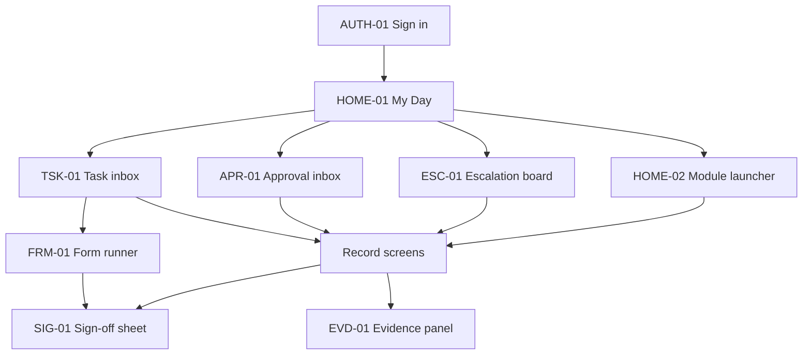

# Foodies screen map

Every screen and WhatsApp flow, with the endpoints it calls. Paths are relative to `/api/v1` and match [api/openapi.yaml](../api/openapi.yaml). Requirements are in [spec.md](spec.md).

This map has 151 screens. Together they use 866 of the 871 API operations. The other 5 are system endpoints with no screen, listed at the end.

## How to read this map

- **Channels.** `Web` means the installable web app. `Web (offline)` means the screen also works without a connection. `WhatsApp` means the same work is available in the WhatsApp channel.
- **Shared on every record.** Any record screen can also use EVD-01 (evidence and comments) and SIG-01 (sign-off). Approval status comes from APR-01. These calls are not repeated in each table.
- **Scope.** Every list is limited to the signed-in user's sites. A filter cannot widen that.
- **Headers.** Writes send `Idempotency-Key`. Updates send `If-Match`. See `docs/spec.md`, section 12.
- **Offline.** Screens marked offline read from the data returned by `GET /sync/manifest` and queue writes for `POST /sync/batches`. The endpoints listed are the operations those queued writes replay.

## Navigation

The home screen keeps the look of the existing dashboard: the orange header, the summary row and the numbered module tiles. It changes in two ways. The summary row shows live work, such as tasks due and approvals waiting, rather than checklist counts. The tiles open working screens rather than developer checklists.

| Tile | Module | Opens |
|---|---|---|
| 01 | Cash & Finance | CSH-01 to CSH-17, PRC-01 to PRC-10, BUD-01, BUD-02, PRK-03 |
| 02 | Equipment & Asset Management | AST-01 to AST-04, MNT-01 to MNT-03 |
| 03 | General Controls | RPM-01 to RPM-05, DOC-01 to DOC-05, FRM-01, HRS-04 |
| 04 | Inventory & Stores | STK-01 to STK-09, PRC-02, PRC-05, PRD-01 |
| 05 | Production & Kitchen Operations | PRD-02 to PRD-08, STK-08, STK-09 |
| 06 | Quality, Food Safety & Compliance | QLT-01 to QLT-06, INC-01, INC-02, NPD-01, FRM-01 |
| 07 | Sales & Customer Service | CUS-01 to CUS-03, PAY-01 to PAY-03, LPR-01, VIS-02 |
| 08 | Store Operations | STO-01, FRM-01, KEY-01 to KEY-03, CTV-01, CTV-02 |
| 09 | Human Resources | IAM-01, IAM-02, HRS-01 to HRS-08 |
| 10 | Trainings & Product Knowledge | TRN-01 to TRN-05, PRK-01, PRK-02, PRD-08 |
| 11 | Security | SEC-01 to SEC-03, VIS-01, KEY-02, CTV-01, CTV-02, INC-01 |
| 12 | Standard Operating Procedures (SOPs) | DOC-01 |
| 13 | Complexes | ORG-01, RPT-01 |

Form-driven areas have no screen of their own. Their checklists and registers run in FRM-01 and are browsed in FRM-02. [spec.md](spec.md) Appendix A shows which areas these are.

## WhatsApp flows

WhatsApp has no screens, so its menu is mapped to the same operations. A WhatsApp user sends `Hi` or taps a notification, and the menu shows only what their role allows.

| Flow | What the user does | Screen equivalent |
|---|---|---|
| WA-01 First use | Confirms a one-time code, sets a PIN in a Flow | AUTH-03, WAA-01 |
| WA-02 My Day | Sees tasks, approvals and alerts as a list | HOME-01 |
| WA-03 Task or checklist | Opens a task and completes the Flow for that form | TSK-01, FRM-01 |
| WA-04 Approve | Reads the summary, taps approve, reject or return, and enters the PIN | APR-01 |
| WA-05 Sign or witness | Receives a sign request and enters the PIN | SIG-01 |
| WA-06 Report | Reports an incident, fault, complaint, NCR or HOLD, with photos | INC-01, MNT-01, CUS-01, QLT-01, QLT-02 |
| WA-07 Alert acknowledgement | Taps acknowledge on an escalation | ESC-01 |
| WA-08 Money trail | Works through flush, cash-up, petty cash, CIT and banking steps | CSH-02 to CSH-08, CSH-12, CSH-14 to CSH-17 |
| WA-09 Stock trail | Works through GRV, transfers, stocktake, waste and orders | PRC-05, STK-03 to STK-08, PRD-01, PRD-06, PRD-07 |
| WA-10 KPI summary | Asks for a dashboard summary | RPT-01 |
| WA-11 Find | Looks up a reference | RPT-02 |
| WA-12 Self-service | Leave, roster, training, acknowledgements, product cards | HRS-01, HRS-03, TRN-02, DOC-05, PRK-02 |

Any operation with `whatsapp` in its `x-channels` value can be reached from these flows.

## Sign-in and account

### AUTH-01 Sign in

Employee number and password, with a two-factor step where the role requires it.  
**Roles:** All users  
**Phase:** 0. **Channels:** Web

| Method | Path | Operation |
|---|---|---|
| POST | `/auth/login` | `login` |
| POST | `/auth/mfa/verify` | `verifyMfa` |

### AUTH-02 Two-factor enrolment

Enrol an authenticator app.  
**Roles:** Finance and admin roles  
**Phase:** 0. **Channels:** Web

| Method | Path | Operation |
|---|---|---|
| POST | `/auth/mfa/enrol` | `enrolMfa` |
| POST | `/auth/mfa/confirm` | `confirmMfa` |

### AUTH-03 Set password and PIN

First-use and later credential change.  
**Roles:** All users  
**Phase:** 0. **Channels:** Web

| Method | Path | Operation |
|---|---|---|
| POST | `/auth/password/change` | `changePassword` |
| POST | `/auth/pin/set` | `setPin` |

### AUTH-04 Device unlock and switch user

PIN unlock and quick user switch, plus silent token refresh and sign-out.  
**Roles:** Branch staff on shared devices  
**Phase:** 0. **Channels:** Web (offline)

| Method | Path | Operation |
|---|---|---|
| POST | `/auth/pin/unlock` | `unlockWithPin` |
| POST | `/auth/refresh` | `refreshToken` |
| POST | `/auth/logout` | `logout` |

### AUTH-05 My account

Profile, permissions, active sessions and notification preferences.  
**Roles:** All users  
**Phase:** 0. **Channels:** Web

| Method | Path | Operation |
|---|---|---|
| GET | `/me` | `getMe` |
| GET | `/me/permissions` | `getMyPermissions` |
| GET | `/me/sessions` | `listMySessions` |
| DELETE | `/me/sessions/{session_id}` | `revokeMySession` |
| GET | `/me/notification-preferences` | `getNotificationPreferences` |
| PUT | `/me/notification-preferences` | `setNotificationPreferences` |

## Home and shared workspace

### HOME-01 My Day

Tasks due, approvals waiting, alerts and branch status for the current shift.  
**Roles:** All users  
**Phase:** 0. **Channels:** Web (offline) + WhatsApp

| Method | Path | Operation |
|---|---|---|
| GET | `/me` | `getMe` |
| GET | `/tasks` | `listTasks` |
| GET | `/approval-requests` | `listApprovalRequests` |
| GET | `/notifications` | `listNotifications` |
| GET | `/dashboards/{dashboard_key}` | `getDashboard` |

### HOME-02 Module launcher

The tile grid from the existing dashboard, filtered by permission, with counts of open work. Includes the SOPs and Complexes tiles.  
**Roles:** All users  
**Phase:** 0. **Channels:** Web

| Method | Path | Operation |
|---|---|---|
| GET | `/me` | `getMe` |
| GET | `/readiness` | `getReadiness` |

### TSK-01 Task inbox

Filter, claim, complete, skip and reassign tasks.  
**Roles:** All users  
**Phase:** 0. **Channels:** Web (offline) + WhatsApp

| Method | Path | Operation |
|---|---|---|
| GET | `/tasks` | `listTasks` |
| POST | `/tasks` | `createTask` |
| GET | `/tasks/{task_id}` | `getTask` |
| PATCH | `/tasks/{task_id}` | `updateTask` |
| POST | `/tasks/{task_id}/claim` | `claimTask` |
| POST | `/tasks/{task_id}/complete` | `completeTask` |
| POST | `/tasks/{task_id}/skip` | `skipTask` |
| POST | `/tasks/{task_id}/reassign` | `reassignTask` |

### TSK-02 Schedule admin

Create and pause recurrences.  
**Roles:** Module owners, System Administrator  
**Phase:** 0. **Channels:** Web

| Method | Path | Operation |
|---|---|---|
| GET | `/schedules` | `listSchedules` |
| POST | `/schedules` | `createSchedule` |
| GET | `/schedules/{schedule_id}` | `getSchedule` |
| PATCH | `/schedules/{schedule_id}` | `updateSchedule` |
| POST | `/schedules/{schedule_id}/pause` | `pauseSchedule` |
| POST | `/schedules/{schedule_id}/resume` | `resumeSchedule` |

### APR-01 Approval inbox

Pending approvals with the record summary and evidence. Includes approve, reject, return and reassign.  
**Roles:** Approvers  
**Phase:** 0. **Channels:** Web + WhatsApp

| Method | Path | Operation |
|---|---|---|
| GET | `/approval-requests` | `listApprovalRequests` |
| GET | `/approval-requests/{approval_request_id}` | `getApprovalRequest` |
| POST | `/approval-requests/{approval_request_id}/approve` | `approveApprovalRequest` |
| POST | `/approval-requests/{approval_request_id}/reject` | `rejectApprovalRequest` |
| POST | `/approval-requests/{approval_request_id}/return` | `returnApprovalRequest` |
| POST | `/approval-requests/{approval_request_id}/reassign` | `reassignApprovalRequest` |

### APR-02 Approval policy admin

Maintain policies and bands from the approved authority matrix.  
**Roles:** System Administrator, Finance Manager  
**Phase:** 0. **Channels:** Web

| Method | Path | Operation |
|---|---|---|
| GET | `/approval-policies` | `listApprovalPolicies` |
| POST | `/approval-policies` | `createApprovalPolicy` |
| GET | `/approval-policies/{approval_policy_id}` | `getApprovalPolicy` |
| PATCH | `/approval-policies/{approval_policy_id}` | `updateApprovalPolicy` |
| POST | `/approval-policies/{approval_policy_id}/submit` | `submitApprovalPolicy` |

### SIG-01 Sign-off sheet

Shows who must sign, captures the PIN, handles external signers and decline.  
**Roles:** All signers  
**Phase:** 0. **Channels:** Web (offline) + WhatsApp

| Method | Path | Operation |
|---|---|---|
| GET | `/signature-requests` | `listSignatureRequests` |
| POST | `/signature-requests` | `createSignatureRequest` |
| GET | `/signature-requests/{signature_request_id}` | `getSignatureRequest` |
| POST | `/signature-requests/{signature_request_id}/sign` | `signSignatureRequest` |
| POST | `/signature-requests/{signature_request_id}/decline` | `declineSignatureRequest` |

### EVD-01 Evidence and comments panel

Shared panel on every record: attachments, comments, linked records.  
**Roles:** All users  
**Phase:** 0. **Channels:** Web (offline) + WhatsApp

| Method | Path | Operation |
|---|---|---|
| GET | `/attachments` | `listAttachments` |
| POST | `/attachments` | `createAttachment` |
| GET | `/attachments/{attachment_id}` | `getAttachment` |
| POST | `/attachments/{attachment_id}/complete` | `completeAttachment` |
| GET | `/comments` | `listComments` |
| POST | `/comments` | `createComment` |
| GET | `/record-links` | `listRecordLinks` |
| POST | `/record-links` | `createRecordLink` |
| DELETE | `/record-links/{record_link_id}` | `deleteRecordLink` |

### NTF-01 Notification centre

Alerts and reminders with read state.  
**Roles:** All users  
**Phase:** 0. **Channels:** Web

| Method | Path | Operation |
|---|---|---|
| GET | `/notifications` | `listNotifications` |
| GET | `/notifications/{notification_id}` | `getNotification` |
| POST | `/notifications/{notification_id}/read` | `readNotification` |
| POST | `/notifications/read-all` | `markAllNotificationsRead` |

### FRM-01 Form runner

Runs any published form: answers, photos, failures, sign-off.  
**Roles:** All users  
**Phase:** 0. **Channels:** Web (offline) + WhatsApp

| Method | Path | Operation |
|---|---|---|
| GET | `/form-submissions` | `listFormSubmissions` |
| POST | `/form-submissions` | `createFormSubmission` |
| GET | `/form-submissions/{form_submission_id}` | `getFormSubmission` |
| PATCH | `/form-submissions/{form_submission_id}` | `updateFormSubmission` |
| POST | `/form-submissions/{form_submission_id}/submit` | `submitFormSubmission` |
| POST | `/form-submissions/{form_submission_id}/review` | `reviewFormSubmission` |
| POST | `/form-submissions/{form_submission_id}/return` | `returnFormSubmission` |
| GET | `/form-templates` | `listFormTemplates` |
| GET | `/form-templates/{form_template_id}` | `getFormTemplate` |
| GET | `/form-templates/{form_template_id}/versions` | `listFormTemplateVersions` |
| GET | `/form-templates/{form_template_id}/versions/{form_template_version_id}` | `getFormTemplateVersion` |

### FRM-02 Register browser

Browse entries of a register by site, date and result, with export.  
**Roles:** Supervisors, managers, auditors  
**Phase:** 0. **Channels:** Web

| Method | Path | Operation |
|---|---|---|
| GET | `/form-submissions` | `listFormSubmissions` |
| GET | `/form-submissions/{form_submission_id}` | `getFormSubmission` |
| POST | `/exports` | `createExportJob` |

### FRM-03 Template builder

Build, version and publish forms, including WhatsApp availability.  
**Roles:** Module owners, QMS Representative  
**Phase:** 0. **Channels:** Web

| Method | Path | Operation |
|---|---|---|
| GET | `/form-templates` | `listFormTemplates` |
| POST | `/form-templates` | `createFormTemplate` |
| GET | `/form-templates/{form_template_id}` | `getFormTemplate` |
| PATCH | `/form-templates/{form_template_id}` | `updateFormTemplate` |
| GET | `/form-templates/{form_template_id}/versions` | `listFormTemplateVersions` |
| POST | `/form-templates/{form_template_id}/versions` | `createFormTemplateVersion` |
| GET | `/form-templates/{form_template_id}/versions/{form_template_version_id}` | `getFormTemplateVersion` |
| PATCH | `/form-templates/{form_template_id}/versions/{form_template_version_id}` | `updateFormTemplateVersion` |
| POST | `/form-templates/{form_template_id}/versions/{form_template_version_id}/submit` | `submitFormTemplateVersion` |
| POST | `/form-templates/{form_template_id}/versions/{form_template_version_id}/publish` | `publishFormTemplateVersion` |
| POST | `/form-templates/{form_template_id}/versions/{form_template_version_id}/retire` | `retireFormTemplateVersion` |

### ESC-01 Escalation board

Open escalations with timers and acknowledgement.  
**Roles:** Managers, executives  
**Phase:** 0. **Channels:** Web + WhatsApp

| Method | Path | Operation |
|---|---|---|
| GET | `/escalations` | `listEscalations` |
| GET | `/escalations/{escalation_id}` | `getEscalation` |
| POST | `/escalations/{escalation_id}/acknowledge` | `acknowledgeEscalation` |
| POST | `/escalations/{escalation_id}/advance` | `advanceEscalation` |

### ESC-02 Escalation policy admin

Severity labels, chains, timers and after-hours contacts.  
**Roles:** Module owners  
**Phase:** 0. **Channels:** Web

| Method | Path | Operation |
|---|---|---|
| GET | `/escalation-policies` | `listEscalationPolicies` |
| POST | `/escalation-policies` | `createEscalationPolicy` |
| GET | `/escalation-policies/{escalation_policy_id}` | `getEscalationPolicy` |
| PATCH | `/escalation-policies/{escalation_policy_id}` | `updateEscalationPolicy` |

### ACT-01 Action tracker

Corrective actions and executive actions from any source.  
**Roles:** All action owners, management  
**Phase:** 0. **Channels:** Web + WhatsApp

| Method | Path | Operation |
|---|---|---|
| GET | `/actions` | `listActions` |
| POST | `/actions` | `createAction` |
| GET | `/actions/{action_id}` | `getAction` |
| PATCH | `/actions/{action_id}` | `updateAction` |
| POST | `/actions/{action_id}/complete` | `completeAction` |
| POST | `/actions/{action_id}/verify` | `verifyAction` |
| POST | `/actions/{action_id}/reopen` | `reopenAction` |

## Setup and administration

### ORG-01 Complexes and sites

The Complexes tile: hierarchy, site types and trading patterns.  
**Roles:** System Administrator, Operations Manager  
**Phase:** 0. **Channels:** Web

| Method | Path | Operation |
|---|---|---|
| GET | `/complexes` | `listComplexes` |
| POST | `/complexes` | `createComplex` |
| GET | `/complexes/{complex_id}` | `getComplex` |
| PATCH | `/complexes/{complex_id}` | `updateComplex` |
| GET | `/sites` | `listSites` |
| POST | `/sites` | `createSite` |
| GET | `/sites/{site_id}` | `getSite` |
| PATCH | `/sites/{site_id}` | `updateSite` |

### ORG-02 Departments, cost centres and lines

Organisational master data.  
**Roles:** System Administrator, Finance  
**Phase:** 0. **Channels:** Web

| Method | Path | Operation |
|---|---|---|
| GET | `/departments` | `listDepartments` |
| POST | `/departments` | `createDepartment` |
| GET | `/departments/{department_id}` | `getDepartment` |
| PATCH | `/departments/{department_id}` | `updateDepartment` |
| GET | `/cost-centres` | `listCostCentres` |
| POST | `/cost-centres` | `createCostCentre` |
| GET | `/cost-centres/{cost_centre_id}` | `getCostCentre` |
| PATCH | `/cost-centres/{cost_centre_id}` | `updateCostCentre` |
| GET | `/production-lines` | `listProductionLines` |
| POST | `/production-lines` | `createProductionLine` |
| GET | `/production-lines/{production_line_id}` | `getProductionLine` |
| PATCH | `/production-lines/{production_line_id}` | `updateProductionLine` |

### ORG-03 Tills, safes and storage

Physical control points.  
**Roles:** System Administrator, Complex Manager  
**Phase:** 0. **Channels:** Web

| Method | Path | Operation |
|---|---|---|
| GET | `/tills` | `listTills` |
| POST | `/tills` | `createTill` |
| GET | `/tills/{till_id}` | `getTill` |
| PATCH | `/tills/{till_id}` | `updateTill` |
| GET | `/safes` | `listSafes` |
| POST | `/safes` | `createSafe` |
| GET | `/safes/{safe_id}` | `getSafe` |
| PATCH | `/safes/{safe_id}` | `updateSafe` |
| GET | `/storage-locations` | `listStorageLocations` |
| POST | `/storage-locations` | `createStorageLocation` |
| GET | `/storage-locations/{storage_location_id}` | `getStorageLocation` |
| PATCH | `/storage-locations/{storage_location_id}` | `updateStorageLocation` |

### ORG-04 Currencies and exchange rates

Currency table and manual rate entry and adjustment.  
**Roles:** Finance Manager, System Administrator  
**Phase:** 0. **Channels:** Web

| Method | Path | Operation |
|---|---|---|
| GET | `/currencies` | `listCurrencies` |
| POST | `/currencies` | `createCurrency` |
| GET | `/currencies/{currency_id}` | `getCurrency` |
| PATCH | `/currencies/{currency_id}` | `updateCurrency` |
| GET | `/fx-rates` | `listFxRates` |
| POST | `/fx-rates` | `createFxRate` |
| GET | `/fx-rates/{fx_rate_id}` | `getFxRate` |
| PATCH | `/fx-rates/{fx_rate_id}` | `updateFxRate` |
| GET | `/fx-rates/effective` | `getEffectiveFxRate` |

### ORG-05 Working calendar

Public holidays for working-day clocks.  
**Roles:** HR, System Administrator  
**Phase:** 0. **Channels:** Web

| Method | Path | Operation |
|---|---|---|
| GET | `/public-holidays` | `listPublicHolidays` |
| POST | `/public-holidays` | `createPublicHoliday` |
| GET | `/public-holidays/{public_holiday_id}` | `getPublicHoliday` |
| PATCH | `/public-holidays/{public_holiday_id}` | `updatePublicHoliday` |
| DELETE | `/public-holidays/{public_holiday_id}` | `deletePublicHoliday` |

### IAM-01 Employee directory

Employee master search and create.  
**Roles:** HR  
**Phase:** 0. **Channels:** Web

| Method | Path | Operation |
|---|---|---|
| GET | `/employees` | `listEmployees` |
| POST | `/employees` | `createEmployee` |
| GET | `/employees/{employee_id}` | `getEmployee` |
| PATCH | `/employees/{employee_id}` | `updateEmployee` |

### IAM-02 Employee profile

Status history, transfers, personnel file and emergency contacts.  
**Roles:** HR, line managers (limited)  
**Phase:** 0. **Channels:** Web

| Method | Path | Operation |
|---|---|---|
| GET | `/employees/{employee_id}` | `getEmployee` |
| GET | `/employees/{employee_id}/status-changes` | `listEmployeeStatusChanges` |
| POST | `/employees/{employee_id}/status-changes` | `createEmployeeStatusChange` |
| GET | `/employees/{employee_id}/transfers` | `listEmployeeTransfers` |
| POST | `/employees/{employee_id}/transfers` | `createEmployeeTransfer` |
| GET | `/employees/{employee_id}/transfers/{employee_transfer_id}` | `getEmployeeTransfer` |
| POST | `/employees/{employee_id}/transfers/{employee_transfer_id}/submit` | `submitEmployeeTransfer` |
| GET | `/employees/{employee_id}/documents` | `listEmployeeDocuments` |
| POST | `/employees/{employee_id}/documents` | `createEmployeeDocument` |
| GET | `/employees/{employee_id}/documents/{employee_document_id}` | `getEmployeeDocument` |
| DELETE | `/employees/{employee_id}/documents/{employee_document_id}` | `deleteEmployeeDocument` |
| GET | `/employees/{employee_id}/emergency-contacts` | `listEmergencyContacts` |
| POST | `/employees/{employee_id}/emergency-contacts` | `createEmergencyContact` |
| PATCH | `/employees/{employee_id}/emergency-contacts/{emergency_contact_id}` | `updateEmergencyContact` |
| DELETE | `/employees/{employee_id}/emergency-contacts/{emergency_contact_id}` | `deleteEmergencyContact` |

### IAM-03 Users and access

Accounts, channels, role assignments and delegations.  
**Roles:** System Administrator, ICT  
**Phase:** 0. **Channels:** Web

| Method | Path | Operation |
|---|---|---|
| GET | `/users` | `listUsers` |
| POST | `/users` | `createUser` |
| GET | `/users/{user_id}` | `getUser` |
| PATCH | `/users/{user_id}` | `updateUser` |
| POST | `/users/{user_id}/lock` | `lockUser` |
| POST | `/users/{user_id}/unlock` | `unlockUser` |
| POST | `/users/{user_id}/disable` | `disableUser` |
| POST | `/users/{user_id}/reset-credentials` | `resetCredentialsUser` |
| GET | `/role-assignments` | `listRoleAssignments` |
| POST | `/role-assignments` | `createRoleAssignment` |
| GET | `/role-assignments/{role_assignment_id}` | `getRoleAssignment` |
| PATCH | `/role-assignments/{role_assignment_id}` | `updateRoleAssignment` |
| DELETE | `/role-assignments/{role_assignment_id}` | `deleteRoleAssignment` |
| GET | `/delegations` | `listDelegations` |
| POST | `/delegations` | `createDelegation` |
| GET | `/delegations/{delegation_id}` | `getDelegation` |
| PATCH | `/delegations/{delegation_id}` | `updateDelegation` |
| POST | `/delegations/{delegation_id}/submit` | `submitDelegation` |
| POST | `/delegations/{delegation_id}/revoke` | `revokeDelegation` |

### IAM-04 Roles and permissions

Role definitions against the permission catalogue.  
**Roles:** System Administrator  
**Phase:** 0. **Channels:** Web

| Method | Path | Operation |
|---|---|---|
| GET | `/roles` | `listRoles` |
| POST | `/roles` | `createRole` |
| GET | `/roles/{role_id}` | `getRole` |
| PATCH | `/roles/{role_id}` | `updateRole` |
| DELETE | `/roles/{role_id}` | `deleteRole` |
| GET | `/permissions` | `listPermissions` |

### IAM-05 Segregation of duties

Maintain conflict rules.  
**Roles:** System Administrator, Internal Audit  
**Phase:** 0. **Channels:** Web

| Method | Path | Operation |
|---|---|---|
| GET | `/sod-rules` | `listSodRules` |
| POST | `/sod-rules` | `createSodRule` |
| GET | `/sod-rules/{sod_rule_id}` | `getSodRule` |
| PATCH | `/sod-rules/{sod_rule_id}` | `updateSodRule` |

### IAM-06 Devices

Enrol and revoke web-app devices.  
**Roles:** ICT, Complex Manager  
**Phase:** 0. **Channels:** Web

| Method | Path | Operation |
|---|---|---|
| GET | `/devices` | `listDevices` |
| POST | `/devices` | `createDevice` |
| GET | `/devices/{device_id}` | `getDevice` |
| PATCH | `/devices/{device_id}` | `updateDevice` |
| POST | `/devices/{device_id}/revoke` | `revokeDevice` |

### RUL-01 Readiness

What blocks go-live, by module, workflow and site.  
**Roles:** System Administrator, GM, module owners  
**Phase:** 0. **Channels:** Web

| Method | Path | Operation |
|---|---|---|
| GET | `/readiness` | `getReadiness` |
| GET | `/workflow-activations` | `listWorkflowActivations` |
| GET | `/workflow-activations/{workflow_activation_id}` | `getWorkflowActivation` |
| POST | `/workflow-activations/{workflow_activation_id}/activate` | `activateWorkflowActivation` |
| POST | `/workflow-activations/{workflow_activation_id}/suspend` | `suspendWorkflowActivation` |

### RUL-02 Rule catalogue

Enter, approve and date rule values.  
**Roles:** Rule owners  
**Phase:** 0. **Channels:** Web

| Method | Path | Operation |
|---|---|---|
| GET | `/rules` | `listRuleDefinitions` |
| GET | `/rules/{rule_definition_id}` | `getRuleDefinition` |
| PATCH | `/rules/{rule_definition_id}` | `updateRuleDefinition` |
| GET | `/rules/{rule_definition_id}/versions` | `listRuleVersions` |
| POST | `/rules/{rule_definition_id}/versions` | `createRuleVersion` |
| GET | `/rules/{rule_definition_id}/versions/{rule_version_id}` | `getRuleVersion` |
| POST | `/rules/{rule_definition_id}/versions/{rule_version_id}/submit` | `submitRuleVersion` |

### AUD-01 Audit explorer

Search the audit trail.  
**Roles:** Internal Audit, ICT  
**Phase:** 0. **Channels:** Web

| Method | Path | Operation |
|---|---|---|
| GET | `/audit-events` | `listAuditEvents` |
| GET | `/audit-events/{audit_event_id}` | `getAuditEvent` |

### SYN-01 Offline outbox

What is queued, sent or failed on this device.  
**Roles:** Branch staff  
**Phase:** 0. **Channels:** Web (offline)

| Method | Path | Operation |
|---|---|---|
| GET | `/sync/manifest` | `getSyncManifest` |
| POST | `/sync/batches` | `submitSyncBatch` |
| GET | `/sync/batches/{batch_id}` | `getSyncBatch` |

### SYN-02 Sync conflicts

Resolve offline writes the server could not apply.  
**Roles:** Supervisors, Complex Manager  
**Phase:** 0. **Channels:** Web

| Method | Path | Operation |
|---|---|---|
| GET | `/sync/conflicts` | `listSyncConflicts` |
| GET | `/sync/conflicts/{sync_conflict_id}` | `getSyncConflict` |
| POST | `/sync/conflicts/{sync_conflict_id}/resolve` | `resolveSyncConflict` |

### WAA-01 WhatsApp administration

Bind, revoke and move numbers. Templates and message log.  
**Roles:** ICT, HR  
**Phase:** 0. **Channels:** Web

| Method | Path | Operation |
|---|---|---|
| GET | `/whatsapp/identities` | `listWhatsappIdentities` |
| POST | `/whatsapp/identities` | `createWhatsappIdentity` |
| GET | `/whatsapp/identities/{whatsapp_identity_id}` | `getWhatsappIdentity` |
| POST | `/whatsapp/identities/{whatsapp_identity_id}/revoke` | `revokeWhatsappIdentity` |
| POST | `/whatsapp/identities/{whatsapp_identity_id}/rebind` | `rebindWhatsappIdentity` |
| GET | `/whatsapp/templates` | `listWhatsappTemplates` |
| POST | `/whatsapp/templates` | `createWhatsappTemplate` |
| GET | `/whatsapp/templates/{whatsapp_template_id}` | `getWhatsappTemplate` |
| PATCH | `/whatsapp/templates/{whatsapp_template_id}` | `updateWhatsappTemplate` |
| GET | `/whatsapp/messages` | `listWhatsappMessages` |
| GET | `/whatsapp/messages/{whatsapp_message_id}` | `getWhatsappMessage` |

### INT-01 Integration health

Status of each connection and its runs.  
**Roles:** ICT  
**Phase:** 0. **Channels:** Web

| Method | Path | Operation |
|---|---|---|
| GET | `/integrations` | `listIntegrations` |
| POST | `/integrations` | `createIntegration` |
| GET | `/integrations/{integration_id}` | `getIntegration` |
| PATCH | `/integrations/{integration_id}` | `updateIntegration` |
| GET | `/integrations/{integration_id}/runs` | `listSyncRuns` |
| POST | `/integrations/{integration_id}/runs` | `createSyncRun` |
| GET | `/integrations/{integration_id}/runs/{sync_run_id}` | `getSyncRun` |

### INT-02 Imports

Upload files and review rejected rows.  
**Roles:** ICT, Finance, Stores  
**Phase:** 0. **Channels:** Web

| Method | Path | Operation |
|---|---|---|
| GET | `/imports` | `listDataImports` |
| POST | `/imports` | `createDataImport` |
| GET | `/imports/{data_import_id}` | `getDataImport` |

### INT-03 Posting queue

Decisions awaiting entry in SAP, GAAP Unity or Belina.  
**Roles:** Finance, Stores, ICT  
**Phase:** 0. **Channels:** Web

| Method | Path | Operation |
|---|---|---|
| GET | `/postings` | `listPostings` |
| GET | `/postings/{posting_id}` | `getPosting` |
| POST | `/postings/{posting_id}/retry` | `retryPosting` |
| POST | `/postings/{posting_id}/mark-posted` | `markPostedPosting` |

### RPT-01 Dashboards

Branch, complex and group dashboards with drill-down. WhatsApp shows the summary tiles.  
**Roles:** Managers, executives  
**Phase:** 0. **Channels:** Web + WhatsApp

| Method | Path | Operation |
|---|---|---|
| GET | `/dashboards/{dashboard_key}` | `getDashboard` |
| GET | `/kpis/{kpi_definition_id}/values` | `getKpiValues` |
| GET | `/kpis` | `listKpiDefinitions` |
| POST | `/kpis` | `createKpiDefinition` |
| GET | `/kpis/{kpi_definition_id}` | `getKpiDefinition` |
| PATCH | `/kpis/{kpi_definition_id}` | `updateKpiDefinition` |

### RPT-02 Global search

Find any record by reference, batch, supplier, employee or product.  
**Roles:** All users  
**Phase:** 0. **Channels:** Web + WhatsApp

| Method | Path | Operation |
|---|---|---|
| GET | `/search` | `search` |

### RPT-03 Exports

Request and collect PDF and Excel exports.  
**Roles:** Authorised users  
**Phase:** 0. **Channels:** Web

| Method | Path | Operation |
|---|---|---|
| GET | `/exports` | `listExportJobs` |
| POST | `/exports` | `createExportJob` |
| GET | `/exports/{export_job_id}` | `getExportJob` |

### RET-01 Retention and disposition

Retention classes, legal holds and disposition batches.  
**Roles:** Records owners, Internal Audit  
**Phase:** 0. **Channels:** Web

| Method | Path | Operation |
|---|---|---|
| GET | `/retention-classes` | `listRetentionClasses` |
| POST | `/retention-classes` | `createRetentionClass` |
| GET | `/retention-classes/{retention_class_id}` | `getRetentionClass` |
| PATCH | `/retention-classes/{retention_class_id}` | `updateRetentionClass` |
| GET | `/legal-holds` | `listLegalHolds` |
| POST | `/legal-holds` | `createLegalHold` |
| GET | `/legal-holds/{legal_hold_id}` | `getLegalHold` |
| POST | `/legal-holds/{legal_hold_id}/release` | `releaseLegalHold` |
| GET | `/disposition-batches` | `listDispositionBatches` |
| POST | `/disposition-batches` | `createDispositionBatch` |
| GET | `/disposition-batches/{disposition_batch_id}` | `getDispositionBatch` |
| POST | `/disposition-batches/{disposition_batch_id}/submit` | `submitDispositionBatch` |
| POST | `/disposition-batches/{disposition_batch_id}/complete` | `completeDispositionBatch` |

## Phase 1: Cash

### CSH-01 Float certificates

Approved float and petty cash per branch.  
**Roles:** GM, Finance Manager  
**Phase:** 1. **Channels:** Web

| Method | Path | Operation |
|---|---|---|
| GET | `/cash/float-certificates` | `listFloatCertificates` |
| POST | `/cash/float-certificates` | `createFloatCertificate` |
| GET | `/cash/float-certificates/{float_certificate_id}` | `getFloatCertificate` |
| POST | `/cash/float-certificates/{float_certificate_id}/submit` | `submitFloatCertificate` |

### CSH-02 Float issue and return

Issue, acknowledge and return float.  
**Roles:** Manager on Duty, Cashier  
**Phase:** 1. **Channels:** Web (offline) + WhatsApp

| Method | Path | Operation |
|---|---|---|
| GET | `/cash/float-issues` | `listFloatIssues` |
| POST | `/cash/float-issues` | `createFloatIssue` |
| GET | `/cash/float-issues/{float_issue_id}` | `getFloatIssue` |
| POST | `/cash/float-issues/{float_issue_id}/acknowledge` | `acknowledgeFloatIssue` |
| POST | `/cash/float-issues/{float_issue_id}/return` | `returnFloatIssue` |

### CSH-03 Exceptional float use

Prior approval and next-day reimbursement.  
**Roles:** Complex Manager, MD  
**Phase:** 1. **Channels:** Web + WhatsApp

| Method | Path | Operation |
|---|---|---|
| GET | `/cash/float-exceptions` | `listFloatExceptions` |
| POST | `/cash/float-exceptions` | `createFloatException` |
| GET | `/cash/float-exceptions/{float_exception_id}` | `getFloatException` |
| POST | `/cash/float-exceptions/{float_exception_id}/submit` | `submitFloatException` |
| POST | `/cash/float-exceptions/{float_exception_id}/reimburse` | `reimburseFloatException` |

### CSH-04 Till flush

Threshold alert, joint count and signed slip.  
**Roles:** Cashier, Supervisor, Security Officer  
**Phase:** 1. **Channels:** Web (offline) + WhatsApp

| Method | Path | Operation |
|---|---|---|
| GET | `/cash/till-flushes` | `listTillFlushes` |
| POST | `/cash/till-flushes` | `createTillFlush` |
| GET | `/cash/till-flushes/{till_flush_id}` | `getTillFlush` |
| PATCH | `/cash/till-flushes/{till_flush_id}` | `updateTillFlush` |
| POST | `/cash/till-flushes/{till_flush_id}/submit` | `submitTillFlush` |
| GET | `/tills` | `listTills` |
| GET | `/safes` | `listSafes` |

### CSH-05 Cash-up

Count by currency and tender against POS and Z-report.  
**Roles:** Cashier, Supervisor, Witness  
**Phase:** 1. **Channels:** Web (offline) + WhatsApp

| Method | Path | Operation |
|---|---|---|
| GET | `/cash/cash-ups` | `listCashUps` |
| GET | `/cash/cash-ups/{cash_up_id}` | `getCashUp` |
| POST | `/cash/cash-ups` | `createCashUp` |
| PATCH | `/cash/cash-ups/{cash_up_id}` | `updateCashUp` |
| POST | `/cash/cash-ups/{cash_up_id}/submit` | `submitCashUp` |
| GET | `/pos/sales-summaries` | `listPosSalesSummaries` |
| GET | `/pos/sales-summaries/{pos_sales_summary_id}` | `getPosSalesSummary` |
| GET | `/pos/z-reports` | `listZReports` |
| POST | `/pos/z-reports` | `createZReport` |
| GET | `/pos/z-reports/{z_report_id}` | `getZReport` |
| GET | `/fx-rates/effective` | `getEffectiveFxRate` |

### CSH-06 Cash-up review

Independent approval and return.  
**Roles:** Complex Manager, Branch Manager, Finance  
**Phase:** 1. **Channels:** Web + WhatsApp

| Method | Path | Operation |
|---|---|---|
| GET | `/cash/cash-ups` | `listCashUps` |
| GET | `/cash/cash-ups/{cash_up_id}` | `getCashUp` |
| POST | `/cash/cash-ups/{cash_up_id}/approve` | `approveCashUp` |
| POST | `/cash/cash-ups/{cash_up_id}/return` | `returnCashUp` |

### CSH-07 Cash variances

Explanation, recovery, repeat counts and referral.  
**Roles:** Complex Manager, Finance, HR  
**Phase:** 1. **Channels:** Web + WhatsApp

| Method | Path | Operation |
|---|---|---|
| GET | `/cash/variances` | `listCashVariances` |
| GET | `/cash/variances/{cash_variance_id}` | `getCashVariance` |
| PATCH | `/cash/variances/{cash_variance_id}` | `updateCashVariance` |
| POST | `/cash/variances/{cash_variance_id}/record-recovery` | `recordRecoveryCashVariance` |
| POST | `/cash/variances/{cash_variance_id}/refer-hr` | `referHrCashVariance` |
| POST | `/cash/variances/{cash_variance_id}/close` | `closeCashVariance` |

### CSH-08 CIT transit

Sealing, limit check, identity, handover and countersignatures.  
**Roles:** Shift or Complex Manager, Security Officer  
**Phase:** 1. **Channels:** Web (offline) + WhatsApp

| Method | Path | Operation |
|---|---|---|
| GET | `/cash/cit/transits` | `listCitTransits` |
| GET | `/cash/cit/transits/{cit_transit_id}` | `getCitTransit` |
| POST | `/cash/cit/transits` | `createCitTransit` |
| PATCH | `/cash/cit/transits/{cit_transit_id}` | `updateCitTransit` |
| POST | `/cash/cit/transits/{cit_transit_id}/seal` | `sealCitTransit` |
| POST | `/cash/cit/transits/{cit_transit_id}/verify-identity` | `verifyIdentityCitTransit` |
| POST | `/cash/cit/transits/{cit_transit_id}/hand-over` | `handOverCitTransit` |
| POST | `/cash/cit/transits/{cit_transit_id}/raise-discrepancy` | `raiseDiscrepancyCitTransit` |
| GET | `/cash/cit/providers` | `listCitProviders` |
| GET | `/cash/cit/providers/{cit_provider_id}/personnel` | `listCitPersons` |

### CSH-09 Vault receipt

Seal verification and amount acknowledged.  
**Roles:** Accounts Clerk  
**Phase:** 1. **Channels:** Web

| Method | Path | Operation |
|---|---|---|
| GET | `/cash/cit/transits` | `listCitTransits` |
| GET | `/cash/cit/transits/{cit_transit_id}` | `getCitTransit` |
| POST | `/cash/cit/transits/{cit_transit_id}/receive-vault` | `receiveVaultCitTransit` |
| POST | `/cash/cit/transits/{cit_transit_id}/raise-discrepancy` | `raiseDiscrepancyCitTransit` |

### CSH-10 CIT reconciliation

Daily dispatches against receipts and deposits.  
**Roles:** Accounts Clerk, Finance  
**Phase:** 1. **Channels:** Web

| Method | Path | Operation |
|---|---|---|
| GET | `/cash/cit/reconciliations` | `listCitReconciliations` |
| POST | `/cash/cit/reconciliations` | `createCitReconciliation` |
| GET | `/cash/cit/reconciliations/{cit_reconciliation_id}` | `getCitReconciliation` |
| PATCH | `/cash/cit/reconciliations/{cit_reconciliation_id}` | `updateCitReconciliation` |
| POST | `/cash/cit/reconciliations/{cit_reconciliation_id}/complete` | `completeCitReconciliation` |

### CSH-11 CIT providers

Providers and approved personnel.  
**Roles:** Finance Manager, Security Manager  
**Phase:** 1. **Channels:** Web

| Method | Path | Operation |
|---|---|---|
| GET | `/cash/cit/providers` | `listCitProviders` |
| POST | `/cash/cit/providers` | `createCitProvider` |
| GET | `/cash/cit/providers/{cit_provider_id}` | `getCitProvider` |
| PATCH | `/cash/cit/providers/{cit_provider_id}` | `updateCitProvider` |
| GET | `/cash/cit/providers/{cit_provider_id}/personnel` | `listCitPersons` |
| POST | `/cash/cit/providers/{cit_provider_id}/personnel` | `createCitPerson` |
| PATCH | `/cash/cit/providers/{cit_provider_id}/personnel/{cit_person_id}` | `updateCitPerson` |

### CSH-12 Banking and proof

Takings banked intact, proof and verification.  
**Roles:** Branch Manager, Finance  
**Phase:** 1. **Channels:** Web + WhatsApp

| Method | Path | Operation |
|---|---|---|
| GET | `/cash/bank-deposits` | `listBankDeposits` |
| POST | `/cash/bank-deposits` | `createBankDeposit` |
| GET | `/cash/bank-deposits/{bank_deposit_id}` | `getBankDeposit` |
| PATCH | `/cash/bank-deposits/{bank_deposit_id}` | `updateBankDeposit` |
| POST | `/cash/bank-deposits/{bank_deposit_id}/submit-proof` | `submitProofBankDeposit` |
| POST | `/cash/bank-deposits/{bank_deposit_id}/verify` | `verifyBankDeposit` |

### CSH-13 Surprise counts

Plan and record unannounced counts.  
**Roles:** Head Office Finance  
**Phase:** 1. **Channels:** Web + WhatsApp

| Method | Path | Operation |
|---|---|---|
| GET | `/cash/surprise-counts` | `listSurpriseCounts` |
| POST | `/cash/surprise-counts` | `createSurpriseCount` |
| GET | `/cash/surprise-counts/{surprise_count_id}` | `getSurpriseCount` |
| PATCH | `/cash/surprise-counts/{surprise_count_id}` | `updateSurpriseCount` |
| POST | `/cash/surprise-counts/{surprise_count_id}/complete` | `completeSurpriseCount` |

### CSH-14 Petty cash book

Balance, vouchers and movements.  
**Roles:** Shift Supervisor, Complex Manager  
**Phase:** 1. **Channels:** Web (offline) + WhatsApp

| Method | Path | Operation |
|---|---|---|
| GET | `/cash/petty-cash/accounts` | `listPettyCashAccounts` |
| POST | `/cash/petty-cash/accounts` | `createPettyCashAccount` |
| GET | `/cash/petty-cash/accounts/{petty_cash_account_id}` | `getPettyCashAccount` |
| PATCH | `/cash/petty-cash/accounts/{petty_cash_account_id}` | `updatePettyCashAccount` |
| GET | `/cash/petty-cash/vouchers` | `listPettyCashVouchers` |
| GET | `/cash/petty-cash/vouchers/{petty_cash_voucher_id}` | `getPettyCashVoucher` |

### CSH-15 Petty cash voucher

Request, verify, issue and receipt.  
**Roles:** Shift Supervisor, Complex Manager, MD  
**Phase:** 1. **Channels:** Web (offline) + WhatsApp

| Method | Path | Operation |
|---|---|---|
| GET | `/cash/petty-cash/vouchers` | `listPettyCashVouchers` |
| POST | `/cash/petty-cash/vouchers` | `createPettyCashVoucher` |
| GET | `/cash/petty-cash/vouchers/{petty_cash_voucher_id}` | `getPettyCashVoucher` |
| PATCH | `/cash/petty-cash/vouchers/{petty_cash_voucher_id}` | `updatePettyCashVoucher` |
| POST | `/cash/petty-cash/vouchers/{petty_cash_voucher_id}/submit` | `submitPettyCashVoucher` |
| POST | `/cash/petty-cash/vouchers/{petty_cash_voucher_id}/verify` | `verifyPettyCashVoucher` |
| POST | `/cash/petty-cash/vouchers/{petty_cash_voucher_id}/issue` | `issuePettyCashVoucher` |
| POST | `/cash/petty-cash/vouchers/{petty_cash_voucher_id}/attach-receipt` | `attachReceiptPettyCashVoucher` |

### CSH-16 Petty cash handover and reconciliation

Joint count, end-of-day and spot check.  
**Roles:** Supervisors  
**Phase:** 1. **Channels:** Web (offline) + WhatsApp

| Method | Path | Operation |
|---|---|---|
| GET | `/cash/petty-cash/handovers` | `listPettyCashHandovers` |
| POST | `/cash/petty-cash/handovers` | `createPettyCashHandover` |
| GET | `/cash/petty-cash/handovers/{petty_cash_handover_id}` | `getPettyCashHandover` |
| POST | `/cash/petty-cash/handovers/{petty_cash_handover_id}/submit` | `submitPettyCashHandover` |
| GET | `/cash/petty-cash/reconciliations` | `listPettyCashReconciliations` |
| POST | `/cash/petty-cash/reconciliations` | `createPettyCashReconciliation` |
| GET | `/cash/petty-cash/reconciliations/{petty_cash_reconciliation_id}` | `getPettyCashReconciliation` |
| POST | `/cash/petty-cash/reconciliations/{petty_cash_reconciliation_id}/submit` | `submitPettyCashReconciliation` |
| POST | `/cash/petty-cash/reconciliations/{petty_cash_reconciliation_id}/review` | `reviewPettyCashReconciliation` |

### CSH-17 Petty cash reimbursement

Claim vouchers from Finance.  
**Roles:** Complex Manager, Finance  
**Phase:** 1. **Channels:** Web + WhatsApp

| Method | Path | Operation |
|---|---|---|
| GET | `/cash/petty-cash/reimbursements` | `listPettyCashReimbursements` |
| POST | `/cash/petty-cash/reimbursements` | `createPettyCashReimbursement` |
| GET | `/cash/petty-cash/reimbursements/{petty_cash_reimbursement_id}` | `getPettyCashReimbursement` |
| POST | `/cash/petty-cash/reimbursements/{petty_cash_reimbursement_id}/submit` | `submitPettyCashReimbursement` |
| POST | `/cash/petty-cash/reimbursements/{petty_cash_reimbursement_id}/record-payment` | `recordPaymentPettyCashReimbursement` |

## Phase 1: Procurement, AP and budgets

### PRC-01 Suppliers

Onboarding, documents, status and amendments.  
**Roles:** Procurement, Finance Manager  
**Phase:** 1. **Channels:** Web

| Method | Path | Operation |
|---|---|---|
| GET | `/suppliers` | `listSuppliers` |
| POST | `/suppliers` | `createSupplier` |
| GET | `/suppliers/{supplier_id}` | `getSupplier` |
| PATCH | `/suppliers/{supplier_id}` | `updateSupplier` |
| POST | `/suppliers/{supplier_id}/submit` | `submitSupplier` |
| POST | `/suppliers/{supplier_id}/suspend` | `suspendSupplier` |
| POST | `/suppliers/{supplier_id}/reinstate` | `reinstateSupplier` |
| GET | `/suppliers/{supplier_id}/amendments` | `listSupplierAmendments` |
| POST | `/suppliers/{supplier_id}/amendments` | `createSupplierAmendment` |
| GET | `/suppliers/{supplier_id}/amendments/{supplier_amendment_id}` | `getSupplierAmendment` |
| POST | `/suppliers/{supplier_id}/amendments/{supplier_amendment_id}/submit` | `submitSupplierAmendment` |

### PRC-02 Purchase requisition

Raise, validate and approve.  
**Roles:** Requesters, HODs, Procurement  
**Phase:** 1. **Channels:** Web + WhatsApp

| Method | Path | Operation |
|---|---|---|
| GET | `/purchase-requisitions` | `listPurchaseRequisitions` |
| POST | `/purchase-requisitions` | `createPurchaseRequisition` |
| GET | `/purchase-requisitions/{purchase_requisition_id}` | `getPurchaseRequisition` |
| PATCH | `/purchase-requisitions/{purchase_requisition_id}` | `updatePurchaseRequisition` |
| POST | `/purchase-requisitions/{purchase_requisition_id}/submit` | `submitPurchaseRequisition` |
| POST | `/purchase-requisitions/{purchase_requisition_id}/validate` | `validatePurchaseRequisition` |
| POST | `/purchase-requisitions/{purchase_requisition_id}/return` | `returnPurchaseRequisition` |
| GET | `/items` | `listItems` |

### PRC-03 Quotation comparison

Like-for-like comparison and selection.  
**Roles:** Procurement  
**Phase:** 1. **Channels:** Web

| Method | Path | Operation |
|---|---|---|
| GET | `/purchase-requisitions/{purchase_requisition_id}/quotations` | `listQuotations` |
| POST | `/purchase-requisitions/{purchase_requisition_id}/quotations` | `createQuotation` |
| GET | `/purchase-requisitions/{purchase_requisition_id}/quotations/{quotation_id}` | `getQuotation` |
| PATCH | `/purchase-requisitions/{purchase_requisition_id}/quotations/{quotation_id}` | `updateQuotation` |
| DELETE | `/purchase-requisitions/{purchase_requisition_id}/quotations/{quotation_id}` | `deleteQuotation` |

### PRC-04 Purchase order

Prepare, approve and issue.  
**Roles:** Procurement, GM, Operations Manager, MD  
**Phase:** 1. **Channels:** Web + WhatsApp

| Method | Path | Operation |
|---|---|---|
| GET | `/purchase-orders` | `listPurchaseOrders` |
| POST | `/purchase-orders` | `createPurchaseOrder` |
| GET | `/purchase-orders/{purchase_order_id}` | `getPurchaseOrder` |
| PATCH | `/purchase-orders/{purchase_order_id}` | `updatePurchaseOrder` |
| POST | `/purchase-orders/{purchase_order_id}/submit` | `submitPurchaseOrder` |
| POST | `/purchase-orders/{purchase_order_id}/issue` | `issuePurchaseOrder` |
| POST | `/purchase-orders/{purchase_order_id}/cancel` | `cancelPurchaseOrder` |

### PRC-05 Goods receipt (GRV)

Receive and inspect at the door, including temperature.  
**Roles:** Stores Controller, Receiving Clerk, Supervisor  
**Phase:** 1. **Channels:** Web (offline) + WhatsApp

| Method | Path | Operation |
|---|---|---|
| GET | `/goods-receipts` | `listGoodsReceipts` |
| POST | `/goods-receipts` | `createGoodsReceipt` |
| GET | `/goods-receipts/{goods_receipt_id}` | `getGoodsReceipt` |
| PATCH | `/goods-receipts/{goods_receipt_id}` | `updateGoodsReceipt` |
| POST | `/goods-receipts/{goods_receipt_id}/submit` | `submitGoodsReceipt` |
| GET | `/purchase-orders` | `listPurchaseOrders` |
| GET | `/purchase-orders/{purchase_order_id}` | `getPurchaseOrder` |

### PRC-06 Delivery discrepancies

Track supplier resolution.  
**Roles:** Stores, Procurement  
**Phase:** 1. **Channels:** Web + WhatsApp

| Method | Path | Operation |
|---|---|---|
| GET | `/delivery-discrepancies` | `listDeliveryDiscrepancies` |
| POST | `/delivery-discrepancies` | `createDeliveryDiscrepancy` |
| GET | `/delivery-discrepancies/{delivery_discrepancy_id}` | `getDeliveryDiscrepancy` |
| PATCH | `/delivery-discrepancies/{delivery_discrepancy_id}` | `updateDeliveryDiscrepancy` |
| POST | `/delivery-discrepancies/{delivery_discrepancy_id}/close` | `closeDeliveryDiscrepancy` |

### PRC-07 Invoice workbench

Capture, three-way match, duplicates, hold and post.  
**Roles:** Accounts and Creditors Clerks, Financial Accountant  
**Phase:** 1. **Channels:** Web

| Method | Path | Operation |
|---|---|---|
| GET | `/supplier-invoices` | `listSupplierInvoices` |
| POST | `/supplier-invoices` | `createSupplierInvoice` |
| GET | `/supplier-invoices/{supplier_invoice_id}` | `getSupplierInvoice` |
| PATCH | `/supplier-invoices/{supplier_invoice_id}` | `updateSupplierInvoice` |
| POST | `/supplier-invoices/{supplier_invoice_id}/match` | `matchSupplierInvoice` |
| POST | `/supplier-invoices/{supplier_invoice_id}/hold` | `holdSupplierInvoice` |
| POST | `/supplier-invoices/{supplier_invoice_id}/approve-exception` | `approveExceptionSupplierInvoice` |
| POST | `/supplier-invoices/{supplier_invoice_id}/post` | `postSupplierInvoice` |

### PRC-08 Payment requisitions

Payment packet and approval.  
**Roles:** Accounts Clerk, Finance Manager, GM, MD, Chairman  
**Phase:** 1. **Channels:** Web + WhatsApp

| Method | Path | Operation |
|---|---|---|
| GET | `/payment-requisitions` | `listPaymentRequisitions` |
| POST | `/payment-requisitions` | `createPaymentRequisition` |
| GET | `/payment-requisitions/{payment_requisition_id}` | `getPaymentRequisition` |
| PATCH | `/payment-requisitions/{payment_requisition_id}` | `updatePaymentRequisition` |
| POST | `/payment-requisitions/{payment_requisition_id}/submit` | `submitPaymentRequisition` |

### PRC-09 Payment runs

Batch, approve and record execution.  
**Roles:** Accounts Clerk, Finance Manager  
**Phase:** 1. **Channels:** Web

| Method | Path | Operation |
|---|---|---|
| GET | `/payment-batches` | `listPaymentBatches` |
| POST | `/payment-batches` | `createPaymentBatch` |
| GET | `/payment-batches/{payment_batch_id}` | `getPaymentBatch` |
| PATCH | `/payment-batches/{payment_batch_id}` | `updatePaymentBatch` |
| POST | `/payment-batches/{payment_batch_id}/submit` | `submitPaymentBatch` |
| POST | `/payment-batches/{payment_batch_id}/record-execution` | `recordExecutionPaymentBatch` |

### PRC-10 Emergency and unauthorised purchases

Exception purchases and review.  
**Roles:** Departments, Operations, Finance  
**Phase:** 1. **Channels:** Web + WhatsApp

| Method | Path | Operation |
|---|---|---|
| GET | `/emergency-procurements` | `listEmergencyProcurements` |
| POST | `/emergency-procurements` | `createEmergencyProcurement` |
| GET | `/emergency-procurements/{emergency_procurement_id}` | `getEmergencyProcurement` |
| PATCH | `/emergency-procurements/{emergency_procurement_id}` | `updateEmergencyProcurement` |
| POST | `/emergency-procurements/{emergency_procurement_id}/submit` | `submitEmergencyProcurement` |
| POST | `/emergency-procurements/{emergency_procurement_id}/review` | `reviewEmergencyProcurement` |
| GET | `/unauthorized-purchases` | `listUnauthorizedPurchases` |
| POST | `/unauthorized-purchases` | `createUnauthorizedPurchase` |
| GET | `/unauthorized-purchases/{unauthorized_purchase_id}` | `getUnauthorizedPurchase` |
| PATCH | `/unauthorized-purchases/{unauthorized_purchase_id}` | `updateUnauthorizedPurchase` |
| POST | `/unauthorized-purchases/{unauthorized_purchase_id}/close` | `closeUnauthorizedPurchase` |

### BUD-01 Budgets

Annual cycle and consolidation.  
**Roles:** Department Heads, Finance, Board  
**Phase:** 1. **Channels:** Web

| Method | Path | Operation |
|---|---|---|
| GET | `/budgets` | `listBudgets` |
| POST | `/budgets` | `createBudget` |
| GET | `/budgets/{budget_id}` | `getBudget` |
| PATCH | `/budgets/{budget_id}` | `updateBudget` |
| POST | `/budgets/{budget_id}/submit` | `submitBudget` |

### BUD-02 Budget variances and reallocations

Monthly variance and reallocation.  
**Roles:** Finance, Department Heads, MD  
**Phase:** 1. **Channels:** Web

| Method | Path | Operation |
|---|---|---|
| GET | `/budgets/{budget_id}/variances` | `listBudgetVariances` |
| GET | `/budgets/{budget_id}/variances/{budget_variance_id}` | `getBudgetVariance` |
| PATCH | `/budgets/{budget_id}/variances/{budget_variance_id}` | `updateBudgetVariance` |
| GET | `/budget-reallocations` | `listBudgetReallocations` |
| POST | `/budget-reallocations` | `createBudgetReallocation` |
| GET | `/budget-reallocations/{budget_reallocation_id}` | `getBudgetReallocation` |
| POST | `/budget-reallocations/{budget_reallocation_id}/submit` | `submitBudgetReallocation` |

## Phase 2: Stock

### STK-01 Item master

Items, classes and critical flags.  
**Roles:** Stores Controller, Cost Accountant  
**Phase:** 2. **Channels:** Web

| Method | Path | Operation |
|---|---|---|
| GET | `/items` | `listItems` |
| POST | `/items` | `createItem` |
| GET | `/items/{item_id}` | `getItem` |
| PATCH | `/items/{item_id}` | `updateItem` |

### STK-02 Stock position

Balances, holds and days of cover by node.  
**Roles:** Stores, Supervisors, Operations  
**Phase:** 2. **Channels:** Web + WhatsApp

| Method | Path | Operation |
|---|---|---|
| GET | `/stock/balances` | `listStockBalances` |
| GET | `/stock/balances/{stock_balance_id}` | `getStockBalance` |

### STK-03 Internal issue

Requisition, issue and acknowledge.  
**Roles:** Storekeeper, Requesters  
**Phase:** 2. **Channels:** Web (offline) + WhatsApp

| Method | Path | Operation |
|---|---|---|
| GET | `/stock-requisitions` | `listStockRequisitions` |
| POST | `/stock-requisitions` | `createStockRequisition` |
| GET | `/stock-requisitions/{stock_requisition_id}` | `getStockRequisition` |
| PATCH | `/stock-requisitions/{stock_requisition_id}` | `updateStockRequisition` |
| POST | `/stock-requisitions/{stock_requisition_id}/submit` | `submitStockRequisition` |
| POST | `/stock-requisitions/{stock_requisition_id}/issue` | `issueStockRequisition` |
| POST | `/stock-requisitions/{stock_requisition_id}/acknowledge` | `acknowledgeStockRequisition` |

### STK-04 Transfers

Request, accept, dispatch, receive, close.  
**Roles:** Storekeepers, Supervisors, Security Officers  
**Phase:** 2. **Channels:** Web (offline) + WhatsApp

| Method | Path | Operation |
|---|---|---|
| GET | `/stock-transfers` | `listStockTransfers` |
| POST | `/stock-transfers` | `createStockTransfer` |
| GET | `/stock-transfers/{stock_transfer_id}` | `getStockTransfer` |
| PATCH | `/stock-transfers/{stock_transfer_id}` | `updateStockTransfer` |
| POST | `/stock-transfers/{stock_transfer_id}/accept` | `acceptStockTransfer` |
| POST | `/stock-transfers/{stock_transfer_id}/reject` | `rejectStockTransfer` |
| POST | `/stock-transfers/{stock_transfer_id}/dispatch` | `dispatchStockTransfer` |
| POST | `/stock-transfers/{stock_transfer_id}/receive` | `receiveStockTransfer` |
| POST | `/stock-transfers/{stock_transfer_id}/close` | `closeStockTransfer` |

### STK-05 Returns and TBA

Follow-up and credit notes.  
**Roles:** Complex Manager, Supervisor  
**Phase:** 2. **Channels:** Web + WhatsApp

| Method | Path | Operation |
|---|---|---|
| GET | `/stock-returns` | `listStockReturns` |
| POST | `/stock-returns` | `createStockReturn` |
| GET | `/stock-returns/{stock_return_id}` | `getStockReturn` |
| PATCH | `/stock-returns/{stock_return_id}` | `updateStockReturn` |
| POST | `/stock-returns/{stock_return_id}/close` | `closeStockReturn` |

### STK-06 Stocktake

All count types, recounts and skip approval.  
**Roles:** Complex Manager, Supervisors, Finance  
**Phase:** 2. **Channels:** Web (offline) + WhatsApp

| Method | Path | Operation |
|---|---|---|
| GET | `/stocktakes` | `listStocktakes` |
| POST | `/stocktakes` | `createStocktake` |
| GET | `/stocktakes/{stocktake_id}` | `getStocktake` |
| PATCH | `/stocktakes/{stocktake_id}` | `updateStocktake` |
| POST | `/stocktakes/{stocktake_id}/submit` | `submitStocktake` |
| POST | `/stocktakes/{stocktake_id}/approve` | `approveStocktake` |
| POST | `/stocktakes/{stocktake_id}/request-skip` | `requestSkipStocktake` |

### STK-07 Stock variances and adjustments

Investigate, adjust and approve.  
**Roles:** Cost Accountant, Finance, Complex Manager  
**Phase:** 2. **Channels:** Web + WhatsApp

| Method | Path | Operation |
|---|---|---|
| GET | `/stock-variances` | `listStockVariances` |
| GET | `/stock-variances/{stock_variance_id}` | `getStockVariance` |
| PATCH | `/stock-variances/{stock_variance_id}` | `updateStockVariance` |
| POST | `/stock-variances/{stock_variance_id}/close` | `closeStockVariance` |
| GET | `/stock-adjustments` | `listStockAdjustments` |
| POST | `/stock-adjustments` | `createStockAdjustment` |
| GET | `/stock-adjustments/{stock_adjustment_id}` | `getStockAdjustment` |
| PATCH | `/stock-adjustments/{stock_adjustment_id}` | `updateStockAdjustment` |
| POST | `/stock-adjustments/{stock_adjustment_id}/submit` | `submitStockAdjustment` |

### STK-08 Waste log

Record at point of occurrence.  
**Roles:** Production, Stores, Branch staff  
**Phase:** 2. **Channels:** Web (offline) + WhatsApp

| Method | Path | Operation |
|---|---|---|
| GET | `/waste-records` | `listWasteRecords` |
| POST | `/waste-records` | `createWasteRecord` |
| GET | `/waste-records/{waste_record_id}` | `getWasteRecord` |
| PATCH | `/waste-records/{waste_record_id}` | `updateWasteRecord` |
| POST | `/waste-records/{waste_record_id}/review` | `reviewWasteRecord` |

### STK-09 Disposal and write-off

Witnessed and approved disposal.  
**Roles:** QA, Stores, Finance  
**Phase:** 2. **Channels:** Web + WhatsApp

| Method | Path | Operation |
|---|---|---|
| GET | `/disposals` | `listDisposals` |
| POST | `/disposals` | `createDisposal` |
| GET | `/disposals/{disposal_id}` | `getDisposal` |
| PATCH | `/disposals/{disposal_id}` | `updateDisposal` |
| POST | `/disposals/{disposal_id}/submit` | `submitDisposal` |
| POST | `/disposals/{disposal_id}/record-disposal` | `recordDisposalDisposal` |

## Phase 2: Central Kitchen and production

### PRD-01 Branch order

Morning and evening cycle with deadlines and late handling.  
**Roles:** Branch Supervisor, Complex Manager  
**Phase:** 2. **Channels:** Web (offline) + WhatsApp

| Method | Path | Operation |
|---|---|---|
| GET | `/central-kitchen/orders` | `listKitchenOrders` |
| GET | `/central-kitchen/orders/{kitchen_order_id}` | `getKitchenOrder` |
| POST | `/central-kitchen/orders` | `createKitchenOrder` |
| PATCH | `/central-kitchen/orders/{kitchen_order_id}` | `updateKitchenOrder` |
| POST | `/central-kitchen/orders/{kitchen_order_id}/submit` | `submitKitchenOrder` |
| POST | `/central-kitchen/orders/{kitchen_order_id}/acknowledge-late` | `acknowledgeLateKitchenOrder` |
| GET | `/products` | `listProducts` |

### PRD-02 Order consolidation

Totals by cycle, unusual flags, confirm.  
**Roles:** Central Kitchen Manager  
**Phase:** 2. **Channels:** Web

| Method | Path | Operation |
|---|---|---|
| GET | `/central-kitchen/orders/consolidated` | `getConsolidatedKitchenOrders` |
| GET | `/central-kitchen/orders` | `listKitchenOrders` |
| GET | `/central-kitchen/orders/{kitchen_order_id}` | `getKitchenOrder` |
| POST | `/central-kitchen/orders/{kitchen_order_id}/confirm` | `confirmKitchenOrder` |

### PRD-03 Production plan

Plan against capacity and materials.  
**Roles:** Production Manager  
**Phase:** 2. **Channels:** Web

| Method | Path | Operation |
|---|---|---|
| GET | `/production-plans` | `listProductionPlans` |
| POST | `/production-plans` | `createProductionPlan` |
| GET | `/production-plans/{production_plan_id}` | `getProductionPlan` |
| PATCH | `/production-plans/{production_plan_id}` | `updateProductionPlan` |
| POST | `/production-plans/{production_plan_id}/confirm` | `confirmProductionPlan` |

### PRD-04 Batch record

Ingredients, lots, output and yield.  
**Roles:** Chefs, Bakers, Operators, Supervisors  
**Phase:** 2. **Channels:** Web (offline) + WhatsApp

| Method | Path | Operation |
|---|---|---|
| GET | `/batches` | `listBatches` |
| GET | `/batches/{batch_id}` | `getBatch` |
| POST | `/batches` | `createBatch` |
| PATCH | `/batches/{batch_id}` | `updateBatch` |
| POST | `/batches/{batch_id}/complete` | `completeBatch` |

### PRD-05 Recipes

Controlled recipes and versions.  
**Roles:** Head Chef, Production Manager, Cost Accountant  
**Phase:** 2. **Channels:** Web

| Method | Path | Operation |
|---|---|---|
| GET | `/recipes` | `listRecipes` |
| POST | `/recipes` | `createRecipe` |
| GET | `/recipes/{recipe_id}` | `getRecipe` |
| PATCH | `/recipes/{recipe_id}` | `updateRecipe` |
| GET | `/recipes/{recipe_id}/versions` | `listRecipeVersions` |
| POST | `/recipes/{recipe_id}/versions` | `createRecipeVersion` |
| GET | `/recipes/{recipe_id}/versions/{recipe_version_id}` | `getRecipeVersion` |
| PATCH | `/recipes/{recipe_id}/versions/{recipe_version_id}` | `updateRecipeVersion` |
| POST | `/recipes/{recipe_id}/versions/{recipe_version_id}/submit` | `submitRecipeVersion` |

### PRD-06 D-Note and dispatch

Pick, verify, security clear.  
**Roles:** Dispatch Team, Drivers, Security Officer  
**Phase:** 2. **Channels:** Web (offline) + WhatsApp

| Method | Path | Operation |
|---|---|---|
| GET | `/dispatch-notes` | `listDispatchNotes` |
| GET | `/dispatch-notes/{dispatch_note_id}` | `getDispatchNote` |
| POST | `/dispatch-notes` | `createDispatchNote` |
| PATCH | `/dispatch-notes/{dispatch_note_id}` | `updateDispatchNote` |
| POST | `/dispatch-notes/{dispatch_note_id}/verify` | `verifyDispatchNote` |
| POST | `/dispatch-notes/{dispatch_note_id}/security-clear` | `securityClearDispatchNote` |

### PRD-07 Delivery receipt

Confirm delivery or raise a discrepancy.  
**Roles:** Receiving Supervisor  
**Phase:** 2. **Channels:** Web (offline) + WhatsApp

| Method | Path | Operation |
|---|---|---|
| GET | `/dispatch-notes/{dispatch_note_id}` | `getDispatchNote` |
| POST | `/dispatch-notes/{dispatch_note_id}/confirm-delivery` | `confirmDeliveryDispatchNote` |
| POST | `/dispatch-notes/{dispatch_note_id}/raise-discrepancy` | `raiseDiscrepancyDispatchNote` |

### PRD-08 Product master

Products, availability, allergens and cards.  
**Roles:** Product Owner, Operations  
**Phase:** 2. **Channels:** Web

| Method | Path | Operation |
|---|---|---|
| GET | `/products` | `listProducts` |
| POST | `/products` | `createProduct` |
| GET | `/products/{product_id}` | `getProduct` |
| PATCH | `/products/{product_id}` | `updateProduct` |

## Phase 3: Exceptions and incidents

### QLT-01 NCR register

Raise, contain, verify and close.  
**Roles:** QC, Production, Complex Manager  
**Phase:** 3. **Channels:** Web (offline) + WhatsApp

| Method | Path | Operation |
|---|---|---|
| GET | `/ncrs` | `listNcrs` |
| POST | `/ncrs` | `createNcr` |
| GET | `/ncrs/{ncr_id}` | `getNcr` |
| PATCH | `/ncrs/{ncr_id}` | `updateNcr` |
| POST | `/ncrs/{ncr_id}/contain` | `containNcr` |
| POST | `/ncrs/{ncr_id}/verify-close` | `verifyCloseNcr` |

### QLT-02 HOLD register

Place, track and release HOLD.  
**Roles:** QC, Stores, Branch Manager  
**Phase:** 3. **Channels:** Web (offline) + WhatsApp

| Method | Path | Operation |
|---|---|---|
| GET | `/holds` | `listHolds` |
| POST | `/holds` | `createHold` |
| GET | `/holds/{hold_id}` | `getHold` |
| PATCH | `/holds/{hold_id}` | `updateHold` |
| POST | `/holds/{hold_id}/release` | `releaseHold` |
| GET | `/batches` | `listBatches` |
| GET | `/batches/{batch_id}` | `getBatch` |
| POST | `/batches/{batch_id}/release` | `releaseBatch` |

### QLT-03 Disposition

Rework, recovery, reject, dispose.  
**Roles:** QC, Management  
**Phase:** 3. **Channels:** Web + WhatsApp

| Method | Path | Operation |
|---|---|---|
| GET | `/holds/{hold_id}/dispositions` | `listDispositions` |
| POST | `/holds/{hold_id}/dispositions` | `createDisposition` |
| GET | `/holds/{hold_id}/dispositions/{disposition_id}` | `getDisposition` |
| POST | `/holds/{hold_id}/dispositions/{disposition_id}/submit` | `submitDisposition` |
| POST | `/holds/{hold_id}/dispositions/{disposition_id}/execute` | `executeDisposition` |

### QLT-04 Recall console

Initiation to effectiveness.  
**Roles:** QA, Food Safety Officer, GM, MD  
**Phase:** 3. **Channels:** Web

| Method | Path | Operation |
|---|---|---|
| GET | `/recalls` | `listRecalls` |
| POST | `/recalls` | `createRecall` |
| GET | `/recalls/{recall_id}` | `getRecall` |
| PATCH | `/recalls/{recall_id}` | `updateRecall` |
| POST | `/recalls/{recall_id}/assess` | `assessRecall` |
| POST | `/recalls/{recall_id}/decide` | `decideRecall` |
| POST | `/recalls/{recall_id}/close` | `closeRecall` |
| GET | `/recalls/{recall_id}/communications` | `listRecallCommunications` |
| POST | `/recalls/{recall_id}/communications` | `createRecallCommunication` |
| GET | `/recalls/{recall_id}/communications/{recall_communication_id}` | `getRecallCommunication` |
| POST | `/recalls/{recall_id}/communications/{recall_communication_id}/submit` | `submitRecallCommunication` |
| POST | `/recalls/{recall_id}/communications/{recall_communication_id}/mark-sent` | `markSentRecallCommunication` |
| POST | `/recalls/{recall_id}/communications/{recall_communication_id}/acknowledge` | `acknowledgeRecallCommunication` |
| GET | `/recalls/{recall_id}/reconciliations` | `listRecallReconciliations` |
| POST | `/recalls/{recall_id}/reconciliations` | `createRecallReconciliation` |
| GET | `/recalls/{recall_id}/reconciliations/{recall_reconciliation_id}` | `getRecallReconciliation` |
| PATCH | `/recalls/{recall_id}/reconciliations/{recall_reconciliation_id}` | `updateRecallReconciliation` |
| POST | `/recalls/{recall_id}/reconciliations/{recall_reconciliation_id}/review` | `reviewRecallReconciliation` |
| GET | `/traceability` | `traceBatch` |

### QLT-05 Recall retrieval

Report quantities returned at each location.  
**Roles:** Branches, Stores, Logistics  
**Phase:** 3. **Channels:** Web (offline) + WhatsApp

| Method | Path | Operation |
|---|---|---|
| GET | `/recalls/{recall_id}/retrievals` | `listRecallRetrievals` |
| POST | `/recalls/{recall_id}/retrievals` | `createRecallRetrieval` |
| GET | `/recalls/{recall_id}/retrievals/{recall_retrieval_id}` | `getRecallRetrieval` |
| PATCH | `/recalls/{recall_id}/retrievals/{recall_retrieval_id}` | `updateRecallRetrieval` |
| GET | `/recalls/{recall_id}/communications` | `listRecallCommunications` |
| POST | `/recalls/{recall_id}/communications/{recall_communication_id}/acknowledge` | `acknowledgeRecallCommunication` |

### QLT-06 Traceability

Forward and back trace.  
**Roles:** QC, Cost Accountant, Internal Audit  
**Phase:** 3. **Channels:** Web

| Method | Path | Operation |
|---|---|---|
| GET | `/traceability` | `traceBatch` |

### INC-01 Report an incident

One entry point for any incident, with severity guidance.  
**Roles:** All employees  
**Phase:** 3. **Channels:** Web (offline) + WhatsApp

| Method | Path | Operation |
|---|---|---|
| POST | `/incidents` | `createIncident` |
| GET | `/incidents/{incident_id}` | `getIncident` |
| GET | `/escalations` | `listEscalations` |

### INC-02 Incident register

Track, investigate and close.  
**Roles:** Managers, SHEQ, Security Manager, Finance  
**Phase:** 3. **Channels:** Web + WhatsApp

| Method | Path | Operation |
|---|---|---|
| GET | `/incidents` | `listIncidents` |
| POST | `/incidents` | `createIncident` |
| GET | `/incidents/{incident_id}` | `getIncident` |
| PATCH | `/incidents/{incident_id}` | `updateIncident` |
| POST | `/incidents/{incident_id}/close` | `closeIncident` |

### CUS-01 Complaint intake

Log a complaint, including allegation prompts.  
**Roles:** FOH, Supervisors  
**Phase:** 3. **Channels:** Web (offline) + WhatsApp

| Method | Path | Operation |
|---|---|---|
| POST | `/complaints` | `createComplaint` |
| GET | `/complaints/{complaint_id}` | `getComplaint` |
| GET | `/search` | `search` |

### CUS-02 Complaint case

Triage, investigate, resolve, close.  
**Roles:** Supervisors, Complex Manager, QC, GM  
**Phase:** 3. **Channels:** Web + WhatsApp

| Method | Path | Operation |
|---|---|---|
| GET | `/complaints` | `listComplaints` |
| POST | `/complaints` | `createComplaint` |
| GET | `/complaints/{complaint_id}` | `getComplaint` |
| PATCH | `/complaints/{complaint_id}` | `updateComplaint` |
| POST | `/complaints/{complaint_id}/triage` | `triageComplaint` |
| POST | `/complaints/{complaint_id}/resolve` | `resolveComplaint` |
| POST | `/complaints/{complaint_id}/close` | `closeComplaint` |

### CUS-03 Service recovery

Remedy within delegated authority.  
**Roles:** Supervisors to MD by authority  
**Phase:** 3. **Channels:** Web + WhatsApp

| Method | Path | Operation |
|---|---|---|
| GET | `/complaints/{complaint_id}/remedies` | `listServiceRecoveries` |
| POST | `/complaints/{complaint_id}/remedies` | `createServiceRecovery` |
| GET | `/complaints/{complaint_id}/remedies/{service_recovery_id}` | `getServiceRecovery` |
| POST | `/complaints/{complaint_id}/remedies/{service_recovery_id}/submit` | `submitServiceRecovery` |
| POST | `/complaints/{complaint_id}/remedies/{service_recovery_id}/execute` | `executeServiceRecovery` |

### PAY-01 Payment incident

Capture, verify status, correct and reconcile.  
**Roles:** Cashier, Supervisor, Finance  
**Phase:** 3. **Channels:** Web (offline) + WhatsApp

| Method | Path | Operation |
|---|---|---|
| GET | `/payment-incidents` | `listPaymentIncidents` |
| POST | `/payment-incidents` | `createPaymentIncident` |
| GET | `/payment-incidents/{payment_incident_id}` | `getPaymentIncident` |
| PATCH | `/payment-incidents/{payment_incident_id}` | `updatePaymentIncident` |
| POST | `/payment-incidents/{payment_incident_id}/verify-status` | `verifyStatusPaymentIncident` |
| POST | `/payment-incidents/{payment_incident_id}/propose-correction` | `proposeCorrectionPaymentIncident` |
| POST | `/payment-incidents/{payment_incident_id}/reconcile` | `reconcilePaymentIncident` |
| POST | `/payment-incidents/{payment_incident_id}/close` | `closePaymentIncident` |

### PAY-02 POS outage

Declare and authorise manual receipting.  
**Roles:** Supervisor, Complex Manager, GM, OM, MD  
**Phase:** 3. **Channels:** Web (offline) + WhatsApp

| Method | Path | Operation |
|---|---|---|
| GET | `/pos-outages` | `listPosOutages` |
| POST | `/pos-outages` | `createPosOutage` |
| GET | `/pos-outages/{pos_outage_id}` | `getPosOutage` |
| PATCH | `/pos-outages/{pos_outage_id}` | `updatePosOutage` |
| POST | `/pos-outages/{pos_outage_id}/submit` | `submitPosOutage` |
| POST | `/pos-outages/{pos_outage_id}/restore` | `restorePosOutage` |
| POST | `/pos-outages/{pos_outage_id}/close` | `closePosOutage` |

### PAY-03 Manual receipting

Book control, receipts, gaps and back-capture.  
**Roles:** Cashier, Supervisor  
**Phase:** 3. **Channels:** Web (offline) + WhatsApp

| Method | Path | Operation |
|---|---|---|
| GET | `/receipt-books` | `listReceiptBooks` |
| POST | `/receipt-books` | `createReceiptBook` |
| GET | `/receipt-books/{receipt_book_id}` | `getReceiptBook` |
| PATCH | `/receipt-books/{receipt_book_id}` | `updateReceiptBook` |
| POST | `/receipt-books/{receipt_book_id}/issue` | `issueReceiptBook` |
| POST | `/receipt-books/{receipt_book_id}/return` | `returnReceiptBook` |
| GET | `/pos-outages/{pos_outage_id}/manual-receipts` | `listManualReceipts` |
| POST | `/pos-outages/{pos_outage_id}/manual-receipts` | `createManualReceipt` |
| GET | `/pos-outages/{pos_outage_id}/manual-receipts/{manual_receipt_id}` | `getManualReceipt` |
| POST | `/pos-outages/{pos_outage_id}/manual-receipts/{manual_receipt_id}/cancel` | `cancelManualReceipt` |
| POST | `/pos-outages/{pos_outage_id}/manual-receipts/{manual_receipt_id}/back-capture` | `backCaptureManualReceipt` |

### MNT-01 Report a fault

Fault report at the equipment.  
**Roles:** Branch staff, Operators  
**Phase:** 3. **Channels:** Web (offline) + WhatsApp

| Method | Path | Operation |
|---|---|---|
| POST | `/equipment-faults` | `createEquipmentFault` |
| GET | `/equipment-faults/{equipment_fault_id}` | `getEquipmentFault` |
| GET | `/assets` | `listAssets` |

### MNT-02 Fault and work orders

Assign, repair, clear return to service.  
**Roles:** Maintenance, Complex Manager  
**Phase:** 3. **Channels:** Web + WhatsApp

| Method | Path | Operation |
|---|---|---|
| GET | `/equipment-faults` | `listEquipmentFaults` |
| POST | `/equipment-faults` | `createEquipmentFault` |
| GET | `/equipment-faults/{equipment_fault_id}` | `getEquipmentFault` |
| PATCH | `/equipment-faults/{equipment_fault_id}` | `updateEquipmentFault` |
| POST | `/equipment-faults/{equipment_fault_id}/convert` | `convertEquipmentFault` |
| GET | `/work-orders` | `listWorkOrders` |
| POST | `/work-orders` | `createWorkOrder` |
| GET | `/work-orders/{work_order_id}` | `getWorkOrder` |
| PATCH | `/work-orders/{work_order_id}` | `updateWorkOrder` |
| POST | `/work-orders/{work_order_id}/assign` | `assignWorkOrder` |
| POST | `/work-orders/{work_order_id}/start` | `startWorkOrder` |
| POST | `/work-orders/{work_order_id}/complete` | `completeWorkOrder` |
| POST | `/work-orders/{work_order_id}/clear` | `clearWorkOrder` |

## Phase 4: Deadline-driven compliance

### RPM-01 Reporting calendar

What is due, submitted, late or missing.  
**Roles:** Department Heads, GM  
**Phase:** 4. **Channels:** Web + WhatsApp

| Method | Path | Operation |
|---|---|---|
| GET | `/reports` | `listReports` |
| GET | `/reports/{report_id}` | `getReport` |
| GET | `/report-definitions` | `listReportDefinitions` |

### RPM-02 Submit a report

Prepare, validate and submit.  
**Roles:** Designated submitters, deputies  
**Phase:** 4. **Channels:** Web + WhatsApp

| Method | Path | Operation |
|---|---|---|
| GET | `/reports/{report_id}` | `getReport` |
| PATCH | `/reports/{report_id}` | `updateReport` |
| POST | `/reports/{report_id}/submit` | `submitReport` |
| POST | `/reports/{report_id}/explain-late` | `explainLateReport` |
| POST | `/form-submissions` | `createFormSubmission` |
| PATCH | `/form-submissions/{form_submission_id}` | `updateFormSubmission` |

### RPM-03 Report review

Review and carry actions forward.  
**Roles:** GM, MD, Department Heads  
**Phase:** 4. **Channels:** Web + WhatsApp

| Method | Path | Operation |
|---|---|---|
| GET | `/reports/{report_id}` | `getReport` |
| POST | `/reports/{report_id}/review` | `reviewReport` |
| POST | `/actions` | `createAction` |

### RPM-04 Calendar administration

Definitions and formal deadline notices.  
**Roles:** GM, System Administrator  
**Phase:** 4. **Channels:** Web

| Method | Path | Operation |
|---|---|---|
| GET | `/report-definitions` | `listReportDefinitions` |
| POST | `/report-definitions` | `createReportDefinition` |
| GET | `/report-definitions/{report_definition_id}` | `getReportDefinition` |
| PATCH | `/report-definitions/{report_definition_id}` | `updateReportDefinition` |
| GET | `/report-deadline-notices` | `listReportDeadlineNotices` |
| POST | `/report-deadline-notices` | `createReportDeadlineNotice` |
| GET | `/report-deadline-notices/{report_deadline_notice_id}` | `getReportDeadlineNotice` |

### RPM-05 Management meeting

Weekly review, minutes and actions.  
**Roles:** GM, MD  
**Phase:** 4. **Channels:** Web

| Method | Path | Operation |
|---|---|---|
| GET | `/management-meetings` | `listManagementMeetings` |
| POST | `/management-meetings` | `createManagementMeeting` |
| GET | `/management-meetings/{management_meeting_id}` | `getManagementMeeting` |
| PATCH | `/management-meetings/{management_meeting_id}` | `updateManagementMeeting` |

### CMP-01 Compliance calendar

Tax, statutory, certificate and contract dates.  
**Roles:** Department Heads, Finance, SHEQ, HR  
**Phase:** 4. **Channels:** Web + WhatsApp

| Method | Path | Operation |
|---|---|---|
| GET | `/compliance-obligations` | `listComplianceObligations` |
| POST | `/compliance-obligations` | `createComplianceObligation` |
| GET | `/compliance-obligations/{compliance_obligation_id}` | `getComplianceObligation` |
| PATCH | `/compliance-obligations/{compliance_obligation_id}` | `updateComplianceObligation` |
| POST | `/compliance-obligations/{compliance_obligation_id}/complete` | `completeComplianceObligation` |

### MNT-03 Maintenance calendar

Plans, due dates and overdue items.  
**Roles:** Maintenance, Complex Manager  
**Phase:** 4. **Channels:** Web + WhatsApp

| Method | Path | Operation |
|---|---|---|
| GET | `/maintenance-plans` | `listMaintenancePlans` |
| POST | `/maintenance-plans` | `createMaintenancePlan` |
| GET | `/maintenance-plans/{maintenance_plan_id}` | `getMaintenancePlan` |
| PATCH | `/maintenance-plans/{maintenance_plan_id}` | `updateMaintenancePlan` |
| GET | `/work-orders` | `listWorkOrders` |

## Phase 5: Registers

### AST-01 Fixed asset register

Asset records and classes.  
**Roles:** Financial Accountant, Finance  
**Phase:** 5. **Channels:** Web

| Method | Path | Operation |
|---|---|---|
| GET | `/assets` | `listAssets` |
| POST | `/assets` | `createAsset` |
| GET | `/assets/{asset_id}` | `getAsset` |
| PATCH | `/assets/{asset_id}` | `updateAsset` |
| GET | `/asset-classes` | `listAssetClasses` |
| POST | `/asset-classes` | `createAssetClass` |
| GET | `/asset-classes/{asset_class_id}` | `getAssetClass` |
| PATCH | `/asset-classes/{asset_class_id}` | `updateAssetClass` |

### AST-02 CAPEX

Request to capitalisation.  
**Roles:** Requesters, Procurement, Finance, MD  
**Phase:** 5. **Channels:** Web

| Method | Path | Operation |
|---|---|---|
| GET | `/capex-requests` | `listCapexRequests` |
| POST | `/capex-requests` | `createCapexRequest` |
| GET | `/capex-requests/{capex_request_id}` | `getCapexRequest` |
| PATCH | `/capex-requests/{capex_request_id}` | `updateCapexRequest` |
| POST | `/capex-requests/{capex_request_id}/submit` | `submitCapexRequest` |

### AST-03 Asset transfers and disposals

Move and dispose of assets.  
**Roles:** Custodians, Finance  
**Phase:** 5. **Channels:** Web + WhatsApp

| Method | Path | Operation |
|---|---|---|
| GET | `/asset-transfers` | `listAssetTransfers` |
| POST | `/asset-transfers` | `createAssetTransfer` |
| GET | `/asset-transfers/{asset_transfer_id}` | `getAssetTransfer` |
| POST | `/asset-transfers/{asset_transfer_id}/submit` | `submitAssetTransfer` |
| POST | `/asset-transfers/{asset_transfer_id}/receive` | `receiveAssetTransfer` |
| GET | `/asset-disposals` | `listAssetDisposals` |
| POST | `/asset-disposals` | `createAssetDisposal` |
| GET | `/asset-disposals/{asset_disposal_id}` | `getAssetDisposal` |
| PATCH | `/asset-disposals/{asset_disposal_id}` | `updateAssetDisposal` |
| POST | `/asset-disposals/{asset_disposal_id}/submit` | `submitAssetDisposal` |
| POST | `/asset-disposals/{asset_disposal_id}/confirm-removal` | `confirmRemovalAssetDisposal` |

### AST-04 Asset verification

Annual count by location.  
**Roles:** Finance, Custodians  
**Phase:** 5. **Channels:** Web (offline) + WhatsApp

| Method | Path | Operation |
|---|---|---|
| GET | `/asset-verifications` | `listAssetVerifications` |
| POST | `/asset-verifications` | `createAssetVerification` |
| GET | `/asset-verifications/{asset_verification_id}` | `getAssetVerification` |
| PATCH | `/asset-verifications/{asset_verification_id}` | `updateAssetVerification` |
| POST | `/asset-verifications/{asset_verification_id}/submit` | `submitAssetVerification` |
| POST | `/asset-verifications/{asset_verification_id}/review` | `reviewAssetVerification` |

### KEY-01 Key register

Master register and custody.  
**Roles:** Complex Manager, Head Office  
**Phase:** 5. **Channels:** Web

| Method | Path | Operation |
|---|---|---|
| GET | `/keys` | `listKeyItems` |
| POST | `/keys` | `createKeyItem` |
| GET | `/keys/{key_item_id}` | `getKeyItem` |
| PATCH | `/keys/{key_item_id}` | `updateKeyItem` |

### KEY-02 Key sign-out

Sign keys out and back in.  
**Roles:** Shift Supervisor, Security Officer  
**Phase:** 5. **Channels:** Web (offline) + WhatsApp

| Method | Path | Operation |
|---|---|---|
| GET | `/key-movements` | `listKeyMovements` |
| POST | `/key-movements` | `createKeyMovement` |
| GET | `/key-movements/{key_movement_id}` | `getKeyMovement` |
| POST | `/key-movements/{key_movement_id}/return` | `returnKeyMovement` |
| GET | `/keys` | `listKeyItems` |

### KEY-03 Key duplication and audits

Approvals, monthly and annual audit.  
**Roles:** Complex Manager, Chairman, Internal Audit  
**Phase:** 5. **Channels:** Web + WhatsApp

| Method | Path | Operation |
|---|---|---|
| GET | `/key-duplication-requests` | `listKeyDuplicationRequests` |
| POST | `/key-duplication-requests` | `createKeyDuplicationRequest` |
| GET | `/key-duplication-requests/{key_duplication_request_id}` | `getKeyDuplicationRequest` |
| PATCH | `/key-duplication-requests/{key_duplication_request_id}` | `updateKeyDuplicationRequest` |
| POST | `/key-duplication-requests/{key_duplication_request_id}/submit` | `submitKeyDuplicationRequest` |
| GET | `/key-audits` | `listKeyAudits` |
| POST | `/key-audits` | `createKeyAudit` |
| GET | `/key-audits/{key_audit_id}` | `getKeyAudit` |
| PATCH | `/key-audits/{key_audit_id}` | `updateKeyAudit` |
| POST | `/key-audits/{key_audit_id}/complete` | `completeKeyAudit` |

### VIS-01 Visitors book

Sign visitors and contractors in and out.  
**Roles:** Security Officer, Reception  
**Phase:** 5. **Channels:** Web (offline) + WhatsApp

| Method | Path | Operation |
|---|---|---|
| GET | `/visitor-entries` | `listVisitorEntries` |
| POST | `/visitor-entries` | `createVisitorEntry` |
| GET | `/visitor-entries/{visitor_entry_id}` | `getVisitorEntry` |
| PATCH | `/visitor-entries/{visitor_entry_id}` | `updateVisitorEntry` |
| POST | `/visitor-entries/{visitor_entry_id}/sign-out` | `signOutVisitorEntry` |

### LPR-01 Lost property

Intake, custody, return, disposal.  
**Roles:** Supervisors, Complex Manager  
**Phase:** 5. **Channels:** Web (offline) + WhatsApp

| Method | Path | Operation |
|---|---|---|
| GET | `/lost-property` | `listLostPropertyItems` |
| POST | `/lost-property` | `createLostPropertyItem` |
| GET | `/lost-property/{lost_property_item_id}` | `getLostPropertyItem` |
| PATCH | `/lost-property/{lost_property_item_id}` | `updateLostPropertyItem` |
| POST | `/lost-property/{lost_property_item_id}/return` | `returnLostPropertyItem` |
| POST | `/lost-property/{lost_property_item_id}/dispose` | `disposeLostPropertyItem` |

### DOC-01 SOP library

The SOPs tile: search and read current approved documents.  
**Roles:** All employees  
**Phase:** 5. **Channels:** Web + WhatsApp

| Method | Path | Operation |
|---|---|---|
| GET | `/documents` | `listDocuments` |
| GET | `/documents/{document_id}` | `getDocument` |
| GET | `/documents/{document_id}/revisions` | `listDocumentRevisions` |
| GET | `/documents/{document_id}/revisions/{document_revision_id}` | `getDocumentRevision` |

### DOC-02 Master Document Register

Register, numbering and review dates.  
**Roles:** QMS Representative, Document Controller  
**Phase:** 5. **Channels:** Web

| Method | Path | Operation |
|---|---|---|
| GET | `/documents` | `listDocuments` |
| POST | `/documents` | `createDocument` |
| GET | `/documents/{document_id}` | `getDocument` |
| PATCH | `/documents/{document_id}` | `updateDocument` |

### DOC-03 Document revision workflow

Draft, review, approve, issue, withdraw.  
**Roles:** Document Owners, HODs, IMR  
**Phase:** 5. **Channels:** Web

| Method | Path | Operation |
|---|---|---|
| GET | `/documents/{document_id}/revisions` | `listDocumentRevisions` |
| POST | `/documents/{document_id}/revisions` | `createDocumentRevision` |
| GET | `/documents/{document_id}/revisions/{document_revision_id}` | `getDocumentRevision` |
| PATCH | `/documents/{document_id}/revisions/{document_revision_id}` | `updateDocumentRevision` |
| POST | `/documents/{document_id}/revisions/{document_revision_id}/submit` | `submitDocumentRevision` |
| POST | `/documents/{document_id}/revisions/{document_revision_id}/issue` | `issueDocumentRevision` |
| POST | `/documents/{document_id}/revisions/{document_revision_id}/withdraw` | `withdrawDocumentRevision` |

### DOC-04 Document requests

Raise a gap and track the five-day clock.  
**Roles:** All employees, HODs  
**Phase:** 5. **Channels:** Web + WhatsApp

| Method | Path | Operation |
|---|---|---|
| GET | `/document-requests` | `listDocumentRequests` |
| POST | `/document-requests` | `createDocumentRequest` |
| GET | `/document-requests/{document_request_id}` | `getDocumentRequest` |
| PATCH | `/document-requests/{document_request_id}` | `updateDocumentRequest` |
| POST | `/document-requests/{document_request_id}/close` | `closeDocumentRequest` |

### DOC-05 Acknowledgements

Read and acknowledge.  
**Roles:** All employees, HR  
**Phase:** 5. **Channels:** Web + WhatsApp

| Method | Path | Operation |
|---|---|---|
| GET | `/document-acknowledgements` | `listDocumentAcknowledgements` |
| GET | `/document-acknowledgements/{document_acknowledgement_id}` | `getDocumentAcknowledgement` |
| POST | `/document-acknowledgements/{document_acknowledgement_id}/acknowledge` | `acknowledgeDocumentAcknowledgement` |

### TRN-01 Training catalogue and matrix

Courses and role requirements.  
**Roles:** Training Manager, HR, HODs  
**Phase:** 5. **Channels:** Web

| Method | Path | Operation |
|---|---|---|
| GET | `/training/courses` | `listCourses` |
| POST | `/training/courses` | `createCourse` |
| GET | `/training/courses/{course_id}` | `getCourse` |
| PATCH | `/training/courses/{course_id}` | `updateCourse` |
| GET | `/training/requirements` | `listTrainingRequirements` |
| POST | `/training/requirements` | `createTrainingRequirement` |
| GET | `/training/requirements/{training_requirement_id}` | `getTrainingRequirement` |
| PATCH | `/training/requirements/{training_requirement_id}` | `updateTrainingRequirement` |
| DELETE | `/training/requirements/{training_requirement_id}` | `deleteTrainingRequirement` |

### TRN-02 Training calendar

Sessions and attendance.  
**Roles:** Training Manager, Trainers, Employees  
**Phase:** 5. **Channels:** Web + WhatsApp

| Method | Path | Operation |
|---|---|---|
| GET | `/training/sessions` | `listTrainingSessions` |
| POST | `/training/sessions` | `createTrainingSession` |
| GET | `/training/sessions/{training_session_id}` | `getTrainingSession` |
| PATCH | `/training/sessions/{training_session_id}` | `updateTrainingSession` |
| POST | `/training/sessions/{training_session_id}/close` | `closeTrainingSession` |

### TRN-03 Assessments and competency

Record results and competency status.  
**Roles:** Trainers, Supervisors  
**Phase:** 5. **Channels:** Web (offline) + WhatsApp

| Method | Path | Operation |
|---|---|---|
| GET | `/training/assessments` | `listTrainingAssessments` |
| POST | `/training/assessments` | `createTrainingAssessment` |
| GET | `/training/assessments/{training_assessment_id}` | `getTrainingAssessment` |
| GET | `/training/competencies` | `listCompetencies` |
| POST | `/training/competencies` | `createCompetency` |
| GET | `/training/competencies/{competency_id}` | `getCompetency` |
| PATCH | `/training/competencies/{competency_id}` | `updateCompetency` |

### TRN-04 Certificates

External certificates and expiry.  
**Roles:** HR, Training Manager  
**Phase:** 5. **Channels:** Web + WhatsApp

| Method | Path | Operation |
|---|---|---|
| GET | `/training/certificates` | `listCertificates` |
| POST | `/training/certificates` | `createCertificate` |
| GET | `/training/certificates/{certificate_id}` | `getCertificate` |
| PATCH | `/training/certificates/{certificate_id}` | `updateCertificate` |

### TRN-05 Training requests

Request and approve training.  
**Roles:** HODs, Complex Manager  
**Phase:** 5. **Channels:** Web + WhatsApp

| Method | Path | Operation |
|---|---|---|
| GET | `/training/requests` | `listTrainingRequests` |
| POST | `/training/requests` | `createTrainingRequest` |
| GET | `/training/requests/{training_request_id}` | `getTrainingRequest` |
| PATCH | `/training/requests/{training_request_id}` | `updateTrainingRequest` |
| POST | `/training/requests/{training_request_id}/submit` | `submitTrainingRequest` |

### HRS-01 Leave

Apply, approve, balances, branch coverage.  
**Roles:** Employees, Line Managers, HR  
**Phase:** 5. **Channels:** Web + WhatsApp

| Method | Path | Operation |
|---|---|---|
| GET | `/leave/requests` | `listLeaveRequests` |
| POST | `/leave/requests` | `createLeaveRequest` |
| GET | `/leave/requests/{leave_request_id}` | `getLeaveRequest` |
| PATCH | `/leave/requests/{leave_request_id}` | `updateLeaveRequest` |
| POST | `/leave/requests/{leave_request_id}/submit` | `submitLeaveRequest` |
| POST | `/leave/requests/{leave_request_id}/cancel` | `cancelLeaveRequest` |
| GET | `/leave/balances` | `listLeaveBalances` |
| GET | `/leave/balances/{leave_balance_id}` | `getLeaveBalance` |
| GET | `/leave/types` | `listLeaveTypes` |
| POST | `/leave/types` | `createLeaveType` |
| GET | `/leave/types/{leave_type_id}` | `getLeaveType` |
| PATCH | `/leave/types/{leave_type_id}` | `updateLeaveType` |

### HRS-02 Exit clearance

Departmental sign-off and access removal.  
**Roles:** HR, Stores, Finance, ICT, Security  
**Phase:** 5. **Channels:** Web + WhatsApp

| Method | Path | Operation |
|---|---|---|
| GET | `/exit-clearances` | `listExitClearances` |
| POST | `/exit-clearances` | `createExitClearance` |
| GET | `/exit-clearances/{exit_clearance_id}` | `getExitClearance` |
| PATCH | `/exit-clearances/{exit_clearance_id}` | `updateExitClearance` |
| POST | `/exit-clearances/{exit_clearance_id}/sign-section` | `signSectionExitClearance` |
| POST | `/exit-clearances/{exit_clearance_id}/complete` | `completeExitClearance` |

## Phase 6: Remaining modules

### STO-01 Store opening gate

Traffic-light gate over opening checklists.  
**Roles:** Shift Supervisor, Complex Manager  
**Phase:** 6. **Channels:** Web (offline) + WhatsApp

| Method | Path | Operation |
|---|---|---|
| GET | `/store-openings` | `listStoreOpenings` |
| POST | `/store-openings` | `createStoreOpening` |
| GET | `/store-openings/{store_opening_id}` | `getStoreOpening` |
| PATCH | `/store-openings/{store_opening_id}` | `updateStoreOpening` |
| POST | `/store-openings/{store_opening_id}/decide` | `decideStoreOpening` |
| POST | `/store-openings/{store_opening_id}/record-opened` | `recordOpenedStoreOpening` |

### HRS-03 Rosters and attendance

Rosters, swaps, attendance.  
**Roles:** Complex Manager, Supervisors, Employees  
**Phase:** 6. **Channels:** Web + WhatsApp

| Method | Path | Operation |
|---|---|---|
| GET | `/rosters` | `listRosters` |
| POST | `/rosters` | `createRoster` |
| GET | `/rosters/{roster_id}` | `getRoster` |
| PATCH | `/rosters/{roster_id}` | `updateRoster` |
| POST | `/rosters/{roster_id}/submit` | `submitRoster` |
| GET | `/attendance-records` | `listAttendanceRecords` |
| POST | `/attendance-records` | `createAttendanceRecord` |
| GET | `/attendance-records/{attendance_record_id}` | `getAttendanceRecord` |
| PATCH | `/attendance-records/{attendance_record_id}` | `updateAttendanceRecord` |

### HRS-04 Uniforms

Issue, replacement and return.  
**Roles:** Training Manager, Supervisors  
**Phase:** 6. **Channels:** Web + WhatsApp

| Method | Path | Operation |
|---|---|---|
| GET | `/uniform-issues` | `listUniformIssues` |
| POST | `/uniform-issues` | `createUniformIssue` |
| GET | `/uniform-issues/{uniform_issue_id}` | `getUniformIssue` |
| PATCH | `/uniform-issues/{uniform_issue_id}` | `updateUniformIssue` |

### HRS-05 Recruitment

Requisitions and candidates.  
**Roles:** HR, HODs  
**Phase:** 6. **Channels:** Web

| Method | Path | Operation |
|---|---|---|
| GET | `/recruitment/requisitions` | `listRecruitmentRequisitions` |
| POST | `/recruitment/requisitions` | `createRecruitmentRequisition` |
| GET | `/recruitment/requisitions/{recruitment_requisition_id}` | `getRecruitmentRequisition` |
| PATCH | `/recruitment/requisitions/{recruitment_requisition_id}` | `updateRecruitmentRequisition` |
| POST | `/recruitment/requisitions/{recruitment_requisition_id}/submit` | `submitRecruitmentRequisition` |
| GET | `/recruitment/candidates` | `listCandidates` |
| POST | `/recruitment/candidates` | `createCandidate` |
| GET | `/recruitment/candidates/{candidate_id}` | `getCandidate` |
| PATCH | `/recruitment/candidates/{candidate_id}` | `updateCandidate` |

### HRS-06 Performance

Reviews and plans.  
**Roles:** Line Managers, HR  
**Phase:** 6. **Channels:** Web

| Method | Path | Operation |
|---|---|---|
| GET | `/performance/reviews` | `listPerformanceReviews` |
| POST | `/performance/reviews` | `createPerformanceReview` |
| GET | `/performance/reviews/{performance_review_id}` | `getPerformanceReview` |
| PATCH | `/performance/reviews/{performance_review_id}` | `updatePerformanceReview` |
| POST | `/performance/reviews/{performance_review_id}/complete` | `completePerformanceReview` |

### HRS-07 Employee relations

Disciplinary cases.  
**Roles:** HR, Management  
**Phase:** 6. **Channels:** Web

| Method | Path | Operation |
|---|---|---|
| GET | `/disciplinary-cases` | `listDisciplinaryCases` |
| POST | `/disciplinary-cases` | `createDisciplinaryCase` |
| GET | `/disciplinary-cases/{disciplinary_case_id}` | `getDisciplinaryCase` |
| PATCH | `/disciplinary-cases/{disciplinary_case_id}` | `updateDisciplinaryCase` |

### HRS-08 Grievances

Confidential grievance tracking.  
**Roles:** Employees, HR  
**Phase:** 6. **Channels:** Web + WhatsApp

| Method | Path | Operation |
|---|---|---|
| GET | `/grievances` | `listGrievances` |
| POST | `/grievances` | `createGrievance` |
| GET | `/grievances/{grievance_id}` | `getGrievance` |
| PATCH | `/grievances/{grievance_id}` | `updateGrievance` |

### SEC-01 Occurrence Book

Append entries and review.  
**Roles:** Security Officer, Security Supervisor  
**Phase:** 6. **Channels:** Web (offline) + WhatsApp

| Method | Path | Operation |
|---|---|---|
| GET | `/security/occurrence-entries` | `listOccurrenceEntries` |
| POST | `/security/occurrence-entries` | `createOccurrenceEntry` |
| GET | `/security/occurrence-entries/{occurrence_entry_id}` | `getOccurrenceEntry` |

### SEC-02 Patrols

Run a patrol round.  
**Roles:** Security Officer  
**Phase:** 6. **Channels:** Web (offline) + WhatsApp

| Method | Path | Operation |
|---|---|---|
| GET | `/security/patrol-rounds` | `listPatrolRounds` |
| POST | `/security/patrol-rounds` | `createPatrolRound` |
| GET | `/security/patrol-rounds/{patrol_round_id}` | `getPatrolRound` |
| PATCH | `/security/patrol-rounds/{patrol_round_id}` | `updatePatrolRound` |
| POST | `/security/patrol-rounds/{patrol_round_id}/complete` | `completePatrolRound` |
| GET | `/security/patrol-routes` | `listPatrolRoutes` |
| GET | `/security/patrol-routes/{patrol_route_id}` | `getPatrolRoute` |

### SEC-03 Patrol route admin

Routes and checkpoints.  
**Roles:** Security Manager  
**Phase:** 6. **Channels:** Web

| Method | Path | Operation |
|---|---|---|
| GET | `/security/patrol-routes` | `listPatrolRoutes` |
| POST | `/security/patrol-routes` | `createPatrolRoute` |
| GET | `/security/patrol-routes/{patrol_route_id}` | `getPatrolRoute` |
| PATCH | `/security/patrol-routes/{patrol_route_id}` | `updatePatrolRoute` |

### CTV-01 CCTV inventory and outages

Cameras and continuity.  
**Roles:** Complex Manager, ICT, Security Manager  
**Phase:** 6. **Channels:** Web + WhatsApp

| Method | Path | Operation |
|---|---|---|
| GET | `/cctv/cameras` | `listCameras` |
| POST | `/cctv/cameras` | `createCamera` |
| GET | `/cctv/cameras/{camera_id}` | `getCamera` |
| PATCH | `/cctv/cameras/{camera_id}` | `updateCamera` |
| GET | `/cctv/outages` | `listCctvOutages` |
| POST | `/cctv/outages` | `createCctvOutage` |
| GET | `/cctv/outages/{cctv_outage_id}` | `getCctvOutage` |
| PATCH | `/cctv/outages/{cctv_outage_id}` | `updateCctvOutage` |
| POST | `/cctv/outages/{cctv_outage_id}/restore` | `restoreCctvOutage` |

### CTV-02 Footage requests

Request, approve, preserve, export, custody.  
**Roles:** Requesters, COO, ICT, MD  
**Phase:** 6. **Channels:** Web + WhatsApp

| Method | Path | Operation |
|---|---|---|
| GET | `/cctv/footage-requests` | `listFootageRequests` |
| POST | `/cctv/footage-requests` | `createFootageRequest` |
| GET | `/cctv/footage-requests/{footage_request_id}` | `getFootageRequest` |
| PATCH | `/cctv/footage-requests/{footage_request_id}` | `updateFootageRequest` |
| POST | `/cctv/footage-requests/{footage_request_id}/submit` | `submitFootageRequest` |
| POST | `/cctv/footage-requests/{footage_request_id}/record-export` | `recordExportFootageRequest` |
| POST | `/cctv/footage-requests/{footage_request_id}/add-custody-entry` | `addCustodyEntryFootageRequest` |
| POST | `/cctv/footage-requests/{footage_request_id}/close` | `closeFootageRequest` |

### PRK-01 Product changes

Change control and retraining impact.  
**Roles:** Product Owner, Operations  
**Phase:** 6. **Channels:** Web

| Method | Path | Operation |
|---|---|---|
| GET | `/product-changes` | `listProductChanges` |
| POST | `/product-changes` | `createProductChange` |
| GET | `/product-changes/{product_change_id}` | `getProductChange` |
| PATCH | `/product-changes/{product_change_id}` | `updateProductChange` |
| POST | `/product-changes/{product_change_id}/submit` | `submitProductChange` |

### PRK-02 Product knowledge cards

Read the staff product card and FAQ.  
**Roles:** All employees  
**Phase:** 6. **Channels:** Web + WhatsApp

| Method | Path | Operation |
|---|---|---|
| GET | `/products` | `listProducts` |
| GET | `/products/{product_id}` | `getProduct` |

### PRK-03 Cost sheets

Standard cost and margin.  
**Roles:** Cost Accountant, Finance Manager  
**Phase:** 6. **Channels:** Web

| Method | Path | Operation |
|---|---|---|
| GET | `/cost-sheets` | `listCostSheets` |
| POST | `/cost-sheets` | `createCostSheet` |
| GET | `/cost-sheets/{cost_sheet_id}` | `getCostSheet` |
| PATCH | `/cost-sheets/{cost_sheet_id}` | `updateCostSheet` |
| POST | `/cost-sheets/{cost_sheet_id}/submit` | `submitCostSheet` |

### NPD-01 NPD pipeline

Stage gates G0 to G5.  
**Roles:** NPD team, QA, Finance, MD  
**Phase:** 6. **Channels:** Web

| Method | Path | Operation |
|---|---|---|
| GET | `/npd/projects` | `listNpdProjects` |
| POST | `/npd/projects` | `createNpdProject` |
| GET | `/npd/projects/{npd_project_id}` | `getNpdProject` |
| PATCH | `/npd/projects/{npd_project_id}` | `updateNpdProject` |
| POST | `/npd/projects/{npd_project_id}/advance-gate` | `advanceGateNpdProject` |

### VIS-02 External visits

Request to close-out.  
**Roles:** Operations, Complex Manager  
**Phase:** 6. **Channels:** Web + WhatsApp

| Method | Path | Operation |
|---|---|---|
| GET | `/external-visits` | `listExternalVisits` |
| POST | `/external-visits` | `createExternalVisit` |
| GET | `/external-visits/{external_visit_id}` | `getExternalVisit` |
| PATCH | `/external-visits/{external_visit_id}` | `updateExternalVisit` |
| POST | `/external-visits/{external_visit_id}/submit` | `submitExternalVisit` |
| POST | `/external-visits/{external_visit_id}/close` | `closeExternalVisit` |

## System endpoints with no screen

These are called by Meta, external systems or monitoring, not by a screen.

| Method | Path | Operation | Caller |
|---|---|---|---|
| GET | `/webhooks/whatsapp` | `verifyWhatsappWebhook` | Meta WhatsApp platform |
| POST | `/webhooks/whatsapp` | `receiveWhatsappWebhook` | Meta WhatsApp platform |
| POST | `/webhooks/whatsapp/flows` | `exchangeWhatsappFlowData` | Meta WhatsApp platform |
| POST | `/integrations/inbound/{system}/events` | `receiveIntegrationEvents` | External system |
| GET | `/health` | `getHealth` | Deployment and monitoring |
